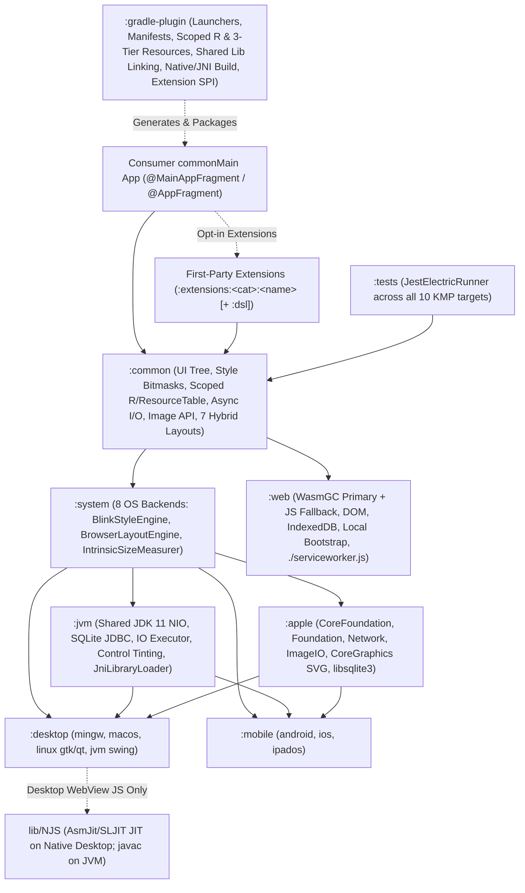
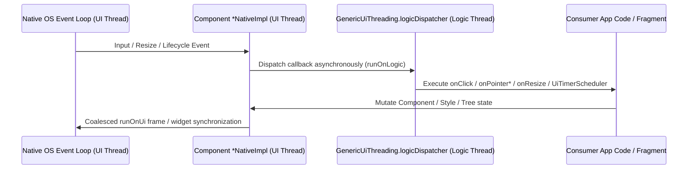

# GenericUI — System Architecture Specification (`ARCHITECTURE.md`)

This document provides the end-to-end architectural blueprint for **GenericUI** (`com.nexustools.genericui`): module topology, execution and threading model, deferred native realization, chrome and icon contracts, resource and styling pipelines, native packaging and extension SPIs, async I/O, and multi-backend UI testing.

For mandatory coding rules, file-layout invariants, and strict isolation prohibitions, read **[`AGENTS.md`](AGENTS.md)** alongside this document.

- **Related Documentation**: [Agent & Engineering Rules (`AGENTS.md`)](AGENTS.md) | [Project Overview (`README.md`)](README.md) | [Documentation Index](docs/README.md) | [Core Runtime Design (`docs/architecture.md`)](docs/architecture.md) | [Backends](docs/backends.md) | [Source Sets](docs/sourcesets.md) | [Gradle Plugin](docs/gradle-plugin.md) | [First-Party Extensions](docs/extensions.md) | [Resources & Icons](docs/resources.md) | [Fragments & Windows](docs/fragments-and-windows.md) | [Layouts & Helpers](docs/layouts-and-helpers.md) | [Async Utilities & DB](docs/utils.md) | [Testing (`JestElectricRunner`)](docs/testing.md)

---

## 1. Architectural Vision & Core Invariants

**GenericUI** is a **native-first, dual-threaded Kotlin Multiplatform (KMP)** framework targeting **9 runtime backends** from a single `commonMain` consumer source set:

| Platform Group | Target Backends (`BackendTarget`) | Native Rendering & Platform Backing |
| :--- | :--- | :--- |
| **Desktop Native (`:desktop`)** | `Windows` (`mingwX64`), `MacOS` (`macosArm64`), `Gtk` (`linuxX64`), `Qt` (`linuxX64`) | Win32 / `UxTheme` / Direct2D, AppKit (`NSWindow`, `NSMenu`, `NSStatusItem`), GTK4 / Cairo / GIO, Qt 6 `QWidget` / `QStyle` / `QPainter` |
| **Desktop JVM (`:desktop` + `:jvm`)** | `Swing` (`jvm`) | Java AWT / Swing with OS Look-And-Feel + optional LWJGL3 |
| **Mobile (`:mobile`)** | `Android` (`android`), `IOS` (`iosArm64` / `iosSimulatorArm64`), `IPadOS` (`iosArm64` / `iosSimulatorArm64`) | 1:1 `AppCompatActivity` / Material 3 / `RecyclerView`, iOS UIKit (`UIDeviceFamily = 1`), iPadOS UIKit `UIWindowScene` + Stage Manager + `UIMenuSystem` |
| **Browser (`:web`)** | `Web` (`wasmJs` primary + `js` fallback) | HTML5 `<genericui:app>` / `<genericui:fragment>` DOM, Local NPM Bootstrap 5, Canvas2D / WebGL2 / WebGPU |

### Non-Negotiable Architectural Invariants
1. **1 Public Type Per `.kt` File**: Every Kotlin source file across all subprojects exports strictly **one** public class, interface, enum, or object named identically to the file (`<TypeName>.kt`), except classless `:dsl` builder files ([`AGENTS.md §1`](AGENTS.md)).
2. **Zero Core-to-Extension Coupling**: Core modules (`:common`, `:system`, `:jvm`, `:apple`, `:desktop`, `:mobile`, `:web`, `:gradle-plugin` core codegen) NEVER import or hardcode extension classes, tags, or runtimes. Extensions plug into core cleanly via registries, hook tables, and build-time contributor SPIs ([`AGENTS.md §11, §15`](AGENTS.md)).
3. **Zero `BackendTarget` Branching in `:common`**: `:common` never switches on `BackendTarget` or parses backend string IDs. Concrete backends implement `NativeFactory` and `*NativeImpl` contracts returning capability flags directly as constants.
4. **Fail-Fast Zero-Stub Registries**: Missing `NativeImpl` bindings or uninitialized extension factories throw explicit runtime errors (`IllegalStateException` / `UnsupportedOperationException`) instead of silently no-oping.
5. **No Default Tooltips**: Neither core controls, backend renderers, nor extensions assign default/fallback tooltips (`tooltipText` defaults strictly to `null`, consumer-supplied only).

---

## 2. Multi-Module Project Topology (`settings.gradle.kts`)

The repository comprises **51 Gradle subprojects** (49 tracked in `GenericUiGradlePlugin.KNOWN_GENERICUI_MODULES`, plus `:gradle-plugin`, `:idea-plugin`, and the `lib/NJS` composite build):

### Subproject Matrix

| Group | Subprojects | Role & Boundaries |
| :--- | :--- | :--- |
| **Core & Shared** | `:common`, `:system`, `:jvm`, `:apple`, `:desktop`, `:mobile`, `:web` | Platform-neutral widget hierarchy (`:common`), shared OS layout/CSS engine (`:system`), JVM (`:jvm`) and Darwin (`:apple`) shared bases, and consolidated desktop/mobile/web platform implementations. |
| **Graphics (`:extensions:graphics:*`)** | `gpu`, `imageprocessing`, `canvas2d` (+`:dsl`), `canvas3d` (+`:dsl`), `threejs` (+`:dsl`) | Unified Vulkan/MoltenVK + OpenGL ES/ANGLE contexts, offscreen compute/fragment image processing, 2D vector/bitmap & 3D canvases, and Three.js PBR scene graph. |
| **Physics (`:extensions:physics:*`)** | `box2d` (+`:dsl`), `box3d` (+`:dsl`) | Pure KMP 2D and 3D rigid-body physics engines and debug renderers. |
| **Game & Input (`:extensions:game:*`)** | `gamepad` (+`:dsl`), `engine` (+`:dsl`), `engine2d` (+`:dsl`), `engine3d` (+`:dsl`) | Controller HID + 6-axis fusion + navigation (`gamepad`), dedicated `PlatformGameLogicThread` + VBlank curve/IK loop (`engine`), and 2D/3D game worlds (`engine2d`, `engine3d`). |
| **Media (`:extensions:media:*`)** | `media` (+`:dsl`), `mediacontrols` (+`:dsl`) | Hardware video/audio playback & FFT analysis (`VideoPlayer`, `AudioPlayer`, desktop `libvlc`/`libvlcj`, codec introspection) and OS media transport/taskbar/key integrations (`MediaControlsSession`). |
| **Data (`:extensions:data:*`)** | `schema` (+`:dsl`) | Reflection-free `@SchemaData` descriptors (`SchemaExtension`, `<ClassName>SchemaDescriptor.kt`, `GeneratedSchemaRegistrar.kt`), typed schema rules, async field groups, and auto-generated `SchemaForm` UIs. |
| **System (`:extensions:system:*`)** | `serviceworker` (+`:dsl`) | Cross-platform `@MainServiceWorker` / `@ServiceWorkerMessage` background workers (`ServiceWorkerExtension`, `ServiceWorkerChannel`, `<Msg>ServiceWorkerCodec.kt`), singleton desktop tray daemons (`serviceworker` secondary executable + autostart), Android foreground services & `BOOT_COMPLETED`, Web `./serviceworker.js` + `${resolvedBase}.sw.js|wasm`, and explicit unsupported contract on iOS/iPadOS (`isSupported == false`, zero simulation). |
| **UI (`:extensions:ui:*`)** | `dsl`, `overlay` (+`:dsl`), `alien` (+`:dsl`), `webview` (+`:dsl`), `codeeditor` (+`:dsl`), `aichat` (+`:dsl`), `pip` (+`:dsl`) | `:common`-only `kotlinx.html`-style DSL (`dsl`), domain-agnostic overlays & frosted HUD surfaces (`overlay`), self-rendered Bootstrap 5 `Canvas2D` engine (`alien`), multi-process Desktop Chromium+`NJS` vs native Mobile/Web `WebView` (`webview`), code editor (`codeeditor`), AI chat drawer (`aichat`), and native Picture-in-Picture (`pip`). |
| **Tooling & Testing** | `:tests`, `:gradle-plugin`, `:idea-plugin`, `lib/NJS` | `JestElectricRunner` multi-backend test harness, KMP build/codegen/packaging/nativebuild plugin, IntelliJ IDEA plugin, and Desktop-only `NJS` JavaScript/TypeScript engine. |

### Target Specificity & Source-Set Resolution (`AppTarget`)

`:gradle-plugin` orders platform overrides deterministically via `AppTarget` specificity (`6` single backend -> `5` `LINUX_COMMON` / `IOS_COMMON` -> `4` `NATIVE_DESKTOP_COMMON` -> `3` `DESKTOP_COMMON` / `MOBILE_COMMON` -> `2` `APPLE_COMMON` / `JVM_COMMON` -> `1` `SYSTEM_COMMON` -> `0` `COMMON`). Detailed source-set hierarchy rules live in [`docs/sourcesets.md`](docs/sourcesets.md).

---

## 3. Dual-Thread UI vs. Logic Execution Model (`GenericUiThreading`)

To keep frame pacing smooth and prevent application callbacks from starving OS event pumps, GenericUI separates the **UI Thread** from the **Logic Thread** on all **8 system backends** (`GenericUiThreading.isSplitThreadingEnabled == true`) while operating cooperatively on `:web` (`isSplitThreadingEnabled == false`).

- **UI Thread (`runOnUi` / `runOnUiSync`)**: Owns native OS handles (`HWND`, `NSWindow`/`NSView`, `GtkWidget`, `QWidget`, Android `View`, `UIView`, Swing EDT, Browser DOM), layout measurement, offscreen tinting, and draw/composite passes.
- **Logic Thread (`runOnLogic` / `runOnLogicAsync`)**: Executes consumer event listeners (`onClick`, `onPointerMove`, `onKeyDown`), timers, and state transitions with `isOnLogicThread() == true`. Per-backend `UiThreadDispatcherNativeImpl` classes live in `:jvm`, `:apple`, `:desktop` (`mingwMain`, `linuxMain`), and `:web`.
- **Dedicated Game Loop Thread (`:extensions:game:engine`)**: `GameLoopScheduler` and `PlatformGameLogicThread` add an isolated fixed-step simulation thread decoupled from both `VBlankAnimationDriver` and `uiDispatcher`.

---

## 4. Component Lifecycle, Deferred Upward Realization, & Layout System

GenericUI decouples Kotlin widget construction from native peer allocation using a strict **three-phase realization model**:

1. **Detached Construction**: Instantiating `Button("Save")`, `VStack()`, or `VideoPlayer()` initializes pure Kotlin state (`nativeImpl == null`). Components can be built, styled, and nested freely before any `Application` or `Window` exists.
2. **Upward Factory Discovery (`resolveBackendFactoryUpward`)**: When `parent.addChild(child)` attaches a node, `child` walks upward `parent -> ... -> RootContainer -> Window -> Application` (or `NativeBackendRegistry.activeFactory`) to locate the active `NativeFactory`.
3. **Downward Realization Cascade (`realizeNativeTree`)**: Once an ancestor connects to a live `Window`/`Fragment`, `realizeNativeTree(factory)` traverses the subtree in **pre-order** to instantiate every `*NativeImpl`, synchronize properties/styles, and install OS listeners. Missing implementations fail fast with `UnsupportedOperationException`/`IllegalStateException`.

### Strict Modular Rendering (`*NativeImpl` + `*RenderUtil`)
Backends NEVER group component rendering into giant `when (component)` switches. Rendering logic lives directly in `<Backend><Component>NativeImpl`, while shared drawing primitives live in type-grouped `<Backend><Topic>RenderUtil` classes (1 class per file).

### Fragments, Navigation Hosts, & 7 Responsive Layouts
- **`Fragment` & `FragmentBundle`**: Mirrors Android lifecycle (`onCreate`, `onStart`, `onResume`, `onPause`, `onStop`, `onSaveInstanceState`, `onDestroy`). On all 8 system targets, startup CLI `Array<String>` arguments are injected into `@MainAppFragment`'s `FragmentBundle`.
- **Android 1:1 Activities & Web Custom Elements**: `:gradle-plugin` generates one `AppCompatActivity` subclass per `@MainAppFragment`/`@AppFragment` on Android; `:web` mounts the root application inside `<genericui:app>` and fragments inside `<genericui:fragment>` (mounting all CSS/scripts strictly in `<head>`).
- **`FragmentHostFragment` & `FragmentHostSystem`**: Manages animated multi-page navigation stacks (`FadeExpandShrink`, `SlideHorizontal`, `Crossfade`), automatic Web `#hash` + `window.history.state` integration, and adaptive chrome.
- **Shared `Layout<I : LayoutImpl>` + `LayoutFactory`**: Each `LayoutContainer` and matching `*Fragment` helper delegates to the same shared `Layout` class, realized via `DesktopLayoutFactory`, `MobileLayoutFactory`, or `WebLayoutFactory` across all **7 hybrid responsive layouts** plus `DockWorkspace` and `TabbedFragment` ([`docs/layouts-and-helpers.md`](docs/layouts-and-helpers.md)).

---

## 5. Window Chrome, `TitleCapabilities`, & Apple Icon Pipeline

### Single-Placement Chrome (`TitleCapabilities`)
`TitleBar` and `MenuBar` are declarative descriptors inspected via `window.titleCapabilities` (`isSupported`, `isTitleBarRequired`, `canEmbedComponentsInTitleBar`) and rendered **at most once**:
- **Windows / GTK / Qt / Swing**: Rendered natively in the window frame/chrome (custom Win32 frame chrome when embedded controls are present).
- **macOS (`AppKit`)**: `MenuBar` attaches globally to `NSApplication.sharedApplication.mainMenu` while `TitleBar` configures `NSWindow` / `NSToolbar`.
- **Android & iPhone iOS**: Rendered as a native top `Navbar` (`MaterialToolbar` / `UINavigationBar`) ONLY when a `TitleBar` or `MenuBar` is configured.
- **iPadOS**: `TitleBar` renders as an inline navigation header while `MenuBar` binds directly to `UIMenuSystem.mainSystem`.
- **Web**: Updates `document.title`; opt-in `Navbar` / Bootstrap menu placement inside viewport when configured.

### Window Policies (`alwaysOnTop`, Client `aspectRatio`, & Accessory Windows)
- `IWindow` supports `setAlwaysOnTop(...)` (`PanelWindow` defaults to `true`) and optional client-viewport `aspectRatio(w, h)`, applied exclusively while `WindowState.NORMAL && !isFullscreen()`.
- On macOS, Dock visibility distinguishes foreground window apps (`NSApplicationActivationPolicyRegular`) from background headless/tray worker processes (`NSApplicationActivationPolicyAccessory`, elevating to `Regular` only while a visible window is open unless Dock-pinned or actively serving).

### Apple Squircle Wrapping vs. Unwrapped Tray Icons
- **Application / Dock Icons**: If generic `app.icon` is configured without `appleIcon` / `macIcon` / `iosIcon` / `ipadosIcon`, build-time `GenericUiAppleIconTileComposer` and runtime `AppleIconTileComposer` wrap the Dock/`.app` icon in a Chrome-style rounded white squircle on macOS (and full-bleed white AppIcon tile on iOS/iPadOS). `MacosNativeWindowHost.isAlreadyWrappedAppleSquircleIcon(...)` detects pre-wrapped buffers before calling `composeRuntimeDockIconBuffer` so icons are never double-wrapped.
- **System Tray / Menu-Bar Icons (Strict Exception)**: Menu-bar status-bar icons (`MacosSystemTrayNativeImpl` / `NSStatusItem`) MUST **NEVER** be wrapped in white squircles (`wrapInAppleTile = false`) or loaded from wrapped `icon.icns`, and on native desktop are embedded directly in the signed Mach-O binary (`tray_icon_png` / `tray_icon_svg`) rather than left as loose files. Monochrome masks use macOS template rendering; multicolor tray artwork renders directly un-templated and unwrapped.

---

## 6. Three-Tier Resources, Scoped `R`, Styling Bitmasks, & 9-Backend Hardware `backdrop-filter`

### Three-Tier Resource Architecture & Scoped `R` Classes
Assets in `src/commonMain/resources/` (`drawable/`, `styles/*.scss`, `values/*.xml`, `raw/`, `font/`, `xml/`, `menu/`, `layout/`) compile into module-scoped `R.kt`, `RC.kt`, `Resource.kt`, and `GeneratedResourceRegistry.kt` declarations with partitioned numeric IDs (`0x7eTTNNNN` for `:common` `com.nexustools.genericui.res.R`, `0x60..0x7d` for extensions such as `com.nexustools.genericui.ext.overlay.res.R`, `com.nexustools.genericui.component.media.res.R`, and `com.nexustools.genericui.ext.alien.res.R`, and `0x7fTTNNNN` for consumer app `<appPkg>.res.R`) alongside `ResourceTable` path-keyed collision resolution:
1. **Tier 1 — Hierarchical Single-Blob (`Web`, `Swing` JAR, `iOS`/`iPadOS` `.app` folder references)**: Preserves canonical paths `gui/...` (`:common`), `gui/ext/<extcat>/<ext>/...` (extensions), and `app/...` (consumer app), serving flat `./serviceworker.js` at web root (outside `gui/`) and pre-seeding `genericui-offline-<buildHash>` in `loader.js`.
2. **Tier 2 — Flat Single-Blob (`Android` `res/<type>[-qual]/` & Apple `Assets.xcassets`)**: Emits `ResourceID.flatName` (`gui_*`, `gui_ext_*`, `app_*`) compliant with `aapt2` and Xcode Asset Catalog naming rules.
3. **Tier 3 — Prefix-Free Native Binary / Shared-Library Embedding (`Windows`, `macOS`, `Linux GTK4`, `Linux Qt6`)**: `GenericUiNativeResourceEmbedder` compiles resources into Win32 `RT_RCDATA`, macOS Mach-O `__TEXT,__const`, and Linux ELF `.rodata` keyed by `<binary_or_library.so|dylib|dll>:<resource_path>_<resource_name>_<ext>` (`ResourceID.nativeResourceKey`, e.g., `drawable_loading_svg`) via `genericui_res_lookup_genericui`, `genericui_res_lookup_<group>`, and `genericui_res_lookup_app` (`dlsym` / `FindResourceW`)—eliminating loose desktop resource files, `.gresource`, and `.qrc`.

### Zero-Allocation Styling & System Restraints
- **64-Bit Bitmask `ComponentStyle` & `ComponentBootstrap`**: Inline styles (`component.getStyle()`) and Bootstrap utilities (`component.getBootstrap()`) track active properties via two 64-bit bitmasks in `:common` with **zero** string maps or CSS serialization outside `:web` (`WebCssStyleTranslator`). Pseudo-states belong strictly in `.scss`/`.css` stylesheets (`Resource.style.*`).
- **System Control Fidelity**: Text elements honor typography (`color`, `font*`, `textAlign`, `lineHeight`); standard controls (`Button`, `TextField`, `CheckBox`, `Select`, `Container`) silently ignore alien skinning overrides and tint strictly via `BootstrapType` (rendering empty-text genuine native controls offscreen, tinting via `ThemeConfig` while preserving native bevels, then compositing contrasting text/icons).
- **Opt-In Custom Styling & 9-Backend `backdrop-filter`**: `AestheticStylePolicy.supportsBackdropFilterBlur(...)` enables hardware-accelerated `backdropFilter` / `setBackdropBlur(...)` across all **9 backends** exclusively on **`StyledContainer`** and **`StyledButton`** (explicitly **excluding `TextBubble`**), backed by platform GPU/compositor blur and `FastBackdropBlurKernel` CPU fallback, alongside `:extensions:ui:alien` (`IAlien`).
- **Unified `ThemeMode.AUTO`**: Live OS light/dark detection across all 9 backends paired with `ThemeConfig` (`light { }`, `dark { }`) propagating to Android Material XML themes, desktop tint tables, and Web `--bs-*` CSS variables.

---

## 7. Build Codegen, Native Shared Libraries, Consumer Native Build, & Extension SPI (`:gradle-plugin`)

The `:gradle-plugin` (`id("com.nexustools.genericui")`) orchestrates the full build graph from a single `genericui { ... }` DSL block:

1. **AST / Source Scanning (`GenericUiFragmentScanner`)**: Discovers `@MainAppFragment`, `@AppFragment`, `@AppApplication`, plus extension-declared annotations (`@SchemaData`, `@MainServiceWorker`, `@ServiceWorkerMessage`).
2. **Per-Backend Launcher, Schema, ServiceWorker, & Manifest Codegen (`GenericUiGenerateLaunchersTask`, `GenericUiGenerateSchemaSourcesTask`, `GenericUiGenerateServiceWorkerCodecsTask`, `GenericUiGenerateAndroidManifestTask`)**: Synthesizes target descriptors, CLI-forwarding entry points, `<ClassName>SchemaDescriptor.kt` + `GeneratedSchemaRegistrar.kt`, validated `@MainServiceWorker` + `<Msg>ServiceWorkerCodec.kt` + `GeneratedServiceWorkerCodecRegistrar.kt`, 1:1 Android `AppCompatActivity` classes, `AndroidManifest.xml`, iOS/iPadOS Xcode targets, desktop resources, and dual Web WasmGC + JS distributions via `GenericUiWebDistributionTask` (`loader.js`).
3. **Dynamic Shared Library Linking & COFF Partitioning on Native Desktop (`GenericUiNativeSharedLibraryCatalog`, `GenericUiBuildNativeSharedLibsTask`, `GenericUiKonanCompilerShim`, `WindowsCoffObjectPartitioner`)**: Links `libgenericui.*`, `libgenericui-{macos,gtk,qt}.*` / `genericui-windows.dll`, `libgenericui-ext-<ext>.*`, `libnjs.*`, and `genericui-tests` cleanly without cross-contaminating GTK and Qt binaries (`.app/Contents/Frameworks/` on macOS, flat `$ORIGIN` on Linux, flat `.dll` without `lib` prefix on Windows using MinGW COFF export partitioning when symbols exceed 65,535).
4. **Desktop vs. Mobile/Web `WebView` Split**: Desktop `:extensions:ui:webview` couples Chromium layout (`ChromiumBlinkEngine`) with `lib/NJS` (AsmJit/SLJIT native JIT or Swing `javac` transpiler) in a dedicated helper process; Android, iOS, iPadOS, and Web use native `WebView`/`WKWebView`/`<iframe>` and NEVER touch `NJS`.
5. **Extensible Extension Contributor SPI & Runtime Registry (`GenericUiExtensionContributor` & `GenericUiExtensionRegistry`)**:
   - Build-time contributors implementing `GenericUiExtensionContributor` (managed by `GenericUiExtensionContributorRegistry` via built-in `PipExtensionContributor`, `SchemaExtensionContributor`, `ServiceWorkerExtensionContributor`, `ServiceLoader`, and `META-INF/genericui/extensions/*.json`) receive `ExtensionBuildContext` and emit Android `<service>`/`<receiver>`/`<provider>`/`<uses-permission>`/Activity hooks (`AndroidExtensionContribution`), Desktop secondary executables (`SecondaryDesktopExecutableContribution`, e.g., `serviceworker.exe`, `Contents/MacOS/serviceworker`, Linux `serviceworker` with `-gtk`/`-qt` compilation variants staged by `GenericUiMultiplatformConfigurator.registerBuildTargetTasks`) + autostart entries, Apple mobile Info.plist contributions (`AppleMobileExtensionContribution`), and Web `./serviceworker.js` `WebSwPluginScript` / `WebWorkerBinarySpec` hooks (`WebServiceWorkerContribution`)—while `:common`'s `GenericUiExtensionRegistry` dispatches `ApplicationLifecycleExtensionHook` at runtime.
6. **Consumer Native / JNI / CInterop / Shared-Library Build System (`gradle-plugin/.../nativebuild/`)**:
   - Consumer applications build custom C/C++/CMake/JNI and K/N CInterop code purely from `build.gradle.kts` (`genericui { jni { library(...) { sourceArchive(...); sources(...); archiveSources(...); archiveIncludeDirs(...); defines(...); cFlags(...); cppFlags(...); linkerFlags(...); abis(...); buildHostLibraryForTests }; cmake(...) }; cinterops { ... }; nativeLibraries { ... } }`, including per-variant scopes on `GenericUiVariantConfig`) — with NDK or zero-NDK Konan LLVM + `target-sysroot-1-android_ndk` cross-compilation (`GenericUiJniToolchainResolver`), 16KB ELF/APK alignment (`-Wl,-z,max-page-size=16384`), Swing `META-INF/native/<os>-<arch>/` bundling (`GenericUiPackageSwingJarTask`), and `:jvm` `JniLibraryLoader`.

---

## 8. Async Non-Blocking I/O, Structured Storage, Networking, & `JestElectricRunner`

Every I/O subsystem exposes **100% asynchronous `suspend` APIs** with zero blocking calls on UI or Logic threads ([`docs/utils.md`](docs/utils.md)):

- **Streams & Binary Buffers**: `ByteOrder`, `ByteBuffer`, `Readable`, `Writable`, `Stream`, `StreamUtil`, and streaming codecs (`BinaryJson`, `BinaryPlist`, `PreferenceObjectCodec`) work identically over memory buffers, `ResourceID.openReadable()`, files, and sockets.
- **Storage & User Directories**: `IFileSystem` (`FileSystem`, `UserDirectory`, `ConfigDirectory`, `CacheDirectory`) maps to Win32 Overlapped I/O, Apple `NSFileManager`/`dispatch_io_t`, GIO `GFile`, Qt `QFile`, JVM NIO, Android SAF + app sandbox, and Browser File System Access + direct `window.indexedDB` for user directories on Web; `PreferenceStore` provides cross-platform typed config backed by `.bson` / `.plist` / `SharedPreferences` / `localStorage`.
- **Zero-Parsing Structured `Database`**: `DatabaseTableSchema`, `DatabaseQuery`, `DatabaseFilter`, `DatabaseComparisonOp`, and `DatabaseSortSpec` construct type-safe AST queries backed by `libsqlite3` (Windows, macOS, Linux, iOS, iPadOS), `sqlite-jdbc` (Swing), `androidx.sqlite:sqlite-ktx` (Android), and `window.indexedDB` (Web) with zero string-parsed SQL.
- **Networking & Connectivity**: Duplex async `TcpSocket : Stream` / `UdpSocket : Stream` (`Network`, `supportsTcp/Udp() = false` on Web), streaming `HttpClient` / `HttpConnection`, RFC 6455 `WebSocket`, Engine.IO/Socket.IO v4 `SocketIoClient`, and live `IApplication.isOffline` monitoring + Web offline manifests.
- **Input Capture (`PointerDragManager`)**: Window-level pointer capture ensures slider/seek drags continue smoothly outside element bounds and never stall on overlay auto-hide timers.
- **Multi-Backend UI Testing (`JestElectricRunner` in `:tests`)**: Drives component trees and 12 `JestElectric*RenderUtil` snapshot renderers uniformly across JVM, Native Desktop, Android host/instrumentation, iOS/iPadOS simulators, and headless Node/Browser Web targets ([`docs/testing.md`](docs/testing.md)).
