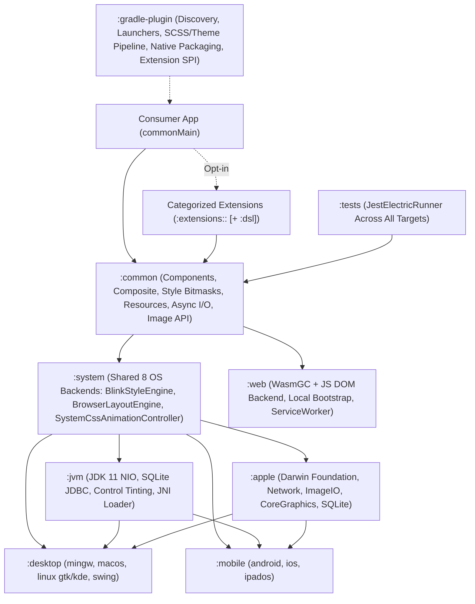

# GenericUI — System Architecture Specification (`ARCHITECTURE.md`)

Architectural blueprint for **GenericUI** (`com.nexustools.genericui`). Mandatory engineering rules and isolation constraints live in [**`AGENTS.md`**](AGENTS.md); module guides live in [**`docs/README.md`**](docs/README.md).

---

## 1. Target Matrix & Architectural Goals

**GenericUI** is a **native-wrapper-first, dual-threaded Kotlin Multiplatform (KMP)** framework compiling a single `commonMain` consumer codebase across **9 platform backends**, wrapping genuine system widgets, native control tinting/theming APIs, and native system visual/compositor effects whenever supported and falling back to custom or alien rendering strictly when the backend lacks native support for a required capability or when `:extensions:ui:alien` is explicitly used:

| Platform Group | `BackendTarget` | Native Backing |
| :--- | :--- | :--- |
| **Desktop Native (`:desktop`)** | `Windows`, `MacOS`, `Gtk`, `Kde` | Win32/`ComCtl32 v6`/`Direct2D`, AppKit, GTK4/Libadwaita/GSK, KF6 + `Breeze` on Qt6 (`QWidget`) |
| **Desktop JVM (`:desktop` + `:jvm`)** | `Swing` | AWT/Swing system Look-And-Feel + optional LWJGL3 |
| **Mobile (`:mobile`)** | `Android`, `IOS`, `IPadOS` | `AppCompatActivity`/Material 3/`RecyclerView`, UIKit (iOS device family & iPadOS Stage Manager/`UIMenuSystem`) |
| **Browser (`:web`)** | `Web` (`wasmJs` + `js`) | Semantic custom-element DOM (`<genericui:app>`/`<genericui:fragment>`), Local Bootstrap CSS/JS, IndexedDB, WebGL2/WebGPU |

---

## 2. Module Topology & `AppTarget` Specificity

GenericUI consolidates into core platform projects, categorized extension modules (each with multi-target source sets + pure-Kotlin companion `:dsl` modules), build tooling, and cross-backend testing:

- **Extension Categories (`:extensions:<cat>:<ext>`)**: `graphics` (`gpu`, `imageprocessing`, `canvas2d`, `canvas3d`, `threejs`), `physics` (`box2d`, `box3d`), `game` (`gamepad`, `engine`, `engine2d`, `engine3d`), `media` (`media`, `mediacontrols`), `data` (`schema`), `system` (`serviceworker`), and `ui` (`dsl`, `overlay`, `alien`, `webview`, `codeeditor`, `aichat`, `pip`).
- **Desktop WebView JS Isolation**: `:extensions:ui:webview` uses Chromium layout + `lib/NJS` (JIT on native desktop, `javac` transpiler on Swing) exclusively on desktop targets while using platform native webviews on mobile and web.
- **`AppTarget` Resolution Hierarchy**: `:gradle-plugin` resolves target-specific overrides monotonically from rank `6` (single backend) through `5..1` shared scopes (`LINUX_COMMON`, `IOS_COMMON`, `NATIVE_DESKTOP_COMMON`, `DESKTOP_COMMON`/`MOBILE_COMMON`, `APPLE_COMMON`/`JVM_COMMON`, `SYSTEM_COMMON`) down to rank `0` (`COMMON`).

---

## 3. Execution, Threading, & Dynamic Frame Pacing

- **Split UI / Logic Threads**: On all system backends, the **UI Thread** owns OS handles, layout passes, style sync, and painting while the **Logic Thread** executes callbacks, timers, and application state—eliminating event-pump stalls; `:web` runs cooperatively in the browser main loop.
- **Native-Animator-First & Monitor-Dynamic VBlank Pacing**: Timed animations and transitions prioritize the platform's native animator, falling back to display VBlank or `requestAnimationFrame` synchronized to the active monitor's live refresh rate (`xHz`, never locked to a fixed Hz).
- **Playback-Driven Media Pacing & Idle Zero**: Video and media surface presentation paces dynamically to the video's playback-speed-adjusted frame rate, remaining idle when no animations or active streams run.

---

## 4. Component Lifecycle, Composition, Layout, & Input Capture

### Three-Phase Deferred Realization
1. **Detached Construction**: Instantiating components and setting pre-mount properties creates pure Kotlin state (`nativeImpl == null`).
2. **Upward Factory Discovery**: Attaching to a parent walks upward to resolve the active `NativeFactory`.
3. **Downward Realization Cascade**: Connecting to a live host traverses the subtree in pre-order to mount genuine retained native widget peers (`<Backend><Component>NativeImpl` backed by shared layout, styling, and platform controllers) directly into nested parent containers and sync properties. Invalid states fail fast via typed `GenericUiException` subclasses.

### Component Tiers & `Composite` Encapsulation
- **Native System Controls vs. Capability-Fallback Custom Surfaces**: GenericUI wraps native system widgets, native control tinting/theming APIs, and native system visual/compositor effects whenever supported by the target backend. Custom self-drawn widgets or software/shader compositing are used strictly when the backend lacks native support for a required capability or when `:extensions:ui:alien` is explicitly used.
- **`Composite`**: Extends `AbstractComponent` (never `AbstractContainer`) and realizes via `StyledContainerNativeImpl` across all 9 backends with zero custom `*NativeImpl`. Subclasses manage sealed `compositeChildren` via `protected` helpers so consumers see a single atomic component whose internal styled primitives participate transparently in CSS matching, layout, focus, and pointer dispatch.
- **Self-Rendered Extension Engine (`:extensions:ui:alien`)**: Opt-in `IAlien` containers/fragments provide standalone Bootstrap 5 + full CSS rendering on `Canvas2D` on system backends and pass-through DOM on `:web`.

### Shared Responsive Layouts, W3C Positioned Parity, & Pointer Capture
- **Unified `Layout<I>` + `LayoutFactory`**: `LayoutContainer` and helper fragments delegate to shared layout helpers realized by `DesktopLayoutFactory`, `MobileLayoutFactory`, or `WebLayoutFactory` (plus lazy virtualized views using viewport windowing and `ViewHolderPool`).
- **Proximal `position: relative` / `Window` Containing-Block Parity**: Across `:web` and `:system` (`BrowserLayoutEngine` + all 8 native backends), `position: absolute` resolves against the **proximal positioned ancestor (`position != static`)**, falling back to the root `Window` if none exists. Layouts honor signed `CssTransform` (`translate`, `translateX`, `translateY`, `scale` with `%` of child box or `px`), stable `z-index` paint/hit-test ordering, and `pointer-events: none` click-through uniformly.
- **Global Pointer Drag Capture (`PointerDragManager`)**: Window-level pointer capture ensures interactive drag sessions continue updating when the pointer moves outside element bounds and terminate cleanly on release.

---

## 5. Fragments, Windows, Chrome, & Icons

- **Annotation Discovery & Capabilities**: `@MainAppFragment`, `@AppFragment`, and `@AppApplication` generate `FragmentMetadata` (`multipleWindows`, `dialog`) and target entry points (`launch` CLI args in `FragmentBundle`, 1:1 Android `AppCompatActivity` generation with dialog theming, distinct iOS/iPadOS Xcode targets, and `<genericui:app>`/`<genericui:fragment>` web elements).
- **`startFragment` & Windowing**: Fragment, window, application, and dual-process `ServiceWorker` APIs route `startFragment(..., openAdditionalWindow)` uniformly through capability validation, supporting attached `DialogWindow`s, standalone `DialogWindow`s when no main window is active, single-instance refocusing, `alwaysOnTop`, and windowed-only client viewport `aspectRatio` locking.
- **Single-Placement Chrome (`TitleCapabilities`)**: Declarative `TitleBar` and `MenuBar` render at most once—natively in window chrome or global system menu bars where appropriate, inline/navigation bars on compact screens, or capability-gated WM-replicating desktop chrome on Linux (with automatic fallback to system WM decorations when tiling/unsupported WMs or structural GTK CSS overrides are detected, keeping `gtk` and `kde` implementations strictly isolated).
- **Apple Icon Pipeline**: Generic app icons lacking explicit Apple overrides automatically receive squircle/tile framing (guarded against double wrapping), whereas tray/status-bar artwork remains unwrapped and binary-embedded.

---

## 6. Resources, Stylesheets, Consumer Themes, & Policy

### Three-Tier Scoped Resources (`ResourceID` & `ResourceTable`)
Module-scoped codegen (`R`, `RC`, `Resource`, `GeneratedResourceRegistry`) partitions numeric IDs (`0x7e` core, `0x60..0x7d` extensions, `0x7f` consumer app) and packages assets via three tiers:
1. **Hierarchical Single-Blob** (`Web` bundle, `Swing` JAR, `iOS`/`iPadOS` `.app`).
2. **Flat Single-Blob** (`Android` `res/`, Apple `Assets.xcassets`).
3. **Prefix-Free Binary Embedding** (`Windows` `RT_RCDATA`, `macOS` Mach-O `__TEXT,__const`, `Linux` ELF `.rodata` symbol lookup).

### Stylesheets, Consumer-Only `theme.scss`, & CSS `@keyframes`
- **Dual Compilation Pipeline**: `GenericUiSassCompileTask` compiles `style.scss` into browser CSS (mounted in `<head>` on `:web`) and zero-parsing `BlinkStyleSheet` objects (evaluated by `BlinkStyleEngine` on `:system`, re-evaluated incrementally on class/state changes). Runtime style/Bootstrap snapshots operate on 64-bit bitmasks without string maps outside `:web`.
- **Raw Library `theme.scss` Templates -> Consumer App Integration**: Prebuilt GenericUI libraries never compile consumer `theme.scss` outputs into library `.jar`/`.klib` artifacts; they package only raw `theme.scss` templates in artifact metadata (`META-INF/genericui/themes/*.scss` and module manifests). Consumer builds extract upstream templates, substitute consumer `genericui { theme { ... } }` palettes and `ThemeMode.AUTO` (`LIGHT`/`DARK`), and integrate the compiled stylesheet (`ThemeStyleSheetRegistry` / generated theme CSS) solely into the consumer application.
- **`.hidden` Visibility & `Animator`-Driven `@keyframes`**: Adding/removing `.hidden` (`opacity: 0; pointer-events: none; cursor: none;`) triggers CSS `@keyframes` animations natively on `:web` and via `SystemCssAnimationController` (`Animator`) across all 8 system backends, ensuring multi-part overlays fade atomically without affecting non-fading sibling layers.
- **`AestheticStylePolicy`**: Standard non-`Button` OS controls render natively and ignore `BootstrapType` and aesthetic overrides on system backends (with form subclasses marking `data-control-variant` for specialized native widget selection). `Button` wraps the backend's unmodified system push control and uses native button tinting/theming APIs whenever supported, falling back to custom rendering strictly where the toolkit lacks native tint support. Non-control Bootstrap semantic surfaces and styled primitives use native system visual/compositor effects whenever supported and invoke custom or shader rendering strictly for capabilities the native compositor lacks, while `:extensions:ui:alien` and `:web` honor full custom styling.

---

## 7. Build Codegen, Native Packaging, & Extension SPI (`:gradle-plugin`)

The `:gradle-plugin` orchestrates source scanning/validation, target launcher synthesis, 2-process background `ServiceWorker` worker binaries and IPC codecs, reflection-free `@SchemaData` descriptors, desktop dynamic shared-library linking + MinGW COFF export partitioning, consumer C/C++/CMake/JNI/CInterop compilation (`nativebuild`), and extensible `GenericUiExtensionContributor` SPI hooks alongside runtime `GenericUiExtensionRegistry` lifecycle hooks.

---

## 8. Async I/O, Data, Media/GPU, & Verification

- **Async Streams & Structured Persistence**: Non-blocking `Readable`/`Writable`/`Stream` byte pipelines and binary codecs (`BinaryJson`, `BinaryPlist`), OS-mapped async `IFileSystem` / `PreferenceStore`, SQL-free type-safe AST `Database` (`libsqlite3` / JDBC / AndroidX SQLite / `indexedDB`), and async `Network` (`TcpSocket`/`UdpSocket`, HTTP, WebSocket, offline tracking).
- **Images, GPU, & Media**: Base image codecs (`ImageLoader`, `ImageBuffer`, platform decoders) + optional offscreen GPU shader/compute processing (`GpuOffscreenContext`), hardware media playback/FFT bridges, and OS media transport integrations (`MediaControlsSession`).
- **Cross-Backend Verification (`JestElectricRunner`)**: Executes unified component-tree verification, `:tests` headless snapshot comparisons, and real retained-widget OS visual capture across JVM, Native Desktop (`cacheDisplayInRect:toBitmapImageRep:`, `PrintWindow(..., PW_RENDERFULLCONTENT)`, `GtkWidgetPaintable` + `GskRenderer`, `QWidget::render`), Android, Apple, and headless Web targets.
