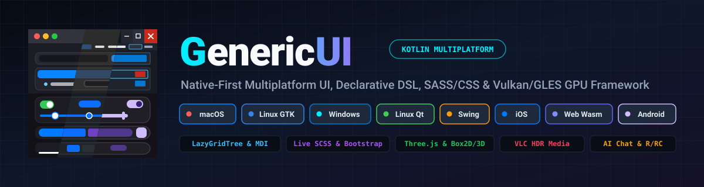

<p align="center">
  
</p>

# GenericUI

**GenericUI** (`com.nexustools.genericui`) is a **Native-First, True Cross-Platform UI, Docking, Hybrid Responsive Layout, Image, Media, & GPU Framework** built with **Kotlin Multiplatform (KMP)**.

Designed to power professional desktop, mobile, and web applications from a **single `commonMain` source set**, GenericUI eliminates the multi-hundred-megabyte RAM and CPU overhead of Electron/NW.js on desktop while providing 100% shared application logic across **Windows (Win32 / UxTheme)**, **macOS (AppKit)**, **Linux (GTK4 & Qt6)**, **Java/JVM (Swing/AWT)**, **Android**, **iOS (UIKit)**, and **Web (HTML5 DOM / WebGL2 / WebGPU)**.

---

## Core Architectural Pillars

1. **Zero-Boilerplate Single-`commonMain` Architecture (`@MainAppFragment` & `@AppFragment`)**
   Consumer applications write all UI, state, and business logic in `src/commonMain/kotlin` by annotating their root fragment with [`@MainAppFragment`](./common/src/commonMain/kotlin/com/nexustools/genericui/component/fragment/MainAppFragment.kt) and secondary screens with [`@AppFragment`](./common/src/commonMain/kotlin/com/nexustools/genericui/component/fragment/AppFragment.kt). At build time, the `:gradle-plugin` automatically generates all 8 platform launchers (`WindowsLauncher`, `MacosLauncher`, `GtkLauncher`, `QtLauncher`, `SwingLauncher`, `IosLauncher`, `WebLauncher`, and 1:1 Android `AppCompatActivity` classes), wires extension factories automatically, and resolves target-specific overrides using deterministic [`AppTarget`](./common/src/commonMain/kotlin/com/nexustools/genericui/enums/system/AppTarget.kt) specificity (`5` Single Backend $\rightarrow$ `4` `Linux` $\rightarrow$ `3` `NativeDesktop` / `Mobile` $\rightarrow$ `2` `Desktop` $\rightarrow$ `1` `System` $\rightarrow$ `0` `Common`).
2. **Command-Line Arguments on System Targets (`FragmentBundle`)**
   On all system targets (`Windows`, `MacOS`, `Gtk`, `Qt`, `Swing`, `Android`, `IOS`), the generated launcher captures process command-line arguments (`Array<String>`) and injects them into the startup [`FragmentBundle`](./common/src/commonMain/kotlin/com/nexustools/genericui/component/fragment/FragmentBundle.kt) passed to `@MainAppFragment.onCreate(savedInstanceState: FragmentBundle?)`—accessible via `hasCommandLineArgs()`, `getCommandLineArgs()`, `getCommandLineArgsArray()`, and `putCommandLineArgs(...)`.
3. **1:1 Android `AppCompatActivity` Generation, `FragmentHostFragment`, & `FragmentHostSystem`**
   - **Android 1:1 Activities**: On `:mobile:android`, every `@MainAppFragment` and `@AppFragment` generates a dedicated `AppCompatActivity` subclass (`<FragmentName>Activity : GenericUiFragmentActivity()`) registered in the generated `AndroidManifest.xml`, mapping `launchFragment(FragmentClass, LaunchArgs)` and [`FragmentLaunchMode`](./common/src/commonMain/kotlin/com/nexustools/genericui/enums/fragment/FragmentLaunchMode.kt) (`SAME_WINDOW`, `CLEAR_TASK`, `NEW_WINDOW`, `NEW_PANEL_WINDOW`, `NEW_DIALOG_WINDOW`) to native Android `Intent`s.
   - **In-Window Navigation (`FragmentHostFragment` & `FragmentHostSystem`)**: [`FragmentHostFragment`](./common/src/commonMain/kotlin/com/nexustools/genericui/component/fragment/helper/FragmentHostFragment.kt) and [`FragmentHostSystem`](./common/src/commonMain/kotlin/com/nexustools/genericui/component/fragment/helper/FragmentHostSystem.kt) provide animated in-window fragment stacks with [`FragmentTransitionSpec.FadeExpandShrink`](./common/src/commonMain/kotlin/com/nexustools/genericui/component/fragment/helper/FragmentTransitionSpec.kt) (and `SlideHorizontal`, `Crossfade`), optional Back/Forward/custom navigation buttons in the `TitleBar` or `Navbar` via [`FragmentNavigationChromeConfig`](./common/src/commonMain/kotlin/com/nexustools/genericui/component/fragment/helper/FragmentNavigationChromeConfig.kt), and automatic Web URL `#hash` + `window.history.state` synchronization.
4. **`IWindow` & `TitleCapabilities` Single-Placement Chrome Rules**
   [`TitleBar`](./common/src/commonMain/kotlin/com/nexustools/genericui/window/TitleBar.kt) and [`MenuBar`](./common/src/commonMain/kotlin/com/nexustools/genericui/component/shell/MenuBar.kt) are declarative instruction descriptors inspected via [`TitleCapabilities`](./common/src/commonMain/kotlin/com/nexustools/genericui/window/TitleCapabilities.kt) (`window.titleCapabilities`) and **never** rendered in two places simultaneously:
   - **`:desktop:windows` / `:desktop:gtk` / `:desktop:qt` / `:desktop:swing`**: Rendered once in the native window frame/chrome (replacing standard Win32 caption chrome when custom controls are present).
   - **`:desktop:macos`**: `MenuBar` attaches to the global top-of-screen macOS system menu bar (`NSApplication.sharedApplication.mainMenu`) while `TitleBar` configures `NSWindow` / `NSToolbar`.
   - **`:mobile:android` / `:mobile:ios`**: Rendered as a native top `Navbar` (`MaterialToolbar` / `UINavigationBar`) **only** when a `TitleBar` or `MenuBar` is set; omitted for full-bleed content otherwise.
   - **`:web`**: Title text updates `document.title` (browser tab title) with `supportsCustomTitleBar = false`, while in-viewport `Navbar` rendering is opt-in.
5. **Android-Style `Resource` (`Resource.ResourceID`), Precompiled `Resource.style`, & Custom Cursors (`CssCustomCursor`)**
   Place assets in `src/commonMain/resources/` (`drawable/`, `styles/*.scss`, `values/strings.xml`, `values/colors.xml`, `raw/`, `font/`, `xml/`) across application and shared library modules. The Gradle plugin generates a type-safe `Resource` class (`Resource.drawable.ic_logo`, `Resource.string.app_title`, `Resource.style.main`, `Resource.raw.default_config`) where every entry is a [`Resource.ResourceID`](./common/src/commonMain/kotlin/com/nexustools/genericui/resources/ResourceID.kt) translated natively by each backend:
   - **`:web`** (`WebResourceResolverImpl`): Translates `ResourceID` into URL strings (`./assets/drawable/...`) and compiles `.scss` into `.css` files.
   - **`:desktop:windows`** (`WindowsResourceResolverImpl`): Compiles resources into a Win32 `.rc`/`.res` object linked directly into the `.exe` binary (`FindResourceW` / `LoadResource` / `LockResource`) and synthesizes `.cur` cursor binaries via `WindowsCurCodec`.
   - **`:mobile:android`** (`AndroidResourceResolverImpl`): Maps `ResourceID` directly to Android `R.drawable.*`, `R.string.*`, and `R.raw.*`.
   - **`:desktop:macos` & `:mobile:ios`**: Resolves via `NSBundle.mainBundle` (and translates custom cursors to multi-rep `NSCursor` via `MacosCursorTranslator` on macOS).
   - **`:desktop:gtk` & `:desktop:qt`**: Compiles and resolves via `GResource` (`g_resources_lookup_data`) and `QResource` (`:/genericui/...`).
   - **`:desktop:swing`**: Resolves from the JVM JAR classpath (`ClassLoader.getResourceAsStream`).
   - **Custom Cursors (`CssCustomCursor`)**: [`CssCustomCursor`](./common/src/commonMain/kotlin/com/nexustools/genericui/style/css/CssCustomCursor.kt) accepts PNG `ResourceID`s, SVG `ResourceID`s, inline SVG markup, or `ImageBuffer`s with `(hotspotX, hotspotY)` and a `CssCursor` fallback, automatically translating to `.cur` on Windows and `NSCursor` on macOS.
6. **`ComponentStyle` (`getStyle()`), `ComponentBootstrap` (`getBootstrap()`), Native `UxTheme` Controls, & Precompiled `.scss` Stylesheets**
   - **`component.getStyle(): ComponentStyle`**: Strongly-typed W3C inline CSS properties ([`ComponentStyle`](./common/src/commonMain/kotlin/com/nexustools/genericui/style/css/ComponentStyle.kt)) accepting typed CSS enums/value classes and `null` to clear, with per-property `important = true` (`!important`) support, standard `accentColor` (`accent-color`), and **zero** pseudo-states on inline `ComponentStyle` (pseudo-classes belong strictly in `.scss` stylesheets).
   - **`component.getBootstrap(): ComponentBootstrap`**: Encapsulates all Bootstrap 5 properties and `Bootstrap*` utility enums ([`ComponentBootstrap`](./common/src/commonMain/kotlin/com/nexustools/genericui/style/bootstrap/ComponentBootstrap.kt): `BootstrapType` defaulting to `BootstrapType.NONE` / `BootstrapType.None`, `BootstrapSize`, `BootstrapWidth`, `BootstrapHeight`, directional `SpacingScale` margins/paddings/gaps including `SpacingScale.AUTO`, `BootstrapBorderWidth`, `BootstrapOpacity`, `BootstrapFontSize`, `BootstrapLineHeight`, `BootstrapFlexGrow`, `BootstrapFlexShrink`, `BootstrapFloat`, `BootstrapUserSelect`, `BootstrapPointerEvents`, `BootstrapObjectFit`, `BootstrapAspectRatio`, `BootstrapVisibility`).
   - **Strict User CSS Class Isolation**: `addClass`, `removeClass`, `hasClass`, `getClasses()`, and `getClass()` operate strictly on user-added custom classes (`customClasses`), keeping enum-added classes 100% invisible.
   - **Strict `:extensions:dsl` Isolation**: DSL builder functions (`style { ... }`, `bootstrap { ... }`, `important { ... }`) live exclusively in `:extensions:dsl` ([`DslStyleAndBootstrapBuilders.kt`](./extensions/dsl/src/commonMain/kotlin/com/nexustools/genericui/ext/dsl/DslStyleAndBootstrapBuilders.kt)) and are never part of `:common`.
   - **Native System Controls vs. `:extensions:alien` Precompiled Bootstrap SCSS**: Native applications **never** use Bootstrap CSS styling—`BootstrapType.NONE` (default) renders the genuine OS system control (Win32 **`UxTheme`** on Windows), semantic `BootstrapType` (`DANGER`, `PRIMARY`, etc.) colors the native control, and unsupported CSS properties on native backends are silently ignored. Conversely, `:extensions:alien` precompiles `bootstrap.scss` into [`AlienPrecompiledBootstrapStyleSheet`](./extensions/alien/common/src/commonMain/kotlin/com/nexustools/genericui/ext/alien/AlienPrecompiledBootstrapStyleSheet.kt) and implements [`IAlien`](./extensions/alien/common/src/commonMain/kotlin/com/nexustools/genericui/ext/alien/IAlien.kt) on `AlienContainer` & `AlienFragment` (`IAlien.BOOTSTRAP_STYLE_SHEET_ID` active by default and removable via `removeStyleSheet(IAlien.BOOTSTRAP_STYLE_SHEET_ID)`, with `insertApplicationStyleSheets: Int = 1` by default or `-1` to disable application stylesheets), supporting 100% of all CSS properties and transitions.
   - **Build-Time `.scss` Precompilation & `IApplication.addStyleSheet` / `removeStyleSheet`**: `.scss` files in `src/commonMain/resources/**` compile to `Resource.style.<name>` (`R.style.<name>`) backed by typed `PrecompiledStyleSheet` (`CompiledStyleRule`) on non-web and `.css` on `:web`. `IApplication.addStyleSheet` and `IApplication.removeStyleSheet` live on `IApplication` (NOT `IFragment`), with automatic `app.addStyleSheet(...)` injection in Gradle-generated `main()` when `styles { globalStyleSheet = "..." }` is configured in `build.gradle.kts`.
7. **`IApplication`, `ThemeMode.AUTO` (Default) 8-Target OS Theme Detection, & `BackendTarget` Group Checks**
   [`IApplication`](./common/src/commonMain/kotlin/com/nexustools/genericui/component/shell/IApplication.kt) (`app.backendTarget`) exposes [`BackendTarget`](./common/src/commonMain/kotlin/com/nexustools/genericui/enums/system/BackendTarget.kt) (`Windows`, `MacOS`, `Gtk`, `Qt`, `Swing`, `Android`, `IOS`, `Web`) with multi-target group checks (`isSystem`, `isDesktop`, `isNativeDesktop`, `isLinux`, `isMobile`, `isApple`, `isUnix`, `isPosix`, `isNative`, `isJvm`, `isTouchPrimary`, `isBrowser`) and theming (`setTheme(ThemeMode)`, `getTheme()`, `getResolvedTheme()`) defaulting to **[`ThemeMode.AUTO`](./common/src/commonMain/kotlin/com/nexustools/genericui/enums/ui/ThemeMode.kt)** (`AUTO`, `DARK`, `LIGHT`) with live 8-target OS dark/light theme detection and `:web` Bootstrap `data-bs-theme="light|dark"` switching.
8. **7 Hybrid Responsive Layout Components & Fragment Helpers Across Desktop, Tablet, Mobile, & Web**
   GenericUI includes 7 responsive layout systems and matching `*Fragment` helpers (documented in [**`docs/layouts-and-helpers.md`**](./docs/layouts-and-helpers.md)):
   - `HybridColumnLayout` & `HybridColumnFragment` (`HybridColumnSpec`, `HybridFoldMode`, `HybridTabPlacement`, `DynamicFullscreenController`, `HybridFullscreenPolicy` [`DISABLED` default])
   - `DockWorkspace` & `DockWorkspaceFragment` (full multi-panel dock workspace on desktop/tablet/wide web that automatically converts `LEFT`, `RIGHT`, `TOP`, `BOTTOM` docks into off-canvas edge swipe-out drawer overlays on small-screen mobile and narrow web viewports via `DockMobileDrawerPolicy`)
   - `AdaptiveNavigationScaffold` & `AdaptiveNavigationScaffoldFragment` (`Sidebar` $\leftrightarrow$ `NavigationRail` $\leftrightarrow$ `BottomNavigationBar`)
   - `ResponsiveMasterDetailLayout` & `ResponsiveMasterDetailFragment` (2/3-pane split $\leftrightarrow$ compact drill-down stack)
   - `HybridSplitNavigationLayout` & `HybridSplitNavigationFragment` (top `TabLayout` $\leftrightarrow$ bottom `BottomNavigationBar`)
   - `CollapsibleBottomDockLayout` & `CollapsibleBottomDockFragment` (main content + collapsible mini-player/bottom dock)
   - `ResponsiveBentoGridLayout` & `ResponsiveBentoGridFragment` (`BentoGridItemSpec` responsive 12/6/1-column dashboard grid)

---

## Complete Module & Extension Architecture Overview

Every `.kt` file across all modules strictly adheres to the **1 Public Class / Interface / Enum Per File** standard.

### A. Core & Platform Backend Modules

| Module | Variant Scope | Responsibility & Native Backing |
| :--- | :--- | :--- |
| **`:common`** | `common` | Platform-agnostic UI widgets, `NativeImpl` contracts, `IWindow`, `TitleCapabilities`, `IApplication`, `ThemeMode` (`AUTO`, `DARK`, `LIGHT`), `BackendTarget`, `AppTarget`, `IFragment`, `@MainAppFragment`, `@AppFragment`, `FragmentBundle`, `FragmentHostFragment`, `FragmentHostSystem`, **7 Hybrid Responsive Layouts & Fragment Helpers**, `DockWorkspace` (with mobile edge drawers), true lazy views (`LazyList`, `LazyGrid`, `TreeView`), `FileBrowserDialog`, `PreferenceStore`, `Resource`/`ResourceID`/`ResourceResolver`, **Full Image API (`com.nexustools.genericui.image.*`)**, `AbstractCanvas`, `ComponentStyle` (`getStyle()`), `ComponentBootstrap` (`getBootstrap()`), `CssCustomCursor`, and `PrecompiledStyleSheet`. |
| **`:systemCommon`** | `systemCommon` | Pure-Kotlin system-target helpers (`SystemStorageKeyHelper`) shared across all 7 non-browser OS targets (`Windows`, `MacOS`, `Gtk`, `Qt`, `Swing`, `Android`, `IOS`). |
| **`:desktop:common`** | `desktopCommon` | Pure-Kotlin desktop foundation shared by all 5 desktop backends (`Windows`, `MacOS`, `Gtk`, `Qt`, `Swing`): `DesktopFileBrowserHelper`, `DesktopLazyViewportEngine`, `DesktopUiTimerNativeImpl`, and desktop dialog/tray/notification helpers. |
| **`:desktop:nativeCommon`** | `nativeDesktopCommon` | Native C/C++/ObjC desktop foundation shared by `Windows`, `MacOS`, `Gtk`, and `Qt`: `DesktopBaseNativeImpl`, `DesktopConfigDirectoryHelper`, `DesktopMultiWindowDockCoordinator`, and POSIX/native widget peers. |
| **`:desktop:linuxCommon`** | `linuxCommon` | Linux XDG desktop foundation shared by `Gtk` and `Qt`: `LinuxXdgConfigDirectoryImpl`, `LinuxXdgCacheDirectoryImpl`, and `LinuxXdgPreferenceStoreImpl`. |
| **`:desktop:windows`** | `windows` | `WindowsLauncher`, Win32 (`HWND` / **`UxTheme`** native dark/light controls / DWM / `IFileOpenDialog` / `IFileSaveDialog`), `WindowsCurCodec` (`.cur` custom cursors), embedded `.exe` Win32 `.rc`/`.res` `WindowsResourceResolverImpl`, Google ANGLE, and Vulkan. |
| **`:desktop:macos`** | `macos` | `MacosLauncher`, macOS AppKit (`NSWindow`, `NSView`, global system `NSMenu`, `NSOpenPanel`/`NSSavePanel`), `MacosCursorTranslator` (`NSCursor`), `NSBundle` `MacosResourceResolverImpl`, CoreGraphics, and MoltenVK. |
| **`:desktop:gtk`** | `gtk` | `GtkLauncher`, Linux GTK4 (`GtkWindow`, `GtkHeaderBar`, `GtkWidget`, `GtkFileDialog`), `GResource` `GtkResourceResolverImpl`, Cairo, EGL, and Vulkan. |
| **`:desktop:qt`** | `qt` | `QtLauncher`, Linux Qt6 (`QMainWindow`, `QMenuBar`, `QDockWidget`, `QWidget`, `QFileDialog`), `QResource` `QtResourceResolverImpl`, `QPainter`, and `QVulkanWindow`. |
| **`:desktop:swing`** | `swing` | `SwingLauncher`, JVM `JFrame`/`JComponent` + `JFileChooser`, JAR classpath `SwingResourceResolverImpl`, and optional LWJGL 3 `JAWT` OpenGL ES & Vulkan (`useLwjglGL`, `useVulkan`). |
| **`:mobile:common`** | `mobileCommon` | Mobile foundation shared by `Android` and `IOS`: `MobileDeviceFormFactor`, `MobileAdaptiveFragmentCoordinator`, `MobileGestureRecognizer`, `MobileFlingPhysics`, `MobilePipController`, and `MobileLazyViewportPool`. |
| **`:mobile:android`** | `android` | 1:1 generated `AppCompatActivity` classes (`<FragmentName>Activity : GenericUiFragmentActivity()`), conditional `MaterialToolbar` navbar, Android `R.*` `AndroidResourceResolverImpl`, `RecyclerView` lazy views, and SAF file/folder picker. |
| **`:mobile:ios`** | `ios` | `IosLauncher`, UIKit (`UIWindow`, conditional `UINavigationBar`, `UIView`, `UICollectionView`/`UITableView`, `UIDocumentPickerViewController`), `NSBundle` `IosResourceResolverImpl`, and MoltenVK. |
| **`:web`** | `web` | `WebLauncher`, Kotlin/Wasm (`wasmJs`, default) + Kotlin/JS IR (`js`, automatic fallback) via `genericui-loader.js`, URL-based `WebResourceResolverImpl`, `<link rel="stylesheet">` + `data-bs-theme="light|dark"`, `#hash` + `window.history.state` fragment routing, Bootstrap splash screen (`#genericui-splash`), semantic HTML5 DOM widgets, and `<input type="file">` dialog. |
| **`:gradle-plugin`** | Gradle Plugin | Plugin `id("com.nexustools.genericui")` providing the `genericui { ... }` DSL, automatic launcher & Android `AppCompatActivity` codegen, `.scss` $\rightarrow$ `PrecompiledStyleSheet` (`Resource.style.<name>`) & `.css` compilation, `Resource` & Win32 `.rc`/`.res` compilation, and extension wiring. |

### B. First-Party Extension Modules (`:extensions:*`)

| Extension | Structure Type | Transitive Dependencies | Responsibility & Key Classes |
| :--- | :--- | :--- | :--- |
| **`:extensions:gpu`** | **Project-of-Projects** (`:common`, `:systemCommon`, `:desktop:*`, `:mobile:*`, `:web`) | `:common` | Unified GPU device, shader, and offscreen context foundation (`GpuDevice`, `GpuOffscreenContext`, `VKContext` primary with SPIR-V & MoltenVK, `GLContext` fallback with Google ANGLE on Windows). |
| **`:extensions:imageprocessing`** | **Project-of-Projects** (`:common`, `:systemCommon`, `:web`) | `:extensions:gpu` | Offscreen in-memory GPU-accelerated image manipulation & filter pipelines (`GpuImageProcessor`, `GpuImageFilterChain`, `GpuImageKernel`, `GpuHistogramAnalyzer`) operating on `:common`'s `ImageBuffer`. |
| **`:extensions:overlay`** | **Single KMP Project** (+ `:extensions:overlay:dsl`) | `:common` | Domain-agnostic customizable overlay architecture (`OverlayHost`, `OverlayHostBox`, `AbstractOverlay`, `PresetOverlay`, `MobileOverlayPreset`, `WebSystemOverlayPreset`, `AutoHideController`, `TrackSeekBar`, `SliderSeekBar`). |
| **`:extensions:canvas2d`** | **Project-of-Projects** (`:common`, `:systemCommon`, `:desktop:*`, `:mobile:*`, `:web` + `:dsl`) | `:extensions:imageprocessing`, `:extensions:overlay` | Dedicated 2D vector/raster canvas (`Canvas2D`, `ScrollCanvas2D`, `Canvas2DContext`, `CurveEditor`, `Canvas2DOverlayHost`). |
| **`:extensions:canvas3d`** | **Project-of-Projects** (`:common`, `:systemCommon`, `:desktop:*`, `:mobile:*`, `:web` + `:dsl`) | `:extensions:gpu`, `:extensions:canvas2d`, `:extensions:overlay` | Dedicated OpenGL ES 3.0+ (`GLCanvas` with ANGLE on Windows) and Vulkan 1.2+ (`VKCanvas` with MoltenVK on Apple) interactive GPU surfaces. |
| **`:extensions:media`** | **Project-of-Projects** (`:common`, `:systemCommon`, `:desktop:*`, `:mobile:*`, `:web` + `:dsl`) | `:extensions:overlay` | `VideoPlayer` (with uniform codec reporting & `VideoOverlayHost`), `AudioPlayer`, `AudioAnalyzer`, `WebVttSrtParser`, native **`libvlc` bindings** in `:extensions:media:desktop:nativeCommon`, and **`libvlcj`** in `:extensions:media:desktop:swing`. |
| **`:extensions:mediacontrols`** | **Project-of-Projects** (`:common`, `:systemCommon`, `:desktop:*`, `:mobile:*`, `:web` + `:dsl`) | `:common` **only** | Standalone OS media session & hardware media key hooks (`MediaControlsSession`, `MediaControlMetadata`, Windows `ITaskbarList3` thumbnail buttons + SMTC + `WM_APPCOMMAND`, macOS `MPRemoteCommandCenter` + `MPNowPlayingInfoCenter`, Linux MPRIS2, Web `navigator.mediaSession`). |
| **`:extensions:webview`** | **Project-of-Projects** (`:common`, `:systemCommon`, `:desktop:*`, `:mobile:*`, `:web` + `:dsl`) | `:common` (plus `lib/NJS` on Desktop/Swing only) | Dedicated `WebView` extension (`WebView`, `WebViewController`, `WebViewJsBridge`). Uses **Chromium (`ChromiumBlinkEngine`) + `NJS` (`lib/NJS` AsmJit/SLJIT Native JIT Engine)** on Desktop, and native `android.webkit.WebView` (`:android`), `WKWebView` (`:ios`), and `<iframe>` (`:web`) — **never using `NJS` on Mobile or Web**. |
| **`:extensions:alien`** | **Project-of-Projects** (`:common`, `:systemCommon`, `:web` + `:dsl`) | `:extensions:canvas2d` | Self-rendered Bootstrap 5.3 `Canvas2D` UI engine (`AlienContainer`, `AlienFragment`, `AlienScrollFragment`, `UnalienContainer`) with precompiled `AlienPrecompiledBootstrapStyleSheet`, `IAlien` (`IAlien.BOOTSTRAP_STYLE_SHEET_ID`, `insertApplicationStyleSheets = 1` default or `-1` to disable application stylesheets), and 100% CSS property & transition support. |
| **`:extensions:codeeditor`** | **Single KMP Project** (+ `:dsl`) | `:extensions:canvas2d` | Extension-only IDE-style code editor (`IdeCodeEditor`) with syntax highlighting, line numbers, code folding, minimap, autocomplete, diagnostics, and `Ctrl+Click` Go-To-Definition. |
| **`:extensions:aichat`** | **Single KMP Project** (+ `:dsl`) | `:extensions:codeeditor` ($\rightarrow$ `canvas2d`) | Reusable AI Assistant UI & orchestration suite (`AiChatContainer`, `AIChatDrawer`, `AIChatConversationList`, `AIChatMessageView`, `AIChatPromptComposer`, `AIChatAgentOrchestrator`). |
| **`:extensions:threejs`** | **Single KMP Project** (+ `:dsl`) | `:extensions:gpu`, `:extensions:canvas3d` | Three.js-inspired 3D scene graph (`ThreeSceneCanvas`, `ThreeGLCanvas`, `ThreeVKCanvas`, `ThreeCamera`, `ThreeMesh`, `ThreeGeometry`, `ThreeMaterial`, `ThreeLight`, `ThreeOrbitControls`). |
| **`:extensions:box2d`** | **Single KMP Project** (+ `:dsl`) | `:extensions:canvas2d`, `:extensions:canvas3d` ($\rightarrow$ `gpu`) | Pure KMP 2D rigid-body & particle physics engine (`Box2DWorld`, `Box2DBody`, `Box2DCollider`, `Box2DJoint`, `Box2DCanvas`). |
| **`:extensions:box3d`** | **Single KMP Project** (+ `:dsl`) | `:extensions:canvas3d`, `:extensions:threejs` ($\rightarrow$ `gpu`) | Pure KMP 3D rigid-body physics engine (`Box3DWorld`, `Box3DBody`, `Box3DCollider`, `Box3DConstraint`, `Box3DThreeJsBridge`). |
| **`:extensions:dsl`** | **Single KMP Project** (+ 12 `:extensions:<name>:dsl` submodules) | `:common` | Declarative Kotlin UI, hybrid layout ([`HybridLayoutDsl.kt`](./extensions/dsl/src/commonMain/kotlin/com/nexustools/genericui/ext/dsl/HybridLayoutDsl.kt)), and style/Bootstrap DSL builders ([`DslStyleAndBootstrapBuilders.kt`](./extensions/dsl/src/commonMain/kotlin/com/nexustools/genericui/ext/dsl/DslStyleAndBootstrapBuilders.kt): `style { ... }`, `bootstrap { ... }`, `important { ... }`, strictly isolated to `:extensions:dsl`). |

---

## Quick Start: Single-`commonMain` Project (`com.nexustools.genericui`)

Apply `id("com.nexustools.genericui")` in `build.gradle.kts`. No manual entry-point configuration or platform launcher files are needed—the plugin discovers `@MainAppFragment` and `@AppFragment` classes automatically, precompiles `.scss` stylesheets into `Resource.style.<name>`, and generates all platform launchers and `Resource` tables:

```kotlin
plugins {
    kotlin("multiplatform")
    id("com.nexustools.genericui")
}

genericui {
    app {
        id = "com.example.studio"
        name = "GenericUI Studio"
        version = "1.0.0"
        packageName = "com.example.studio"
    }

    window {
        title = "GenericUI Studio"
        width = 1440
        height = 900
        minWidth = 960
        minHeight = 600
        resizable = true
        icon = "src/commonMain/resources/drawable/ic_studio_logo.svg"
    }

    theme {
        mode = "auto"     // Defaults to "auto" (ThemeMode.AUTO); supports "auto", "dark", "light"
        color = "#2A80FF"
    }

    styles {
        compileSass = true
        generateWebCss = true
        precompileToKotlin = true
        sourceDir = "src/commonMain/resources/styles"
        globalStyleSheet = "styles/main.scss" // Automatically injects app.addStyleSheet("styles/main.scss") in generated main()
    }

    backends {
        all() // Enables windows, macos, gtk, qt, swing, android, ios, and web (wasmJs + js fallback)
    }

    // Optional hierarchical variant overrides (common -> systemCommon -> desktopCommon -> nativeDesktopCommon -> linuxCommon, mobileCommon, or per-backend):
    desktopCommon {
        window {
            width = 1600
            height = 960
        }
    }

    extensions {
        gpu()              // :extensions:gpu
        imageProcessing()  // :extensions:imageprocessing (transitively enables gpu)
        overlay()          // :extensions:overlay
        canvas2d()         // :extensions:canvas2d
        canvas3d()         // :extensions:canvas3d
        media()            // :extensions:media (transitively enables overlay)
        mediaControls()    // :extensions:mediacontrols (standalone OS media session & hardware media keys)
        webView()          // :extensions:webview (Chromium + NJS JIT on Desktop; native on Mobile/Web)
        alien()            // :extensions:alien (precompiled Bootstrap 5.3 Canvas2D UI + IAlien)
        codeEditor()       // :extensions:codeeditor
        aiChat()           // :extensions:aichat
        threeJs()          // :extensions:threejs
        box2d()            // :extensions:box2d
        box3d()            // :extensions:box3d
        dsl()              // :extensions:dsl + enabled extension :dsl submodules
    }

    resources {
        enabled = true
        packageName = "com.example.studio.res"
        translateForAllBackends = true
    }
}
```

---

## Code Examples (`src/commonMain/kotlin`)

### 1. `@MainAppFragment`, `getBootstrap()`, `getStyle()`, `CssCustomCursor`, `ThemeMode.AUTO`, & `Resource.style`

```kotlin
package com.example.studio

import com.example.studio.res.Resource
import com.nexustools.genericui.component.action.Button
import com.nexustools.genericui.component.fragment.AppFragment
import com.nexustools.genericui.component.fragment.Fragment
import com.nexustools.genericui.component.fragment.FragmentBundle
import com.nexustools.genericui.component.fragment.MainAppFragment
import com.nexustools.genericui.component.fragment.helper.FragmentHostFragment
import com.nexustools.genericui.component.fragment.helper.FragmentNavigationChromeConfig
import com.nexustools.genericui.component.fragment.helper.FragmentTransitionSpec
import com.nexustools.genericui.component.layout.VStack
import com.nexustools.genericui.component.typography.Heading
import com.nexustools.genericui.enums.bootstrap.BootstrapSize
import com.nexustools.genericui.enums.bootstrap.BootstrapType
import com.nexustools.genericui.enums.bootstrap.BootstrapWidth
import com.nexustools.genericui.enums.bootstrap.SpacingScale
import com.nexustools.genericui.enums.css.CssCursor
import com.nexustools.genericui.enums.ui.ThemeMode
import com.nexustools.genericui.resources.getString
import com.nexustools.genericui.style.color.RgbaColor
import com.nexustools.genericui.style.css.CssCornerRadii
import com.nexustools.genericui.style.css.CssCustomCursor
import com.nexustools.genericui.window.TitleBar

@MainAppFragment(label = "Studio")
class StudioRootFragment : FragmentHostFragment(
    appTitle = "GenericUI Studio",
    transitionSpec = FragmentTransitionSpec.FadeExpandShrink(durationMs = 400, activationDelayMs = 40),
    navigationChrome = FragmentNavigationChromeConfig(
        showBackButton = true,
        showForwardButton = true
    )
) {
    override fun onCreate(savedState: FragmentBundle?) {
        super.onCreate(savedState)

        // Read command-line arguments on system targets (Windows, MacOS, Gtk, Qt, Swing, Android, IOS):
        if (savedState?.hasCommandLineArgs() == true) {
            val cliArgs = savedState.getCommandLineArgs()
            println("Launched on ${hostingWindow?.application?.backendTarget} with CLI args: $cliArgs")
        }

        // Theme defaults to ThemeMode.AUTO (follows OS dark/light theme across all 8 backends):
        hostingWindow?.application?.setTheme(ThemeMode.AUTO)
        hostingWindow?.application?.addStyleSheet(Resource.style.main)

        setTitleBar(TitleBar(title = Resource.string.app_title.getString()))
        registerRoute("dashboard", ProjectDashboardFragment::class, title = "Dashboard") {
            ProjectDashboardFragment()
        }
        resolveInitialDeepLink(defaultRoute = "dashboard", defaultArgs = savedState)
    }
}

@AppFragment(label = "Dashboard", route = "dashboard")
class ProjectDashboardFragment : Fragment() {
    init {
        val rootStack = VStack().apply {
            // 1. Strongly-typed Bootstrap 5 utilities (invisible to getClasses() / hasClass())
            getBootstrap().apply {
                width = BootstrapWidth.W_100
                padding = SpacingScale.S3
                gap = SpacingScale.S2
            }
            // 2. Strongly-typed W3C inline CSS style with !important and custom cursor (.cur on Windows, NSCursor on macOS)
            getStyle().apply {
                setBorderRadius(CssCornerRadii.all(12f), important = true)
                setAccentColor(RgbaColor.fromHex("#2A80FF"))
                setCursor(
                    CssCustomCursor.fromResource(
                        resourceId = Resource.drawable.cursor_brush,
                        hotspotX = 4,
                        hotspotY = 28,
                        fallback = CssCursor.CROSSHAIR
                    )
                )
            }

            addChild(Heading(Resource.string.welcome_heading.getString(), level = 3))
            addChild(
                Button("Primary Action").apply {
                    // BootstrapType.NONE is default (native UxTheme control on Windows); PRIMARY colors native control:
                    getBootstrap().apply {
                        type = BootstrapType.PRIMARY
                        size = BootstrapSize.LG
                    }
                }
            )
        }
        addChild(rootStack)
    }
}
```

---

### 2. Hybrid Responsive Layout Helpers (`HybridColumnFragment` & `DockWorkspaceFragment` with Mobile Edge Drawers)

See the [**Hybrid Layouts & Fragment Helpers Guide (`docs/layouts-and-helpers.md`)**](./docs/layouts-and-helpers.md) for all 7 responsive layouts and fragment helpers (`HybridColumnLayout`, `DockWorkspace`, `AdaptiveNavigationScaffold`, `ResponsiveMasterDetailLayout`, `HybridSplitNavigationLayout`, `CollapsibleBottomDockLayout`, and `ResponsiveBentoGridLayout`):

```kotlin
import com.nexustools.genericui.component.dock.DockMobileDrawerPolicy
import com.nexustools.genericui.component.fragment.MainAppFragment
import com.nexustools.genericui.component.fragment.helper.DockWorkspaceFragment
import com.nexustools.genericui.component.fragment.helper.HybridColumnFragment
import com.nexustools.genericui.component.layout.HybridColumnSpec
import com.nexustools.genericui.component.layout.HybridFoldMode
import com.nexustools.genericui.component.layout.HybridFullscreenPolicy
import com.nexustools.genericui.component.layout.HybridTabPlacement
import com.nexustools.genericui.enums.dock.DockPosition
import com.nexustools.genericui.enums.dock.StudioWindowMode
import com.nexustools.genericui.window.TitleBar

// 1. HybridColumnFragment: Side-by-side columns on tablet landscape / desktop / wide web;
//    pinned top 16:9 media player + bottom tabs on small-screen mobile / narrow web:
@MainAppFragment
class MediaSuiteMainFragment : HybridColumnFragment(
    foldMode = HybridFoldMode.PIN_FIRST_COLUMN_TOP,
    tabPlacement = HybridTabPlacement.ADAPTIVE_TOP_IN_COLUMNS_BOTTOM_IN_SINGLE,
    fullscreenPolicy = HybridFullscreenPolicy.AUTO_PHONE_LANDSCAPE_AND_TABLET_LOCKED
) {
    override fun onConfigureColumns() {
        setTitleBar(TitleBar(title = "Media Suite"))
        addFragmentColumn(
            spec = HybridColumnSpec(id = "player", title = "Player", colMd = 7, compactAspectRatio = 16f / 9f),
            fragment = PlayerViewportFragment()
        )
        addFragmentColumn(
            spec = HybridColumnSpec(id = "shows", title = "Shows & Podcasts", colMd = 5, scrollableInSingleMode = true),
            fragment = ShowBrowserFragment()
        )
        addFragmentColumn(
            spec = HybridColumnSpec(id = "queue", title = "Up Next Queue", colMd = 5, scrollableInSingleMode = true),
            fragment = PlaybackQueueFragment()
        )
    }
}

// 2. DockWorkspaceFragment: Full multi-panel dock workspace on desktop/tablet/wide web that
//    automatically converts LEFT/RIGHT/BOTTOM docks into edge swipe-out drawers on < 600dp mobile/web:
@MainAppFragment
class StudioDockWorkspaceFragment : DockWorkspaceFragment(
    initialMode = StudioWindowMode.SINGLE_WINDOW
) {
    override fun onConfigureWorkspace() {
        dockWorkspace.mobileDrawerPolicy = DockMobileDrawerPolicy.AUTO
        setTitleBar(TitleBar(title = "Hybrid Vector & Raster Studio"))
        dockFragment("toolbox", "Tools & Brushes", ToolboxFragment(), DockPosition.LEFT)
        dockFragment("canvas-doc-1", "hero-character.hacanvas", CanvasEditorFragment(), DockPosition.CENTER)
        dockFragment("layers", "Layers & Channels", LayersPanelFragment(), DockPosition.RIGHT)
        dockFragment("timeline", "Keyframe & Cel Timeline", TimelineFragment(), DockPosition.BOTTOM)
    }
}
```

---

### 3. Base `:common` Image API (`ImageLoader`, `ImageBuffer`) & Offscreen GPU `:extensions:imageprocessing`

```kotlin
import com.nexustools.genericui.image.ImageDecodeOptions
import com.nexustools.genericui.image.ImageFormat
import com.nexustools.genericui.image.ImageLoader
import com.nexustools.genericui.image.ImageSource
import com.nexustools.genericui.image.PixelFormat
import com.nexustools.genericui.ext.imageprocessing.GpuImageFilterChain
import com.nexustools.genericui.ext.imageprocessing.GpuImageKernel
import com.nexustools.genericui.ext.imageprocessing.GpuImageProcessor
import com.nexustools.genericui.resources.getBytes

// 1. Decode an image into an in-memory ImageBuffer using the base :common Image API
val sourceBuffer = ImageLoader.decode(
    source = ImageSource.fromBytes(Resource.raw.sample_photo.getBytes() ?: ByteArray(0)),
    options = ImageDecodeOptions(targetPixelFormat = PixelFormat.RGBA_8888, premultiplyAlpha = true)
)

// 2. Process the ImageBuffer offscreen in memory on the GPU (:extensions:imageprocessing + :extensions:gpu)
val gpuProcessor = GpuImageProcessor.createOffscreen()
val filterChain = GpuImageFilterChain()
    .addGaussianBlur(radiusPx = 6.0f)
    .addExposureContrast(exposureEv = 0.35f, contrast = 1.15f)
    .addCustomKernel(GpuImageKernel.sharpen3x3(amount = 0.5f))

val outputBuffer = gpuProcessor.process(sourceBuffer, filterChain)
val encodedPngBytes = ImageLoader.encode(outputBuffer, ImageFormat.PNG)
```

---

### 4. `:extensions:canvas2d` (`Canvas2D`) & `:extensions:canvas3d` (`GLCanvas`, `VKCanvas`) with `registerVBlankRender(deltaMs)`

```kotlin
import com.nexustools.genericui.ext.canvas2d.Canvas2D
import com.nexustools.genericui.ext.canvas3d.GLCanvas
import com.nexustools.genericui.ext.canvas3d.VKCanvas

// 1. 2D Vector/Raster Canvas (:extensions:canvas2d)
val canvas2d = Canvas2D(width = 800, height = 600).apply {
    var angle = 0.0
    registerVBlankRender { deltaMs ->
        angle += deltaMs * 0.002
        clear("#181A1F")
    }
}

// 2. OpenGL ES 3.0+ Canvas (:extensions:canvas3d + :extensions:gpu, Google ANGLE -> D3D11 on Windows)
val glCanvas = GLCanvas(width = 1280, height = 720, preferES31 = true).apply {
    registerVBlankRender { deltaMs ->
        glContext?.clearColorBuffer(0.08f, 0.09f, 0.12f, 1.0f)
    }
}

// 3. Vulkan 1.2+ Canvas (:extensions:canvas3d + :extensions:gpu, MoltenVK -> Metal on macOS & iOS)
val vkCanvas = VKCanvas(width = 1280, height = 720, enableValidation = true).apply {
    registerVBlankRender { deltaMs ->
        // Record command buffer for current swapchain image...
    }
}
```

---

## Categorized Documentation & Submodule Directory

All documentation across `GenericUI` and its submodules is organized by category and cross-referenced. Start with the [**Master Documentation Index (`docs/README.md`)**](./docs/README.md) or browse by category below:

### Category 1 — Core Architecture, Hybrid Layouts, Fragments, Application, Resources, SourceSets, & UI Components
- [**Master Documentation Index (`docs/README.md`)**](./docs/README.md) — Central navigation hub for all guides across the framework and its submodules.
- [**Core Architecture (`docs/architecture.md`)**](./docs/architecture.md) — Multi-tier module hierarchy (`:common`, `:systemCommon`, `:desktop:common`, `:desktop:nativeCommon`, `:desktop:linuxCommon`, `:mobile:common`, `:web`), Deferred Upward `NativeImpl` Resolution, `TitleCapabilities` single-placement rules, and 1-Class-Per-File standard.
- [**Hybrid Responsive Layouts & Fragment Helpers (`docs/layouts-and-helpers.md`)**](./docs/layouts-and-helpers.md) — Comprehensive guide to `HybridColumnLayout`/`HybridColumnFragment`, `DockWorkspace`/`DockWorkspaceFragment` (compact mobile edge swipe-out drawers via `DockMobileDrawerPolicy`), `AdaptiveNavigationScaffold`/`AdaptiveNavigationScaffoldFragment`, `ResponsiveMasterDetailLayout`/`ResponsiveMasterDetailFragment`, `HybridSplitNavigationLayout`/`HybridSplitNavigationFragment`, `CollapsibleBottomDockLayout`/`CollapsibleBottomDockFragment`, `ResponsiveBentoGridLayout`/`ResponsiveBentoGridFragment`, `HybridBreakpointSpec`, `HybridLayoutMode`, and `:extensions:dsl` builders ([`docs/layouts-and-hybrid-ui.md`](./docs/layouts-and-hybrid-ui.md)).
- [**Fragments & Windows (`docs/fragments-and-windows.md`)**](./docs/fragments-and-windows.md) — `@MainAppFragment`, `@AppFragment`, `AppTarget` specificity resolution (`5 -> 0`), `FragmentBundle` CLI args on system targets, `IFragment`, `launchFragment(FragmentClass, LaunchArgs)` & `FragmentLaunchMode`, 1:1 Android `AppCompatActivity` generation, `IWindow` & `TitleCapabilities`, `FragmentHostFragment`, `FragmentHostSystem`, `FadeExpandShrink`, and Web `#hash` + `window.history.state`.
- [**Application, Theming (`ThemeMode.AUTO`), Stylesheets, & `BackendTarget` (`docs/application.md`)**](./docs/application.md) — Zero-boilerplate `@MainAppFragment` bootstrapping, optional `@AppApplication`, `ThemeMode` (`AUTO` default, `DARK`, `LIGHT`) with 8-target OS dark/light theme detection, `IApplication.addStyleSheet` / `removeStyleSheet`, `BackendTarget` group checks, and `IApplication` capabilities.
- [**Resource System, `Resource.style`, & Custom Cursors (`docs/resources.md`)**](./docs/resources.md) — Android-style `Resource` (`Resource.drawable.*`, `Resource.string.*`, `Resource.style.*`, `Resource.raw.*`) & `Resource.ResourceID` generation across shared/library modules, `.scss` precompilation to `PrecompiledStyleSheet`, `CssCustomCursor` (`.cur` on Windows & `NSCursor` on macOS), and translation across all 8 backends.
- [**Hierarchical SourceSet Setup (`docs/sourcesets.md`)**](./docs/sourcesets.md) — Single-`commonMain` default + optional multi-tier KMP sourceSet tree (`commonMain` $\to$ `webMain` & `systemMain` $\to$ `desktopMain` (`swingMain`, `nativeDesktopMain` $\to$ `windowsMain`, `macosMain`, `linuxMain` $\to$ `gtkMain`, `qtMain`) & `mobileMain` (`androidMain`, `iosMain`)).
- [**Components, Helper Fragments, Docking, & Styling (`docs/components-and-docking.md`)**](./docs/components-and-docking.md) — 75+ widgets, `FragmentHostFragment`, `DockWorkspaceFragment`, `AdaptiveSplitTabFragment`, `FileBrowserDialog`, true lazy views, `ComponentStyle` (`getStyle()`) + `ComponentBootstrap` (`getBootstrap()`), and `LinearGradient` / `RadialGradient` background styling.
- [**Utilities, Binary Codecs (`BinaryJson` `.bson` & `BinaryPlist` `.plist`), & `PreferenceStore` (`docs/utils.md`)**](./docs/utils.md) — Complete reference for `BinaryJson` (`.bson`), `BinaryPlist` (`bplist00` `.plist`), cross-platform `PreferenceStore` & `PreferenceObjectCodec`, `UserDirectory` / `ConfigDirectory` / `CacheDirectory`, `UiTimerScheduler`, `ResourceID` / `ResourceResolver`, `ComponentStyle`, `ComponentBootstrap`, `CssCustomCursor`, `PrecompiledStyleSheet`, and `SystemThemeDetector`.
- [**Media & Hardware Canvases (`docs/media-and-canvases.md`)**](./docs/media-and-canvases.md) — Base `:common` Image API, `AbstractCanvas` (`registerVBlankRender` with `deltaMs`), `:extensions:gpu` (Google ANGLE on Windows, MoltenVK on Apple), `:extensions:imageprocessing`, `:extensions:overlay`, `:extensions:canvas2d`, `:extensions:canvas3d`, `:extensions:media`, and `:extensions:mediacontrols`.
- [**Agent & Developer Guidelines (`AGENTS.md`)**](./AGENTS.md) — Authoritative engineering rules and invariants.

### Category 2 — Build System, Gradle Plugin, & IDE Tooling
- [**Gradle Plugin Guide (`docs/gradle-plugin.md`)**](./docs/gradle-plugin.md) — Full `genericui { ... }` DSL reference (`app`, `window`, `theme`, `styles` with `globalStyleSheet`, `backends`, `extensions`, hierarchical variant scopes, `android { manifest { ... }; services { ... } }`, `resources`, `sourceSets`, and registered tasks).
- [**IntelliJ IDEA Plugin Guide (`docs/idea-plugin.md`)**](./docs/idea-plugin.md) — New Project Wizard for single-`commonMain` `@MainAppFragment` projects and live `Manage GenericUI Targets & Extensions` checkbox dialog (`:idea-plugin`).

### Category 3 — Platform Backends (8 Backends Across Common Foundation & 3 Submodules)
- [**Platform Backends Overview (`docs/backends.md`)**](./docs/backends.md) — Feature comparison, module hierarchy, and build task reference across all 8 backends.
- [**Desktop Submodule (`desktop/README.md`)**](./desktop/README.md) *(Contains zero VLC/media code; all VLC/media code is strictly in `:extensions:media`)*:
  - [`:desktop:common` — Pure-Kotlin Desktop Foundation (`desktop/docs/common.md`)](./desktop/docs/common.md)
  - [`:desktop:nativeCommon` — Native C/C++/ObjC Desktop Foundation (`desktop/docs/nativeCommon.md`)](./desktop/docs/nativeCommon.md)
  - [`:desktop:linuxCommon` — Linux XDG Desktop Foundation (`desktop/docs/linuxCommon.md`)](./desktop/docs/linuxCommon.md)
  - [`:desktop:windows` — Windows Win32 / UxTheme / Direct2D / Google ANGLE / Vulkan (`desktop/docs/windows.md`)](./desktop/docs/windows.md)
  - [`:desktop:macos` — macOS AppKit / CoreGraphics / MoltenVK (`desktop/docs/macos.md`)](./desktop/docs/macos.md)
  - [`:desktop:gtk` — Linux GTK4 / Cairo / EGL / Vulkan (`desktop/docs/gtk.md`)](./desktop/docs/gtk.md)
  - [`:desktop:qt` — Linux Qt6 / QPainter / QVulkanWindow (`desktop/docs/qt.md`)](./desktop/docs/qt.md)
  - [`:desktop:swing` — JVM Swing / Java2D / Optional LWJGL OpenGL ES & Vulkan (`desktop/docs/swing.md`)](./desktop/docs/swing.md)
- [**Mobile Submodule (`mobile/README.md`)**](./mobile/README.md):
  - [`:mobile:common` — Mobile Layout, Gestures, PiP, & Lazy Pool (`mobile/docs/common.md`)](./mobile/docs/common.md)
  - [`:mobile:android` — Android 1:1 `AppCompatActivity` Generation / Material 3 / RecyclerView / SAF / Vulkan (`mobile/docs/android.md`)](./mobile/docs/android.md)
  - [`:mobile:ios` — iOS UIKit / CADisplayLink / UIDocumentPicker / MoltenVK (`mobile/docs/ios.md`)](./mobile/docs/ios.md)
- [**Web Submodule (`web/README.md`)**](./web/README.md):
  - [`:web` — HTML5 DOM / Canvas2D / WebGL2 / WebGPU Backend (`web/docs/web-backend.md`)](./web/docs/web-backend.md)
  - [`:web` — Wasm-Default + JS IR Fallback Loader, Bootstrap Splash Screen, SHA-1 Hashing, & `.svg` Web Icon (`web/docs/wasm-js-loader-and-splash.md`)](./web/docs/wasm-js-loader-and-splash.md)

### Category 4 — First-Party Extensions (15 Extensions + 12 `:dsl` Submodules)
- [**Extensions Overview (`docs/extensions.md`)**](./docs/extensions.md) | [**Extensions Submodule Index (`extensions/README.md`)**](./extensions/README.md)
- **GPU Compute, Image Processing, Compositing Overlay, & Canvases**:
  - [`:extensions:gpu` — Cross-Platform Vulkan & OpenGL ES GPU Compute (`extensions/docs/gpu.md`)](./extensions/docs/gpu.md)
  - [`:extensions:imageprocessing` — Offscreen GPU Filters & Layer Compositor (`extensions/docs/imageprocessing.md`)](./extensions/docs/imageprocessing.md)
  - [`:extensions:overlay` — Cross-Platform Translucent GPU/Native Compositing Overlay (`extensions/docs/overlay.md`)](./extensions/docs/overlay.md)
  - [`:extensions:canvas2d` & `:extensions:canvas2d:dsl` — Extended 2D Canvas & Curve Editor (`extensions/docs/canvas2d.md`)](./extensions/docs/canvas2d.md)
  - [`:extensions:canvas3d` & `:extensions:canvas3d:dsl` — Extended OpenGL ES & Vulkan Canvases (`extensions/docs/canvas3d.md`)](./extensions/docs/canvas3d.md)
- **Multimedia, Media Controls, Embedded Web Engines, & Alien UI**:
  - [`:extensions:media` & `:extensions:media:dsl` — VideoPlayer, AudioPlayer, AudioAnalyzer, & Desktop VLC HDR Engine (`extensions/docs/media.md`)](./extensions/docs/media.md)
  - [`:extensions:mediacontrols` — Standalone System Media Session & Hardware Media Key Hooks (`extensions/docs/mediacontrols.md`)](./extensions/docs/mediacontrols.md)
  - [`:extensions:webview` & `:extensions:webview:dsl` — Embedded WebView & `:NJS` Bridge (`extensions/docs/webview.md`)](./extensions/docs/webview.md)
  - [`:extensions:alien` — Self-Rendered Bootstrap 5.3 Canvas2D UI Engine & `IAlien` (`extensions/docs/alien.md`)](./extensions/docs/alien.md)
  - [**`:NJS` — Nexus JavaScript & TypeScript Engine (`lib/NJS/README.md`)**](./lib/NJS/README.md) | [**NJS Master Docs Index (`lib/NJS/docs/README.md`)**](./lib/NJS/docs/README.md):
    - [NJS Core Architecture (`lib/NJS/docs/architecture.md`)](./lib/NJS/docs/architecture.md)
    - [`:NJS:common` — Lexer, Parser, ES2024+/TS AST, & Bytecode IR (`lib/NJS/docs/common.md`)](./lib/NJS/docs/common.md)
    - [`:NJS:native` — AsmJit / SLJIT Native JIT Engine (`lib/NJS/docs/native-jit.md`)](./lib/NJS/docs/native-jit.md)
    - [`:NJS:jvm` — Java/JVM Bytecode Compiler System (`lib/NJS/docs/jvm-compiler.md`)](./lib/NJS/docs/jvm-compiler.md)
    - [`:NJS:runtime` — Execution Contexts, Event Loop, & Promises (`lib/NJS/docs/runtime.md`)](./lib/NJS/docs/runtime.md)
    - [`:NJS:compiler` — Optimizer, TypeScript Stripper, & Bundler (`lib/NJS/docs/compiler.md`)](./lib/NJS/docs/compiler.md)
    - [`:NJS:nodejs` — Node.js Standard Library Compatibility (`lib/NJS/docs/nodejs-compat.md`)](./lib/NJS/docs/nodejs-compat.md)
    - [`:NJS:app` — CLI REPL & GenericUI `:extensions:webview` Embedding (`lib/NJS/docs/cli-and-embedding.md`)](./lib/NJS/docs/cli-and-embedding.md)
    - [`:NJS:gradle-plugin` — NJS Gradle Plugin (`lib/NJS/docs/gradle-plugin.md`)](./lib/NJS/docs/gradle-plugin.md)
- **Code Editing & Multi-Provider AI Agents**:
  - [`:extensions:codeeditor` & `:extensions:codeeditor:dsl` — Syntax-Highlighted IDE Code Editor (`extensions/docs/codeeditor.md`)](./extensions/docs/codeeditor.md)
  - [`:extensions:aichat` & `:extensions:aichat:dsl` — Multi-Provider AI Chat & Tool-Call Loop (`extensions/docs/aichat.md`)](./extensions/docs/aichat.md)
- **3D Scene Graph & 2D/3D Rigid-Body Physics**:
  - [`:extensions:threejs` & `:extensions:threejs:dsl` — Kotlin Multiplatform Three.js 3D Engine (`extensions/docs/threejs.md`)](./extensions/docs/threejs.md)
  - [`:extensions:box2d` & `:extensions:box2d:dsl` — 2D Rigid-Body Physics Engine (`extensions/docs/box2d.md`)](./extensions/docs/box2d.md)
  - [`:extensions:box3d` & `:extensions:box3d:dsl` — 3D Rigid-Body Physics Engine (`extensions/docs/box3d.md`)](./extensions/docs/box3d.md)
- **Declarative Kotlin UI, Hybrid Layout, & Style/Bootstrap DSL**:
  - [`:extensions:dsl` & Extension `:dsl` Submodules (`extensions/docs/dsl.md`)](./extensions/docs/dsl.md)

### Category 5 — Automated Cross-Platform UI Testing (`JestElectricRunner`)
- [**Testing Overview (`docs/testing.md`)**](./docs/testing.md) | [**Tests Submodule Index (`tests/README.md`)**](./tests/README.md)
- [`JestElectricRunner` BDD & Robolectric API Guide (`tests/docs/jest-electric-runner.md`)](./tests/docs/jest-electric-runner.md)
- [Platform Test Runners & Live Visual Windows Testing (`tests/docs/platform-test-runners.md`)](./tests/docs/platform-test-runners.md)
