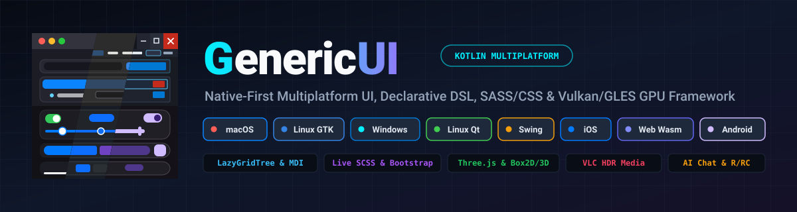

<p align="center">
  
</p>

# GenericUI

**GenericUI** (`com.nexustools.genericui`) is a **Native-First, True Cross-Platform UI, Docking, Hybrid Responsive Layout, Image, Media, & GPU Framework** built with **Kotlin Multiplatform (KMP)**.

Designed to power professional desktop, mobile, tablet, and web applications from a **single `commonMain` source set**, GenericUI eliminates the multi-hundred-megabyte RAM and CPU overhead of Electron/NW.js on desktop while providing 100% shared application logic across **Windows (Win32 / `ComCtl32 v6`)**, **macOS (AppKit)**, **Linux (GTK4 & KDE KF6)**, **Java/JVM (Swing/AWT)**, **Android**, **iOS (UIKit)**, **iPadOS (UIKit / UIWindowScene / Stage Manager)**, and **Web (HTML5 DOM / WebGL2 / WebGPU)**.

---

## Core Architectural Pillars

1. **Zero-Boilerplate Single-`commonMain` Architecture (`@MainAppFragment` & `@AppFragment`)**
   Consumer applications write all UI, state, and business logic in `src/commonMain/kotlin` by annotating their root fragment with [`@MainAppFragment`](./common/src/commonMain/kotlin/com/nexustools/genericui/component/fragment/MainAppFragment.kt) and secondary screens with [`@AppFragment`](./common/src/commonMain/kotlin/com/nexustools/genericui/component/fragment/AppFragment.kt). At build time, the `:gradle-plugin` automatically generates all 9 platform launchers (`WindowsLauncher`, `MacosLauncher`, `GtkLauncher`, `KdeLauncher`, `SwingLauncher`, `IosLauncher`, `IpadosLauncher`, `WebLauncher`, and 1:1 Android `AppCompatActivity` classes), wires extension factories automatically (zero-stub fail-fast registries + `defaultPlatformMediaControlsFactory()`), and resolves target-specific overrides using deterministic [`AppTarget`](./common/src/commonMain/kotlin/com/nexustools/genericui/enums/system/AppTarget.kt) specificity (`6` Single Backend $\rightarrow$ `5` `LINUX_COMMON` / `IOS_COMMON` $\rightarrow$ `4` `NATIVE_DESKTOP_COMMON` $\rightarrow$ `3` `DESKTOP_COMMON` / `MOBILE_COMMON` $\rightarrow$ `2` `APPLE_COMMON` / `JVM_COMMON` $\rightarrow$ `1` `SYSTEM_COMMON` $\rightarrow$ `0` `COMMON`).
2. **Command-Line Arguments on System Targets (`FragmentBundle`)**
   On all 8 system targets (`Windows`, `MacOS`, `Gtk`, `Kde`, `Swing`, `Android`, `IOS`, `IPadOS`), the generated launcher captures process command-line arguments (`Array<String>`) and injects them into the startup [`FragmentBundle`](./common/src/commonMain/kotlin/com/nexustools/genericui/component/fragment/FragmentBundle.kt) passed to `@MainAppFragment.onCreate(savedInstanceState: FragmentBundle?)`—accessible via `hasCommandLineArgs()`, `getCommandLineArgs()`, `getCommandLineArgsArray()`, and `putCommandLineArgs(...)`.
3. **1:1 Android `AppCompatActivity` Generation, `FragmentHostFragment`, `FragmentHostSystem`, `<genericui:app>`, & `<genericui:fragment>`**
   - **Android 1:1 Activities**: On `:mobile` (`androidTarget`), every `@MainAppFragment` and `@AppFragment` generates a dedicated `AppCompatActivity` subclass (`<FragmentName>Activity : GenericUiFragmentActivity()`) registered in the generated `AndroidManifest.xml`, mapping `launchFragment(FragmentClass, LaunchArgs)` and [`FragmentLaunchMode`](./common/src/commonMain/kotlin/com/nexustools/genericui/enums/fragment/FragmentLaunchMode.kt) (`SAME_WINDOW`, `CLEAR_TASK`, `NEW_WINDOW`, `NEW_PANEL_WINDOW`, `NEW_DIALOG_WINDOW`) to native Android `Intent`s.
   - **Canonical `<genericui:app>` & `<genericui:fragment>` Custom Element Tags**: On `:web`, `<genericui:app>` is the root application DOM element (with zero `<link>`, `<style>`, or `<script>` tags injected inside `<genericui:app>`; all stylesheets and scripts are mounted strictly in `<head>` and deduplicated against HTML template links), and `<genericui:fragment>` (`htmlTag = "genericui:fragment"`) is the canonical custom element tag for all `Fragment` subclasses (`Fragment`, `ScrollFragment`, `FragmentHostFragment`).
   - **In-Window Navigation (`FragmentHostFragment` & `FragmentHostSystem`)**: [`FragmentHostFragment`](./common/src/commonMain/kotlin/com/nexustools/genericui/component/fragment/helper/FragmentHostFragment.kt) and [`FragmentHostSystem`](./common/src/commonMain/kotlin/com/nexustools/genericui/component/fragment/helper/FragmentHostSystem.kt) provide animated in-window fragment stacks with [`FragmentTransitionSpec.FadeExpandShrink`](./common/src/commonMain/kotlin/com/nexustools/genericui/component/fragment/helper/FragmentTransitionSpec.kt) (and `SlideHorizontal`, `Crossfade`), optional Back/Forward/custom navigation buttons in the `TitleBar` or `Navbar` via [`FragmentNavigationChromeConfig`](./common/src/commonMain/kotlin/com/nexustools/genericui/component/fragment/helper/FragmentNavigationChromeConfig.kt), and automatic Web URL `#hash` + `window.history.state` synchronization.
4. **`IWindow` (`alwaysOnTop`, Client-Viewport `aspectRatio`) & `TitleCapabilities` Single-Placement Chrome Rules**
   [`TitleBar`](./common/src/commonMain/kotlin/com/nexustools/genericui/window/TitleBar.kt) and [`MenuBar`](./common/src/commonMain/kotlin/com/nexustools/genericui/component/shell/MenuBar.kt) are declarative instruction descriptors inspected via [`TitleCapabilities`](./common/src/commonMain/kotlin/com/nexustools/genericui/window/TitleCapabilities.kt) (`window.titleCapabilities`) and **never** rendered in two places simultaneously:
   - **`:desktop` (`Windows`, `Gtk`, `Kde`, `Swing`)**: Rendered once in the native window frame/chrome (replacing standard Win32 caption chrome when custom controls are present).
   - **`:desktop` (`MacOS`)**: `MenuBar` attaches to the global top-of-screen macOS system menu bar (`NSApplication.sharedApplication.mainMenu`) while `TitleBar` configures `NSWindow` / `NSToolbar`.
   - **`:mobile` (`Android`, `IOS`, `IPadOS`)**: Rendered as a native top `Navbar` (`MaterialToolbar` on Android; `UINavigationBar` on iOS/iPadOS) **only** when a `TitleBar` or `MenuBar` is set (on iPadOS `MenuBar` also populates `UIMenuSystem.mainSystem`); omitted for full-bleed content otherwise.
   - **`:web`**: Title text updates `document.title` (browser tab title) with `supportsCustomTitleBar = false`, while in-viewport `Navbar` rendering is opt-in.
   - **Window Controls (`alwaysOnTop` & Client-Viewport `aspectRatio`)**: [`IWindow`](./common/src/commonMain/kotlin/com/nexustools/genericui/window/IWindow.kt) / `Window` / `genericui { window { ... } }` support `isAlwaysOnTop` / `setAlwaysOnTop(...)` (`PanelWindow` defaults to `alwaysOnTop = true` when unset) and optional client-viewport `aspectRatio(width, height)` / `setAspectRatio(...)` locking, applied only while `state == WindowState.NORMAL && !isFullscreen()` and left unconstrained when maximized or fullscreen ([`docs/fragments-and-windows.md`](./docs/fragments-and-windows.md)).
5. **Three-Tier Resources, Scoped `R` Classes (`ResourceID`, `ResourceTable`), Apple Icons, Precompiled `Resource.style`, & `CssCustomCursor`**
   Place assets in `src/commonMain/resources/` (`drawable/`, `styles/*.scss`, `values/strings.xml`, `values/colors.xml`, `raw/`, `font/`, `xml/`, `menu/`, `layout/`) across `:common`, extensions, and consumer apps. Every module compiles isolated scoped `R.kt` / `RC.kt` / `Resource.kt` / `GeneratedResourceRegistry.kt` files (`com.nexustools.genericui.res.R` `0x7e`, extension packages such as `com.nexustools.genericui.ext.overlay.res.R` `0x60..0x7d`, and consumer `<appPkg>.res.R` `0x7f`) registered into `ResourceTable` and delivered in **3 backend tiers**:
   - **Tier 1 — Hierarchical Single-Blob (`:web`, `:desktop` Swing JAR, & Apple `.app` folder references)**: Preserves canonical relative paths `gui/...` (`:common`), `gui/ext/<extcat>/<ext>/...` (extensions), and `app/...` (consumer app), serving `./serviceworker.js` at web root (outside `gui/`) and resolving via `WebResourceResolverImpl` / `SwingResourceResolverImpl` (`ClassLoader.getResourceAsStream`).
   - **Tier 2 — Flat Single-Blob (`:mobile` Android `res/` & Apple `Assets.xcassets`)**: Emits `ResourceID.flatName` (`gui_*`, `gui_ext_*`, `app_*`) complying with `aapt2` and Xcode Asset Catalog naming rules (`AndroidResourceResolverImpl`, `AppleResourceResolverNativeImpl`).
   - **Tier 3 — Prefix-Free Native Binary/Shared-Library Embedding (`Windows`, `macOS`, `Linux GTK4`, `Linux KDE`)**: `GenericUiNativeResourceEmbedder` compiles resources into Win32 `RT_RCDATA`, macOS Mach-O `__TEXT,__const`, and Linux ELF `.rodata` keyed by `<binary_or_library.so|dylib|dll>:<resource_path>_<resource_name>_<ext>` (`ResourceID.nativeResourceKey`) with lookup symbols `genericui_res_lookup_genericui`, `genericui_res_lookup_<group>`, and `genericui_res_lookup_app` (`WindowsResourceResolverImpl`, `MacosResourceResolverImpl`, `LinuxResourceResolverImpl`).
   - **Apple Icon Pipeline (`appleIcon`, `macIcon`, `iosIcon`, `ipadosIcon`)**: Generic `app.icon` / `appIcon` inputs without an Apple-specific override automatically get Chrome-style **rounded white squircle wrapping** on macOS (`GenericUiAppleIconTileComposer` at build time + `AppleIconTileComposer` / `MacosNativeWindowHost.composeRuntimeDockIconBuffer` guarded by `!isAlreadyWrappedAppleSquircleIcon(...)`) and **full-bleed white-backed AppIcon framing** on iOS/iPadOS ([`docs/resources.md`](./docs/resources.md)). Menu-bar tray icons (`tray_icon_png` / `tray_icon_svg`) remain **unwrapped** (`wrapInAppleTile = false`) and embedded inside the signed Mach-O binary.
   - **Custom Cursors (`CssCustomCursor`)**: [`CssCustomCursor`](./common/src/commonMain/kotlin/com/nexustools/genericui/style/css/CssCustomCursor.kt) accepts PNG `ResourceID`s, SVG `ResourceID`s, inline SVG markup, or `ImageBuffer`s with `(hotspotX, hotspotY)` and a `CssCursor` fallback, automatically translating to `.cur` on Windows (`WindowsCurCodec`) and `NSCursor` on macOS (`MacosCursorTranslator`).
6. **Zero-Allocation Strongly-Typed `ComponentStyle` (`getStyle()`), `ComponentBootstrap` (`getBootstrap()`), Pure Retained Native Widgets, Strictly `Button`-Only `BootstrapType`, & Precompiled `.scss` Stylesheets**
   - **Zero String-Keyed Style APIs & Bitmask-Driven `ComponentStyle`**: [`ComponentStyle`](./common/src/commonMain/kotlin/com/nexustools/genericui/style/css/ComponentStyle.kt) (`component.getStyle()`) and [`ComputedStyle`](./common/src/commonMain/kotlin/com/nexustools/genericui/style/css/ComputedStyle.kt) store 100% strongly-typed properties tracked via two 64-bit bitmasks (`activePropertiesBitmaskLow` / `activePropertiesBitmaskHigh`, `importantBitmaskLow` / `importantBitmaskHigh` via [`CssProperty`](./common/src/commonMain/kotlin/com/nexustools/genericui/style/css/CssProperty.kt)) with **zero** `Map<String, String>` allocation or CSS string formatting on non-web backends. String-keyed style APIs (`setStyleProperty(String, String)`, `getStyleProperty`, `removeStyleProperty`, `clearStyleProperties`, `inlineStyle`, `setRawDeclaration`, `getRawDeclaration`, `fromDeclarations`, `rawDeclarations`) are strictly prohibited in `:common`. On `:web`, [`WebCssStyleTranslator`](./web/src/commonMain/kotlin/com/nexustools/genericui/web/style/WebCssStyleTranslator.kt) translates `ComponentStyle` and `ComponentBootstrap` into DOM CSS strings automatically.
   - **`component.getBootstrap(): ComponentBootstrap`**: Encapsulates all Bootstrap 5 properties and `Bootstrap*` utility enums ([`ComponentBootstrap`](./common/src/commonMain/kotlin/com/nexustools/genericui/style/bootstrap/ComponentBootstrap.kt): `BootstrapType` defaulting to `BootstrapType.NONE` / `BootstrapType.None`, `BootstrapSize`, `BootstrapWidth`, `BootstrapHeight`, directional `SpacingScale` margins/paddings/gaps including `SpacingScale.AUTO`, `BootstrapBorderWidth`, `BootstrapOpacity`, `BootstrapFontSize`, `BootstrapLineHeight`, `BootstrapFlexGrow`, `BootstrapFlexShrink`, `BootstrapFloat`, `BootstrapUserSelect`, `BootstrapPointerEvents`, `BootstrapObjectFit`, `BootstrapAspectRatio`, `BootstrapVisibility`).
   - **System Backend Typography, Strictly `Button`-Only Control `BootstrapType`, & Aesthetic Style Restraints**: On all 8 non-web system targets (`Windows`, `MacOS`, `Gtk`, `Kde`, `Swing`, `Android`, `IOS`, `IPadOS`), standard UI controls mount genuine OS widgets directly and cannot have their aesthetic styles redesigned to look alien without `:extensions:ui:alien` (or `StyledComponent`, `StyledContainer`, `StyledButton`, `Composite`, `StyledSlider`):
     - **Text / Typography Elements (`Label`, `Text`, `Heading`, `Blockquote`, `CodeBlock`, `MarkdownView`)**: Honor typography and text-color properties (`color` / `textColor`, `fontFamily`, `fontSize`, `fontWeight`, `fontStyle`, `lineHeight`, `letterSpacing`, `textAlign`, `textDecoration`, `textTransform`, `textOverflow`, `whiteSpace`, `wordBreak`, plus `bootstrap.textColorType`, `bootstrap.fontSize`, `bootstrap.fontWeight`, `bootstrap.textAlignment`).
     - **Strictly `Button`-Only Control `BootstrapType` (`Button` & `Button` Subclasses ONLY: `Button`, `IconButton`, `ToggleButton`, `FloatingActionButton`, `StyledButton`)**: Among control components, **ONLY `Button` and subclasses of `Button`** support `BootstrapType` (`bootstrap.type`, `bootstrap.backgroundType`, `bootstrap.outline`). Standard native buttons ignore aesthetic `ComponentStyle` skinning/typography overrides, whereas `StyledButton` honors both `BootstrapType` and full CSS/SCSS styling.
     - **Non-`Button` Controls & Standard Containers (`DropdownButton`, `SplitDropdownButton`, `ProgressBar`, `Spinner`, `StyledSlider`, `Composite`, `CheckBox`, `RadioButton`, `Switch`, `Select`, `ComboBox`, `DatePicker`, `TimePicker`, `ColorPicker`, `SearchField`, `NumberField`, `TextField`, `TextArea`, `RangeSlider`, `Slider`, `TabContainer`, `Tab`, `ScrollView`, `Container`, etc.)**: **`DropdownButton`, `SplitDropdownButton`, `ProgressBar`, `Spinner`, `StyledSlider`, `Composite`, and all other non-`Button` control components MUST NOT support `BootstrapType`**, and standard controls/containers ignore aesthetic `ComponentStyle` skinning and typography overrides on system backends. Form subclasses (`ComboBox`, `DatePicker`, `TimePicker`, `ColorPicker`, `SearchField`, `NumberField`, `SplitDropdownButton`) stamp `data-control-variant` for specialized native widget selection.
     - **Bootstrap-Specific Non-Control Classes (`Badge`, `Alert`, `Banner`, `Toast`, `Card`, `ListGroup`, `ListGroupItem`, `Jumbotron`, `Well`)**: DO support semantic **`BootstrapType`** (`type`, `backgroundType`, `textColorType`, `borderType`) across all **9 backends**, mounting custom native semantic widgets styled via `:system`'s `SemanticSurfaceStyleResolver` (`SemanticSurfacePaintSpec`).
     - **[`StyledContainer`](./common/src/commonMain/kotlin/com/nexustools/genericui/component/layout/StyledContainer.kt), [`StyledButton`](./common/src/commonMain/kotlin/com/nexustools/genericui/component/action/StyledButton.kt), `StyledComponent`, `Composite`, & `StyledSlider` (and `:extensions:ui:alien`)**: Mount dedicated custom native widgets powered by shared `:system` (`StyledWidgetVisualController`), `:apple` (`AppleStyledSurfaceHelper`, `AppleBackdropFilterController`), `:jvm` (`JvmBackdropCapturePlanner`), `linux/style` (`LinuxStyledSurfaceHelper`, `LinuxBackdropFilterController`), and `nativeDesktopMain` (`DesktopContainerLayoutController`, `DesktopStyledWidgetDelegate`) helpers honoring full CSS/SCSS styling across all 9 backends, including gradients (`GradientStopNormalizer`) and all 10 `CssFilter` / `backdrop-filter` ops (`FastBackdropBlurKernel`, `CssFilterColorMatrix`) under `AestheticStylePolicy`. `Composite : AbstractComponent` (NOT `AbstractContainer`) hides internal children while realizing via `StyledContainerNativeImpl` with zero custom `*NativeImpl`, `StyledComponent` provides a pure stylesheet-driven non-container visual leaf (`StyledComponentNativeImpl`), and `StyledSlider : Composite` composes track `StyledButton` (`.styled-slider-track`), `$accent`-colored progress `StyledComponent` (`.styled-slider-progress`), and knob `StyledButton` (`.styled-slider-knob`) — without supporting `BootstrapType`.
     - **`style.scss`-First Rules, Raw Library `theme.scss` Templates, `.hidden` + `Animator` `@keyframes`, & Proximal `position: relative` Parity**: Static visuals, interactive state visuals (`:hover`, `:focus`, `:active`, `:disabled`), layouts (`position`, `top`, `transform`, `z-index`, `pointer-events`, `cursor`), and theme-derived colors live in `style.scss` / `theme.scss` for `:common`, extensions, and consumer apps (with zero direct component styles in Kotlin beyond runtime-dynamic `%` values, and zero class/id/app fast-paths). GenericUI libraries (`:common`, `:extensions:*`) are prebuilt/generic and NEVER compile or integrate resulting `theme.scss` code into library `.jar`/`.klib` artifacts — they package only raw uncompiled `src/commonMain/resources/styles/theme.scss` templates inside `META-INF/genericui/themes/<scopeId>.scss` and `META-INF/genericui/module-resources/<scopeId>.json`, and ONLY the consumer application's `:gradle-plugin` build extracts those templates, substitutes its `genericui { theme { ... } }` settings from `build.gradle.kts`, and integrates `GenericUiGeneratedThemeStyleSheet` (`:system`) and `gui/genericui-theme.css` (`:web`) solely into the consumer application (with `ThemeStyleSheetRegistry` for runtime updates). `:system` drives `@keyframes` (such as `.hidden` overlay fade-in/out) via VBlank-synced `Animator` (`SystemCssAnimationController`) and resolves `position: absolute` against the proximal `position: relative` ancestor (else `Window`) with CSS `transform: translate(...)`, `z-index`, and `pointer-events: none` click-through parity across all 9 backends.
   - **Unmodified Native Push Button (`BootstrapType.NONE && !outline`) vs. Custom Bootstrap Button Widgets / Mobile-Swing Tinting**:
     - When `(type == null || type == BootstrapType.NONE) && !outline` on `Button` (and on any non-`Button` native control): Mounts the 100% unmodified genuine native OS child widget (`Win32 ComCtl32 v6` `HWND`, AppKit `NSButton`/`NSControl`, GTK4/Libadwaita `GtkButton`/`GtkWidget*`, KDE `KF6` + `Breeze` `QPushButton`/`QWidget*`, Swing Look-And-Feel, Material 3 on Android, UIKit on iOS/iPadOS).
     - When `BootstrapType != BootstrapType.NONE` or `outline == true` on **`Button` / `Button` subclasses (`Button`, `IconButton`, `ToggleButton`, `FloatingActionButton`)**: On all 4 native desktop backends, `DesktopButtonNativeImpl` swaps live to a dedicated custom toolkit Bootstrap button widget (`"GenericUIBootstrapButtonW"`, `MacosBootstrapButtonControl`, `GtkBootstrapButtonWidget`, `KdeBootstrapButtonWidget`); on Swing, Android, and iOS/iPadOS, native buttons tint bevel-preserving control graphics via `ThemeConfig` (`JvmControlTintPixelUtil` / `IosControlTintRenderUtil`).
   - **Strict User CSS Class Isolation & `:extensions:ui:dsl` Isolation**: `addClass`, `removeClass`, `hasClass`, `getClasses()`, and `getClass()` operate strictly on user-added custom classes (`customClasses`), keeping enum-added classes 100% invisible. DSL builder functions (`style { ... }`, `bootstrap { ... }`, `important { ... }`) live exclusively in `:extensions:ui:dsl` ([`DslStyleAndBootstrapBuilders.kt`](./extensions/ui/dsl/src/commonMain/kotlin/com/nexustools/genericui/ext/dsl/DslStyleAndBootstrapBuilders.kt)) and are never part of `:common`.
   - **Build-Time `.scss` Precompilation, Local NPM Bootstrap Packaging, `Resources.*` IDs, & `IApplication.addStyleSheet` / `removeStyleSheet`**: `.scss` files in `src/commonMain/resources/**` compile to `Resource.style.<name>` (`R.style.<name>`) backed by typed `PrecompiledStyleSheet` (`CompiledStyleRule`) on non-web and `.css` on `:web`. Instead of a CDN, `:web` packages local NPM Bootstrap (`npm i bootstrap`) bundling `bootstrap.min.css` and `bootstrap.bundle.min.js` directly into resources, and `Resources` provides built-in `Resources.BOOTSTRAP`, `Resources.BOOTSTRAP_JS`, `Resources.BOOTSTRAP_ICONS`, and `Resources.GENERICUI` `ResourceID`s that are mounted in `<head>` (deduplicated against HTML template `<link>` tags, with zero `<link>`, `<style>`, or `<script>` tags inside `<genericui:app>`) and can be removed from an `Application`'s stylesheets via `app.removeStyleSheet(Resources.BOOTSTRAP)` or `app.removeStyleSheet(Resources.GENERICUI)`. `IApplication.addStyleSheet` and `IApplication.removeStyleSheet` live on `IApplication` (NOT `IFragment`), with automatic `app.addStyleSheet(...)` injection in Gradle-generated `main()` when `styles { globalStyleSheet = "..." }` is configured in `build.gradle.kts`.
7. **`IApplication`, `ThemeMode.AUTO` (Default) 9-Target OS Theme Detection, Unified Cross-Platform `ThemeConfig`, `getPreferenceStore()`, & `BackendTarget` Group Checks**
   [`IApplication`](./common/src/commonMain/kotlin/com/nexustools/genericui/component/shell/IApplication.kt) (`app.backendTarget`) exposes [`BackendTarget`](./common/src/commonMain/kotlin/com/nexustools/genericui/enums/system/BackendTarget.kt) (`Windows`, `MacOS`, `Gtk`, `Kde`, `Swing`, `Android`, `IOS`, `IPadOS`, `Web`) with multi-target group checks (`isSystem`, `isDesktop`, `isNativeDesktop`, `isLinux`, `isMobile`, `isApple`, `isIosFamily`, `isUnix`, `isPosix`, `isNative`, `isJvm`, `isTouchPrimary`, `isBrowser`), application-scoped preferences (`app.getPreferenceStore()`, also accessible on any fragment via `fragment.getPreferenceStore()`), and unified theming (`setThemeMode(ThemeMode)`, `getThemeMode()`, `getResolvedTheme()`, `setThemeConfig(ThemeConfig)`, `getThemeConfig()`, `setThemeColor(String?)`) defaulting to **[`ThemeMode.AUTO`](./common/src/commonMain/kotlin/com/nexustools/genericui/enums/ui/ThemeMode.kt)** (`AUTO`, `DARK`, `LIGHT`) with live 9-target OS dark/light theme detection, [`ThemeConfig`](./common/src/commonMain/kotlin/com/nexustools/genericui/style/theme/ThemeConfig.kt) / [`ThemeColorSet`](./common/src/commonMain/kotlin/com/nexustools/genericui/style/theme/ThemeColorSet.kt) / [`BootstrapColorPalette`](./common/src/commonMain/kotlin/com/nexustools/genericui/style/color/BootstrapColorPalette.kt) semantic palette overrides, automatic Android Material XML generation (`res/values/genericui_theme_colors.xml`, `res/values/themes.xml`, `res/values-night/themes.xml` with `@style/Theme.GenericUI.App`), and `:web` build-time pre-generated `gui/genericui-theme.css` (`<link id="genericui-build-theme-css">`) + runtime `<style id="genericui-runtime-theme-css">` injection + Bootstrap `data-bs-theme="light|dark"` switching.
8. **7 Hybrid Responsive Layout Components, Fragment Helpers, & `TabbedFragment` Across Desktop, Tablet, Mobile, & Web**
   GenericUI includes 7 responsive layout systems and matching `*Fragment` helpers plus multi-tab `TabbedFragment` chrome adaptation (documented in [**`docs/layouts-and-helpers.md`**](./docs/layouts-and-helpers.md) and [**`docs/fragments-and-windows.md`**](./docs/fragments-and-windows.md)):
   - `HybridColumnLayout` & `HybridColumnFragment` (`HybridColumnSpec`, `HybridFoldMode`, `HybridTabPlacement`, `DynamicFullscreenController`, `HybridFullscreenPolicy` [`DISABLED` default])
   - `DockWorkspace` & `DockWorkspaceFragment` (full multi-panel dock workspace on desktop/tablet/wide web that automatically converts `LEFT`, `RIGHT`, `TOP`, `BOTTOM` docks into off-canvas edge swipe-out drawer overlays on small-screen mobile and narrow web viewports via `DockMobileDrawerPolicy`)
   - `AdaptiveNavigationScaffold` & `AdaptiveNavigationScaffoldFragment` (`Sidebar` $\leftrightarrow$ `NavigationRail` $\leftrightarrow$ `BottomNavigationBar`)
   - `ResponsiveMasterDetailLayout` & `ResponsiveMasterDetailFragment` (2/3-pane split $\leftrightarrow$ compact drill-down stack)
   - `HybridSplitNavigationLayout` & `HybridSplitNavigationFragment` (top `TabLayout` $\leftrightarrow$ bottom `BottomNavigationBar`)
   - `CollapsibleBottomDockLayout` & `CollapsibleBottomDockFragment` (main content + collapsible mini-player/bottom dock)
   - `ResponsiveBentoGridLayout` & `ResponsiveBentoGridFragment` (`BentoGridItemSpec` responsive 12/6/1-column dashboard grid)
   - `TabbedFragment` (`TabbedChromeMode.AUTO`, `DESKTOP_BROWSER_TABS` on desktop/tablet/wide web, and Chrome/Firefox-style `MOBILE_SWITCHER_PILL` with `[N]` tab-count badge & full-screen tab switcher overlay on compact `< 600dp` viewports, backed by per-tab `FragmentHostSystem` instances with `maxHistoryPerTab = 50`)
9. **100% Async Non-Blocking Coroutine I/O (`ByteOrder`, `ByteBuffer`, `ReadableByteBuffer`, `WritableByteBuffer`, `Readable`, `Writable`, `Stream`, `IFileSystem`), Streaming Binary Codecs (`BinaryJson`, `BinaryPlist`, `PreferenceObjectCodec`), Zero-Parsing `Database`, Networking (`Network`, `TcpSocket`, `UdpSocket`, `HttpConnection`, `HttpClient`, `SocketIoClient`), & Offline PWA Support (`isOffline`)**
   All stream, file system, database, resource streaming, and network operations are **100% asynchronous, non-blocking Kotlin `suspend` functions** (documented in [**`docs/utils.md`**](./docs/utils.md)):
   - **`ByteOrder`, `ByteBuffer`, `ReadableByteBuffer : Readable`, `WritableByteBuffer : Writable`, `Readable`, `Writable`, `Stream : Readable, Writable`, & `StreamUtil`**: Multi-endian binary buffer manipulation (`ByteOrder.BIG_ENDIAN`, `ByteOrder.LITTLE_ENDIAN`, `readByte/Short/Int/Long/Float/Double(order)`, `writeByte/Short/Int/Long/Float/Double(value, order)`, `toString(encoding = "utf8")`), in-memory `ReadableByteBuffer` & `WritableByteBuffer` stream adapters, NodeJS-like async streams (`read`, `readBuffer`, `readAllBytes`, `readAllText`, `write`, `writeText`, `flush`, `end`, `pipe`, `StreamUtil.pipeline`, `StreamUtil.copy`), and `suspend fun Resource.openReadable(resId): Readable?` / `openStream(resId): Readable?` (`ResourceID.openReadable()` / `openStream()`).
   - **Streaming Binary & Preference Codecs (`BinaryJson`, `BinaryPlist`, `PreferenceObjectCodec`)**: Direct streaming `encode(value, writable: Writable)` / `encodeElement(element, writable: Writable)` and `suspend fun decode(readable: Readable)` / `suspend fun decodeElement(readable: Readable)` over any `Readable` or `Writable` stream (`ReadableByteBuffer`, `WritableByteBuffer`, files, or network sockets).
   - **`IFileSystem` (`FileSystem`, `UserDirectory`, `ConfigDirectory`, `CacheDirectory`) & `FileSystemAvailability`**: Shared contract (`isAvailable()`, `resolve(...)`, `openDatabase(name, version)`, `suspend fun read(path): ByteBuffer?`, `suspend fun write(path, buffer/bytes/readable, append)`, `suspend fun openReadable(path): Readable?`, `suspend fun openWritable(path, append): Writable`). On system targets, `ConfigDirectory` and `CacheDirectory` delegate `IFileSystem` operations to `FileSystem` (`FileSystem` has **no `indexdb://` scheme**). On `:web`, `ConfigDirectory` and `CacheDirectory` use browser `window.indexedDB` **directly** (`"genericui_user_dirs:<appName>"`, stores `"config"` and `"cache"`) **without** using `Database`, while `PreferenceStore` (`put` / `get`) uses `window.localStorage` with the `"genericui:"` key prefix.
   - **`Database` (`com.nexustools.genericui.util.Database`)**: Zero-parsing enum/class-based structured query & filter AST (`DatabaseTableSchema`, `DatabaseColumnSpec`, `DatabaseColumnType`, `DatabaseRecord`, `DatabaseValue`, `DatabaseQuery`, `DatabaseFilter`, `DatabaseComparisonOp`, `DatabaseLogicalOp`, `DatabaseSortSpec`, `DatabaseSortDirection` — **no raw SQL or string-parsed queries**), backed by **`libsqlite3`** (`windows`, `macos`, `gtk`, `kde`, `ios`, `ipados`), `org.xerial:sqlite-jdbc` (`swing`), `androidx.sqlite:sqlite-ktx` (`android`), and browser `window.indexedDB` (`"genericui_db:<databaseName>:<filePath>"` with `"tbl:<tableName>"` stores).
   - **`Network` (`openTcpSocket`, `openUdpSocket`, `TcpSocket : Stream`, `UdpSocket : Stream`), `HttpConnection : Stream` (`HttpRequest : Writable`, `HttpResponse : Readable`), `HttpClient`, & `SocketIoClient`**: Non-blocking duplex `Stream` TCP/UDP sockets (`Network.supportsTcp()` / `supportsUdp()` / `supportsMulticastUdp()` returning `false` on `:web`), full async `HttpClient` (`openConnection` returning `HttpConnection : Stream` with `request: HttpRequest` (`Writable`) and `awaitResponse(): HttpResponse` (`Readable`)), and Engine.IO v4 / Socket.IO v4 `SocketIoClient` (`SocketIoClient.io(url, options)`).
   - **Offline State (`IApplication.isOffline`), `:web` Data-URL Preloader (`DataUrlCodec`), & `Window` Resize Propagation**: Live `app.isOffline` / `isOnline` + `addOfflineListener`, 5-stage Web resource preloader (`"Initializing"`, `"Loading Resources"`, `"Loading Application"`, `"Error"`, `"Ready"`) with `manifest.webmanifest` (`"offline_enabled": true`, `"resources": [...]`), `loader.js` offline cache pre-seeding, and web-root `./serviceworker.js` (plus optional `${resolvedBase}.sw.js|wasm` service worker runtime scripts when `:extensions:system:serviceworker` is enabled), and automatic `Window` resize propagation (`onResize` & `onConfigurationChanged`) through `FragmentContainer` $\rightarrow$ `FragmentHostFragment` / `AlienFragmentHostFragment`.

---

## Consolidated 51-Project Module & Extension Architecture

Every `.kt` file across all **51 Gradle subprojects** strictly adheres to the **1 Public Class / Interface / Enum Per File** standard.

### A. Core & Shared Platform Backend Modules

| Module | Source Sets / Targets | Responsibility & Native Backing |
| :--- | :--- | :--- |
| **`:common`** | `commonMain` (all 9 backends; shares `jvmAndAndroidMain`) | Platform-agnostic UI widgets, `NativeImpl` contracts, `IWindow` (`isAlwaysOnTop`, windowed `aspectRatio`), `AppleIconTileComposer`, `TitleCapabilities`, `IApplication`, `ThemeMode` (`AUTO`, `DARK`, `LIGHT`), `BackendTarget`, `AppTarget`, `IFragment`, `@MainAppFragment`, `@AppFragment`, `FragmentBundle`, **7 Hybrid Responsive Layouts**, `DockWorkspace`, `PanelWindow`, true lazy views, `FileBrowserDialog`, `PreferenceStore`, `Resource`/`ResourceID`/`ResourceResolver`, **Full Image API**, `AbstractCanvas`, `ComponentStyle`, `ComponentBootstrap`, `CssCustomCursor`, and `PrecompiledStyleSheet`. |
| **`:system`** | `commonMain` (all 8 OS targets excluding Web) | Blink-style CSS matching & layout engines (`BlinkStyleEngine`, `BrowserLayoutEngine`, `IntrinsicSizeMeasurer`), `StyledWidgetVisualController`, `SemanticSurfaceStyleResolver`, and `SystemStorageKeyHelper`. |
| **`:jvm`** | `jvmSharedMain` (`jvm` + `android`) | Shared Java/JDK 11 module ([`docs/jvm.md`](./docs/jvm.md)): `JvmIoExecutor`, `JvmUiThreadDispatcherBase`, `JvmFileSystemBase`, `JvmDatabaseBase`, `JvmResourceResolverBase`, NIO/HTTP/WebSocket client, `JvmBackdropCapturePlanner`, and `JvmControlTintPixelUtil`. |
| **`:apple`** | `appleMain` (`macosArm64`, `iosArm64`, `iosSimulatorArm64`) | Shared Darwin module ([`docs/apple.md`](./docs/apple.md)): `AppleStyledSurfaceHelper`, `AppleBackdropFilterController`, `CoreFoundation`, `Foundation`, `Security` TLS SNI, `Network` (`NWConnection`, `NWPathMonitor`), `ImageIO`, `CoreGraphics` (`AppleSvgCoreGraphicsRasterizer`), `UniformTypeIdentifiers`, `UserNotifications`, `libsqlite3` (`AppleDatabaseNativeImpl`), and `ApplePreferenceStoreNativeImpl`. |
| **`:desktop`** | `commonMain`, `nativeDesktopMain`, `mingwMain`, `macosMain`, `linuxMain`, `jvmMain` | Consolidated 5-target retained-widget desktop backends (`Windows` child `HWND`/`ComCtl32 v6`/`Win32ControlMessageRouter`/`Win32LayeredStageHostHwnd`/Direct2D/ANGLE/Vulkan/`WindowsCurCodec`; `MacOS` flipped AppKit `NSView`/`MacosWindowRootView`/`MacosHostWindow`/`MacosCursorTranslator`/MoltenVK/runtime Dock squircle wrapping; strictly isolated **`Gtk`** GTK4/Libadwaita/GSK & **`Kde`** `KF6` + `Breeze` on Qt6 alien `QWidget*` + shared XDG/`linux/style`/`LinuxSqliteDatabaseNativeImpl`/`LinuxResourceResolverImpl`; `Swing` AWT/Swing + optional LWJGL3). Zero VLC/media code. |
| **`:mobile`** | `commonMain`, `androidMain`, `iosMain` (`ios/*` + `ipados/*`) | Consolidated 3-target mobile backends: **Android** (1:1 `AppCompatActivity`, Material 3, `RecyclerView`, SAF, `:jvm` services), **iOS** (`IosLauncher`, UIKit `UIDeviceFamily = 1`, `CADisplayLink`, MoltenVK), and **iPadOS** ([`docs/ipados.md`](./docs/ipados.md) — `IpadosLauncher`, `IpadosSceneDelegate` multi-window Stage Manager / Split View, `IpadosWindowImpl` aspect clamping, `UIMenuSystem.mainSystem`, trackpad/keyboard). |
| **`:web`** | `commonMain`, `wasmJsMain`, `jsMain` | `WebLauncher`, Kotlin/Wasm primary + Kotlin/JS fallback via `loader.js`, `<genericui:app>` & `<genericui:fragment>`, local NPM Bootstrap packaging (`Resources.*`), `WebResourceResolverImpl`, `data-bs-theme`, `#hash` + `window.history.state`, and Canvas2D/WebGL2/WebGPU. |
| **`:tests`** | All 10 KMP targets (`common`, `system`, `desktop`, `jvmAndAndroid`, `nativeDesktop`, `mingw`, `macos`, `linux`, `mobile`, `ios`, `web`, `js`, `wasmJs`) | Consolidated **`JestElectricRunner`** UI test framework, headless snapshot utilities (`12 JestElectric*RenderUtil`), and real OS retained-widget visual capture runners (`cacheDisplayInRect:toBitmapImageRep:`, `PrintWindow`, `GtkWidgetPaintable` + `GskRenderer`, `QWidget::render`). |
| **`:gradle-plugin` & `:idea-plugin`** | JVM Gradle & IntelliJ IDEA Plugins | `id("com.nexustools.genericui")` (`genericuiValidateApp`, launcher/Activity/Xcode generation, `@SchemaData` & `@MainServiceWorker`/`@ServiceWorkerMessage` codegen, `GenericUiExtensionContributor` SPI, `compileGenericUiSass`, `compileGenericUiResources`, native binary resource embedding, native desktop shared-library linking with `WindowsCoffObjectPartitioner` & `GenericUiKonanCompilerShim`, and `jni`/`cinterops`/`nativeLibraries` native builds) and IntelliJ New Project / Manage Targets dialogs. |

### B. Categorized First-Party Extension Modules (`:extensions:{graphics,physics,game,media,data,system,ui}:*`)

All **22 extensions** (plus **19 companion `:dsl` modules** across **7** domain categories) are **single consolidated KMP projects**, with **fail-fast zero-stub registries** (`Canvas2DExtension`, `Canvas3DRegistry`, `MediaExtension`, `WebView`, `MediaControlsRegistry` with default real `DefaultPlatformMediaControlsFactory`):

| Category | Extensions & Companion `:dsl` Projects | Responsibility & Key Classes |
| :--- | :--- | :--- |
| **Graphics** | **`:extensions:graphics:gpu`**, **`imageprocessing`**, **`canvas2d`** (+`:dsl`), **`canvas3d`** (+`:dsl`), **`threejs`** (+`:dsl`) | Unified Vulkan (`VKContext`, MoltenVK) + OpenGL ES (`GLContext`, Google ANGLE) contexts; offscreen `GpuImageProcessor`; `Canvas2D`, `CurveEditor`, `Canvas3D`, `ScrollCanvas3D`; Three.js PBR scene graph (`Scene`, `PerspectiveCamera`, `WebGLRenderer`, `OrbitControls`). |
| **Physics** | **`:extensions:physics:box2d`** (+`:dsl`), **`:extensions:physics:box3d`** (+`:dsl`) | Pure KMP 2D & 3D rigid-body physics engines (`World2D`, `Body2D`, Joints, `Box2DDebugDrawer`; `World3D`, `Body3D`, Constraints, `Box3DDebugRenderer`). |
| **Game & Input** | **`:extensions:game:gamepad`** (+`:dsl`), **`engine`** (+`:dsl`), **`engine2d`** (+`:dsl`), **`engine3d`** (+`:dsl`) | Switch Pro/Joy-Con, DualSense/DualShock 4, & Xbox unified controller input + 6-axis `SixAxisSensorFusion` + vendor haptics/triggers/LEDs + zero-config customizable `GamepadUiNavigator` ([`docs/gamepad.md`](./docs/gamepad.md)); dedicated `PlatformGameLogicThread`, VBlank curves/springs/waves, SVG `Skeleton2D` + `TwoBoneIkSolver2D`, `UiStageHost`, `Game2DCanvasHost` (`Box2D`), and `Game3DCanvasHost` (`Three.js` + `Box3D` + `ProceduralHumanoidRig3D`) ([`docs/game-engines.md`](./docs/game-engines.md)). |
| **Media** | **`:extensions:media:media`** (+`:dsl`), **`:extensions:media:mediacontrols`** (+`:dsl`) | Hardware video/audio playback & FFT analysis (`VideoPlayer`, `AudioPlayer`, `AudioAnalyzer`, desktop `libvlc`/`libvlcj`); standalone `:common`-only OS transport controls & keyboard keys (`MediaControlsSession`, auto-wired real `DefaultPlatformMediaControlsFactory` across all targets). |
| **Data** | **`:extensions:data:schema`** (+`:dsl`) | Reflection-free `@SchemaData` codegen (`SchemaExtension`, `<ClassName>SchemaDescriptor.kt`, `GeneratedSchemaRegistrar.kt`), typed schema validation, async field/group evaluation, and auto-generated `SchemaForm` UIs. |
| **System** | **`:extensions:system:serviceworker`** (+`:dsl`) | Cross-platform background `@MainServiceWorker` + `@ServiceWorkerMessage` IPC (`ServiceWorkerExtension`, `ServiceWorker`, `ServiceWorkerChannel`), desktop secondary `serviceworker` tray executables & autostart, Android foreground `<service>`/`BOOT_COMPLETED`, Web `./serviceworker.js` + `${resolvedBase}.sw.js\|wasm`, and honest `isSupported == false` on iOS/iPadOS. |
| **UI & Tooling** | **`:extensions:ui:dsl`**, **`overlay`** (+`:dsl`), **`alien`** (+`:dsl`), **`webview`** (+`:dsl`), **`codeeditor`** (+`:dsl`), **`aichat`** (+`:dsl`), **`pip`** (+`:dsl`) | `kotlinx.html`-style DSL + MVC + `style { }` / `bootstrap { }` builders; domain-agnostic overlays (`OverlayHost`); self-rendered Bootstrap 5.3 `Canvas2D` engine (`IAlien`); multi-process Chromium + `NJS` JIT `WebView` on Desktop (native on Mobile/Web); `IdeCodeEditor`; `AiChatContainer` + `AIChatAgentOrchestrator`; cross-platform Picture-in-Picture (`pip`). |

### C. Per-Backend Native Implementation Matrix: Async `Readable`/`Writable`, `IFileSystem`, `Database`, `Network`, `HttpClient`, `SocketIoClient`, & `isOffline`

| Backend | Async `Readable` / `Writable` & `FileSystem` (`IFileSystem`) | `ConfigDirectory` & `CacheDirectory` (`UserDirectory : IFileSystem`) | `Database` (Zero-Parsing Structured AST) | `Network` (`TcpSocket` & `UdpSocket`) | `HttpClient` | `WebSocket` & `SocketIoClient` | `IApplication.isOffline` & Offline Support |
| :--- | :--- | :--- | :--- | :--- | :--- | :--- | :--- |
| **Windows (`:desktop` `mingwMain`)** | Win32 `CreateFileW` (`FILE_FLAG_OVERLAPPED`) (`FileSystemAvailability.Always`). | `%APPDATA%\<appName>` & `%LOCALAPPDATA%\<appName>\Cache`. | Native C **`libsqlite3`** (`WindowsDatabaseNativeImpl`). | WinSock2 (TCP/TLS & UDP + multicast). | WinHTTP (`WinHttpOpen`, `WinHttpSendRequest`). | WinHTTP WebSocket + Socket.IO v4. | WinINet / `INetworkListManager`. |
| **macOS (`:desktop` `macosMain` + `:apple`)** | `:apple`'s `AppleFileSystemBase` (`NSFileManager`, `dispatch_io_t`). | `~/.config/<appName>` & `~/Library/Caches/<appName>` (`AppleUserDirectoryNativeImpl`). | System **`libsqlite3`** (`AppleDatabaseNativeImpl`). | `:apple` `NWConnection` & BSD UDP (`AppleTcpSocket`/`AppleUdpSocket`). | `:apple` `NSURLSession` (`AppleHttpClientNativeImpl`). | `:apple` `NSURLSessionWebSocketTask` + Socket.IO v4. | `:apple` `NWPathMonitor`. |
| **Linux GTK4 & KDE (`:desktop` `linuxMain`)** | `LinuxPosixFileSystemNativeImpl` async POSIX (`Always`). | XDG (`LinuxXdgConfigDirectoryImpl` / `LinuxXdgCacheDirectoryImpl`). | **`libsqlite3`** (`LinuxSqliteDatabaseNativeImpl`). | POSIX sockets (`LinuxPosixTcpSocketNativeImpl` TLS & `LinuxPosixUdpSocketNativeImpl`). | `libcurl` (`LinuxCurlHttpClientNativeImpl`). | `LinuxRfc6455WebSocketNativeImpl` + Socket.IO v4. | GIO `GNetworkMonitor` (`LinuxGioNetworkMonitorNativeImpl`). |
| **JVM Swing (`:desktop` `jvmMain` + `:jvm`)** | `:jvm`'s `JvmFileSystemBase` + `JvmIoExecutor` (`Always`). | Host OS config/cache dirs (`SwingUserDirectoryNativeImpl`). | **`sqlite-jdbc`** (`SwingDatabaseNativeImpl` : `JvmDatabaseBase`). | `:jvm`'s `JvmTcpSocketNativeImpl` & `JvmUdpSocketNativeImpl`. | `:jvm`'s `JvmHttpUrlConnectionClient`. | `:jvm`'s `JvmRfc6455WebSocketNativeImpl` + Socket.IO v4. | `java.net.NetworkInterface`. |
| **Android (`:mobile` `androidMain` + `:jvm`)** | SAF `ContentResolver` (`WithPermission`) + `:jvm` sandbox (`Always`). | `context.filesDir` & `context.cacheDir` (`AndroidUserDirectoryNativeImpl`). | **`androidx.sqlite:sqlite-ktx`** (`AndroidDatabaseNativeImpl` : `JvmDatabaseBase`). | `:jvm`'s `JvmTcpSocketNativeImpl` & `JvmUdpSocketNativeImpl`. | `:jvm`'s `JvmHttpUrlConnectionClient`. | `:jvm`'s `JvmRfc6455WebSocketNativeImpl` + Socket.IO v4. | `ConnectivityManager`. |
| **iOS & iPadOS (`:mobile` `iosMain` + `:apple`)** | `UIDocumentPickerViewController` (`WithPermission`) + `:apple` sandbox (`Always`). | `Library/Application Support` & `Library/Caches` (`AppleUserDirectoryNativeImpl`). | System **`libsqlite3`** (`AppleDatabaseNativeImpl`). | `:apple` `NWConnection` & BSD UDP. | `:apple` `NSURLSession` (`AppleHttpClientNativeImpl`). | `:apple` `NSURLSessionWebSocketTask` + Socket.IO v4. | `:apple` `NWPathMonitor`. |
| **Web (`:web`)** | Browser File System Access API (`WithPermission`) + `<input type="file">` fallback. | Browser **`window.indexedDB` directly** (`"genericui_user_dirs:<appName>"`, `Always`; `PreferenceStore` uses `localStorage`). | Browser **`window.indexedDB`** (`"genericui_db:<name>:<path>"`). | `supportsTcp/Udp() = false`. | Browser `window.fetch()` + `ReadableStream`. | Browser `window.WebSocket` + Socket.IO v4. | `!navigator.onLine` + offline PWA `manifest.webmanifest` & web-root `./serviceworker.js`. |

---

## Quick Start: Single-`commonMain` Project (`com.nexustools.genericui`)

Apply `id("com.nexustools.genericui")` in `build.gradle.kts`. No manual entry-point configuration or platform launcher files are needed—the plugin discovers `@MainAppFragment` and `@AppFragment` classes automatically, precompiles `.scss` stylesheets into `Resource.style.<name>`, and generates all platform launchers and `Resource` tables:

```kotlin
plugins {
    kotlin("multiplatform")
    id("com.nexustools.genericui")
}

genericui {
    app {
        id = "com.example.studio"
        name = "GenericUI Studio"
        version = "1.0.0"
        packageName = "com.example.studio"
    }

    window {
        title = "GenericUI Studio"
        width = 1440
        height = 900
        minWidth = 960
        minHeight = 600
        resizable = true
        alwaysOnTop = false
        aspectRatio(16, 9) // Clamped only in normal windowed state; unconstrained when maximized/fullscreen
        icon = "src/commonMain/resources/drawable/ic_studio_logo.svg"
    }

    // Optional Apple-specific icons (omitting wraps generic icon in Chrome-style white squircle on macOS & white AppIcon on iOS/iPadOS):
    // appleIcon("src/commonMain/resources/drawable/ic_apple.svg")
    // macIcon("src/commonMain/resources/drawable/ic_macos.svg")
    // iosIcon("src/commonMain/resources/drawable/ic_iphone.svg")
    // ipadosIcon("src/commonMain/resources/drawable/ic_ipad.svg")

    theme {
        mode = "auto"           // Defaults to "auto" (ThemeMode.AUTO); supports "auto", "dark", "light"
        primaryColor = "#2A80FF"
        secondaryColor = "#64748B"
        accentColor = "#2A80FF"
        successColor = "#10B981"
        dangerColor = "#EF4444"
        warningColor = "#F59E0B"
        infoColor = "#06B6D4"
        light {
            backgroundColor = "#F8FAFC"
            surfaceColor = "#FFFFFF"
            textPrimaryColor = "#0F172A"
            textSecondaryColor = "#475569"
            borderColor = "#E2E8F0"
        }
        dark {
            backgroundColor = "#0F172A"
            surfaceColor = "#1E293B"
            textPrimaryColor = "#F8FAFC"
            textSecondaryColor = "#94A3B8"
            borderColor = "#334155"
        }
    }

    styles {
        compileSass = true
        generateWebCss = true
        precompileToKotlin = true
        sourceDir = "src/commonMain/resources/styles"
        globalStyleSheet = "styles/main.scss" // Automatically injects app.addStyleSheet("styles/main.scss") in generated main()
    }

    backends {
        all() // Enables windows, macos, gtk, kde, swing, android, ios, ipados, and web (wasmJs + js fallback)
    }

    // Optional hierarchical variant overrides (common -> systemCommon -> appleCommon / jvmCommon -> desktopCommon / mobileCommon -> nativeDesktopCommon -> linuxCommon / iosCommon -> target):
    desktopCommon {
        window {
            width = 1600
            height = 960
        }
    }

    extensions {
        gpu()              // :extensions:graphics:gpu
        imageProcessing()  // :extensions:graphics:imageprocessing (transitively enables gpu)
        overlay()          // :extensions:ui:overlay
        canvas2d()         // :extensions:graphics:canvas2d
        canvas3d()         // :extensions:graphics:canvas3d
        media()            // :extensions:media:media (transitively enables overlay)
        mediaControls()    // :extensions:media:mediacontrols (default real platform controls factory)
        webView()          // :extensions:ui:webview (Chromium + NJS JIT on Desktop; native on Mobile/Web)
        alien()            // :extensions:ui:alien (precompiled Bootstrap 5.3 Canvas2D UI + IAlien)
        codeEditor()       // :extensions:ui:codeeditor
        aiChat()           // :extensions:ui:aichat
        threeJs()          // :extensions:graphics:threejs
        box2d()            // :extensions:physics:box2d
        box3d()            // :extensions:physics:box3d
        gamepad()          // :extensions:game:gamepad
        engine()           // :extensions:game:engine
        engine2d()         // :extensions:game:engine2d
        engine3d()         // :extensions:game:engine3d
        schema()           // :extensions:data:schema (@SchemaData descriptor codegen)
        serviceWorker {    // :extensions:system:serviceworker
            autostart = false
            trayIcon = null
            openWindowOnLaunch = true
            androidForegroundServiceType = "specialUse"
            androidSpecialUseFgsSubtype = "GenericUI background ServiceWorker execution"
        }
        pip()              // :extensions:ui:pip (Picture-in-Picture)
        dsl()              // :extensions:ui:dsl + companion :dsl modules for enabled extensions
    }

    resources {
        enabled = true
        packageName = "com.example.studio.res"
        translateForAllBackends = true
    }

    // Optional consumer C/C++/CMake/JNI & Kotlin/Native CInterop build configuration:
    // jni { library("my_native") { sources("src/native/cpp"); abis("arm64-v8a", "x86_64"); buildHostLibraryForTests = true } }
    // cinterops { create("my_c_api") { defFile("src/native/my_c_api.def"); packageName("com.example.studio.native") } }
    // nativeLibraries { link("mylib"); libraryDirs("libs") }
}
```

---

## Code Examples (`src/commonMain/kotlin`)

### 1. `@MainAppFragment`, `getBootstrap()`, `getStyle()`, `CssCustomCursor`, `ThemeMode.AUTO`, & `Resource.style`

```kotlin
package com.example.studio

import com.example.studio.res.Resource
import com.nexustools.genericui.component.action.Button
import com.nexustools.genericui.component.fragment.AppFragment
import com.nexustools.genericui.component.fragment.Fragment
import com.nexustools.genericui.component.fragment.FragmentBundle
import com.nexustools.genericui.component.fragment.MainAppFragment
import com.nexustools.genericui.component.fragment.helper.FragmentHostFragment
import com.nexustools.genericui.component.fragment.helper.FragmentNavigationChromeConfig
import com.nexustools.genericui.component.fragment.helper.FragmentTransitionSpec
import com.nexustools.genericui.component.layout.VStack
import com.nexustools.genericui.component.typography.Heading
import com.nexustools.genericui.enums.bootstrap.BootstrapSize
import com.nexustools.genericui.enums.bootstrap.BootstrapType
import com.nexustools.genericui.enums.bootstrap.BootstrapWidth
import com.nexustools.genericui.enums.bootstrap.SpacingScale
import com.nexustools.genericui.enums.css.CssCursor
import com.nexustools.genericui.enums.ui.ThemeMode
import com.nexustools.genericui.resources.getString
import com.nexustools.genericui.style.color.RgbaColor
import com.nexustools.genericui.style.css.CssCornerRadii
import com.nexustools.genericui.style.css.CssCustomCursor
import com.nexustools.genericui.window.TitleBar

@MainAppFragment(label = "Studio")
class StudioRootFragment : FragmentHostFragment(
    appTitle = "GenericUI Studio",
    transitionSpec = FragmentTransitionSpec.FadeExpandShrink(durationMs = 400, activationDelayMs = 40),
    navigationChrome = FragmentNavigationChromeConfig(
        showBackButton = true,
        showForwardButton = true
    )
) {
    override fun onCreate(savedState: FragmentBundle?) {
        super.onCreate(savedState)

        // Read command-line arguments on system targets (Windows, MacOS, Gtk, Kde, Swing, Android, IOS):
        if (savedState?.hasCommandLineArgs() == true) {
            val cliArgs = savedState.getCommandLineArgs()
            println("Launched on ${hostingWindow?.application?.backendTarget} with CLI args: $cliArgs")
        }

        // Theme defaults to ThemeMode.AUTO (follows OS dark/light theme across all 9 backends):
        hostingWindow?.application?.setThemeMode(ThemeMode.AUTO)
        hostingWindow?.application?.addStyleSheet(Resource.style.main)

        setTitleBar(TitleBar(title = Resource.string.app_title.getString()))
        registerRoute("dashboard", ProjectDashboardFragment::class, title = "Dashboard") {
            ProjectDashboardFragment()
        }
        resolveInitialDeepLink(defaultRoute = "dashboard", defaultArgs = savedState)
    }
}

@AppFragment(label = "Dashboard", route = "dashboard")
class ProjectDashboardFragment : Fragment() {
    init {
        val rootStack = VStack().apply {
            // 1. Strongly-typed Bootstrap 5 utilities (invisible to getClasses() / hasClass())
            getBootstrap().apply {
                width = BootstrapWidth.W_100
                padding = SpacingScale.S3
                gap = SpacingScale.S2
            }
            // 2. Strongly-typed W3C inline CSS style:
            //    Layout/cursor properties apply on all backends; aesthetic skinning (borderRadius, backgroundColor,
            //    borderColor, boxShadow) applies on StyledContainer / StyledButton / :extensions:ui:alien / :web
            //    and is silently ignored on standard containers/controls on system targets:
            getStyle().apply {
                setCursor(
                    CssCustomCursor.fromResource(
                        resourceId = Resource.drawable.cursor_brush,
                        hotspotX = 4,
                        hotspotY = 28,
                        fallback = CssCursor.CROSSHAIR
                    )
                )
            }

            addChild(
                Heading(Resource.string.welcome_heading.getString(), level = 3).apply {
                    // Text / Typography elements honor fontFamily, fontSize, fontWeight, fontStyle, color, etc. on all 9 targets:
                    getStyle().setColor(RgbaColor.fromHex("#2A80FF"), important = true)
                }
            )
            addChild(
                Button("Primary Action").apply {
                    // BootstrapType.NONE && !outline mounts the 100% unmodified genuine OS push button;
                    // PRIMARY mounts a custom Bootstrap button widget on native desktop (or tinted sprite on Swing/mobile):
                    getBootstrap().apply {
                        type = BootstrapType.PRIMARY
                        size = BootstrapSize.LG
                    }
                }
            )
        }
        addChild(rootStack)
    }
}
```

---

### 2. Hybrid Responsive Layout Helpers (`HybridColumnFragment` & `DockWorkspaceFragment` with Mobile Edge Drawers)

See the [**Hybrid Layouts & Fragment Helpers Guide (`docs/layouts-and-helpers.md`)**](./docs/layouts-and-helpers.md) for all 7 responsive layouts and fragment helpers (`HybridColumnLayout`, `DockWorkspace`, `AdaptiveNavigationScaffold`, `ResponsiveMasterDetailLayout`, `HybridSplitNavigationLayout`, `CollapsibleBottomDockLayout`, and `ResponsiveBentoGridLayout`):

```kotlin
import com.nexustools.genericui.component.dock.DockMobileDrawerPolicy
import com.nexustools.genericui.component.fragment.MainAppFragment
import com.nexustools.genericui.component.fragment.helper.DockWorkspaceFragment
import com.nexustools.genericui.component.fragment.helper.HybridColumnFragment
import com.nexustools.genericui.component.layout.HybridColumnSpec
import com.nexustools.genericui.component.layout.HybridFoldMode
import com.nexustools.genericui.component.layout.HybridFullscreenPolicy
import com.nexustools.genericui.component.layout.HybridTabPlacement
import com.nexustools.genericui.enums.dock.DockPosition
import com.nexustools.genericui.enums.dock.StudioWindowMode
import com.nexustools.genericui.window.TitleBar

// 1. HybridColumnFragment: Side-by-side columns on tablet landscape / desktop / wide web;
//    pinned top 16:9 media player + bottom tabs on small-screen mobile / narrow web:
@MainAppFragment
class MediaSuiteMainFragment : HybridColumnFragment(
    foldMode = HybridFoldMode.PIN_FIRST_COLUMN_TOP,
    tabPlacement = HybridTabPlacement.ADAPTIVE_TOP_IN_COLUMNS_BOTTOM_IN_SINGLE,
    fullscreenPolicy = HybridFullscreenPolicy.AUTO_PHONE_LANDSCAPE_AND_TABLET_LOCKED
) {
    override fun onConfigureColumns() {
        setTitleBar(TitleBar(title = "Media Suite"))
        addFragmentColumn(
            spec = HybridColumnSpec(id = "player", title = "Player", colMd = 7, compactAspectRatio = 16f / 9f),
            fragment = PlayerViewportFragment()
        )
        addFragmentColumn(
            spec = HybridColumnSpec(id = "shows", title = "Shows & Podcasts", colMd = 5, scrollableInSingleMode = true),
            fragment = ShowBrowserFragment()
        )
        addFragmentColumn(
            spec = HybridColumnSpec(id = "queue", title = "Up Next Queue", colMd = 5, scrollableInSingleMode = true),
            fragment = PlaybackQueueFragment()
        )
    }
}

// 2. DockWorkspaceFragment: Full multi-panel dock workspace on desktop/tablet/wide web that
//    automatically converts LEFT/RIGHT/BOTTOM docks into edge swipe-out drawers on < 600dp mobile/web:
@MainAppFragment
class StudioDockWorkspaceFragment : DockWorkspaceFragment(
    initialMode = StudioWindowMode.SINGLE_WINDOW
) {
    override fun onConfigureWorkspace() {
        dockWorkspace.mobileDrawerPolicy = DockMobileDrawerPolicy.AUTO
        setTitleBar(TitleBar(title = "Hybrid Vector & Raster Studio"))
        dockFragment("toolbox", "Tools & Brushes", ToolboxFragment(), DockPosition.LEFT)
        dockFragment("canvas-doc-1", "hero-character.hacanvas", CanvasEditorFragment(), DockPosition.CENTER)
        dockFragment("layers", "Layers & Channels", LayersPanelFragment(), DockPosition.RIGHT)
        dockFragment("timeline", "Keyframe & Cel Timeline", TimelineFragment(), DockPosition.BOTTOM)
    }
}
```

---

### 3. Base `:common` Image API (`ImageLoader`, `ImageBuffer`) & Offscreen GPU `:extensions:graphics:imageprocessing`

```kotlin
import com.nexustools.genericui.image.ImageDecodeOptions
import com.nexustools.genericui.image.ImageFormat
import com.nexustools.genericui.image.ImageLoader
import com.nexustools.genericui.image.ImageSource
import com.nexustools.genericui.image.PixelFormat
import com.nexustools.genericui.ext.imageprocessing.GpuImageFilterChain
import com.nexustools.genericui.ext.imageprocessing.GpuImageKernel
import com.nexustools.genericui.ext.imageprocessing.GpuImageProcessor
import com.nexustools.genericui.resources.getBytes

// 1. Decode an image into an in-memory ImageBuffer using the base :common Image API
val sourceBuffer = ImageLoader.decode(
    source = ImageSource.fromBytes(Resource.raw.sample_photo.getBytes() ?: ByteArray(0)),
    options = ImageDecodeOptions(targetPixelFormat = PixelFormat.RGBA_8888, premultiplyAlpha = true)
)

// 2. Process the ImageBuffer offscreen in memory on the GPU (:extensions:graphics:imageprocessing + :extensions:graphics:gpu)
val gpuProcessor = GpuImageProcessor.createOffscreen()
val filterChain = GpuImageFilterChain()
    .addGaussianBlur(radiusPx = 6.0f)
    .addExposureContrast(exposureEv = 0.35f, contrast = 1.15f)
    .addCustomKernel(GpuImageKernel.sharpen3x3(amount = 0.5f))

val outputBuffer = gpuProcessor.process(sourceBuffer, filterChain)
val encodedPngBytes = ImageLoader.encode(outputBuffer, ImageFormat.PNG)
```

---

### 4. `:extensions:graphics:canvas2d` (`Canvas2D`) & `:extensions:graphics:canvas3d` (`Canvas3D`) with `registerVBlankRender(deltaMs)`

```kotlin
import com.nexustools.genericui.component.media.Canvas2D
import com.nexustools.genericui.component.media.Canvas3D
import com.nexustools.genericui.component.media.GLClearBuffer
import com.nexustools.genericui.component.media.GLContextAttributes
import com.nexustools.genericui.component.media.VKDeviceAttributes
import com.nexustools.genericui.component.media.VKRenderPassDescriptor
import com.nexustools.genericui.ext.gpu.GpuAccelerationPolicy

// 1. 2D Vector/Raster Canvas (:extensions:graphics:canvas2d)
val canvas2d = Canvas2D(width = 800, height = 600).apply {
    var angle = 0.0
    registerVBlankRender { deltaMs ->
        angle += deltaMs * 0.002
        clear("#181A1F")
    }
}

// 2. Unified 3D Canvas (:extensions:graphics:canvas3d + :extensions:graphics:gpu — OpenGL ES 3.0+ / ANGLE or Vulkan 1.2+ / MoltenVK / WebGPU)
val glCanvas = Canvas3D(width = 1280, height = 720, accelerationPolicy = GpuAccelerationPolicy.PREFER_HARDWARE).apply {
    val gl = getContext(GLContextAttributes(preferAngleOnWindows = true))
    registerVBlankRender { _ ->
        gl.clearColor(0.08f, 0.09f, 0.12f, 1.0f)
        gl.clear(setOf(GLClearBuffer.COLOR, GLClearBuffer.DEPTH))
    }
}

val vkCanvas = Canvas3D(width = 1280, height = 720, accelerationPolicy = GpuAccelerationPolicy.PREFER_HARDWARE).apply {
    val vk = getContext(VKDeviceAttributes(enableValidation = true))
    registerVBlankRender { _ ->
        vk.beginRenderPass(VKRenderPassDescriptor(clearR = 0.05f, clearG = 0.07f, clearB = 0.12f, clearA = 1.0f))
        vk.endRenderPass()
    }
}
```

---

## Categorized Documentation & Submodule Directory

All documentation across `GenericUI` and its submodules is organized by category and cross-referenced. Start with the [**Master Documentation Index (`docs/README.md`)**](./docs/README.md) or browse by category below:

### Category 1 — Core Architecture, Foundations (`:jvm` / `:apple`), Hybrid Layouts, Fragments, & Utilities
- [**Master Documentation Index (`docs/README.md`)**](./docs/README.md) — Central navigation hub for all guides across the 51-project framework.
- [**Core Architecture (`docs/architecture.md`)**](./docs/architecture.md) — Consolidated module hierarchy (`:common`, `:system`, `:jvm`, `:apple`, `:desktop`, `:mobile`, `:web`), fail-fast registries, Deferred Upward `NativeImpl` Resolution, `TitleCapabilities`, `GenericUiExtensionRegistry`, `GenericUiExtensionContributor` SPI, 9-backend `backdropFilter` policy, and 1-Class-Per-File standard.
- [**Shared JVM Foundation (`docs/jvm.md`)**](./docs/jvm.md) — `:jvm` (`jvmSharedMain` / `jvmSharedTest`) shared JDK 11 I/O, networking, SQLite, preferences, resource resolution, `JniLibraryLoader`, and pixel tinting across Swing & Android.
- [**Shared Apple Foundation (`docs/apple.md`)**](./docs/apple.md) — `:apple` (`appleMain` / `appleTest`) shared Darwin `CoreFoundation`, `Security`, `Network`, `ImageIO`, `CoreGraphics` SVG rasterization, and `libsqlite3` across macOS, iOS, & iPadOS.
- [**Hybrid Responsive Layouts & Fragment Helpers (`docs/layouts-and-helpers.md`)**](./docs/layouts-and-helpers.md) — All 7 responsive layouts & helpers (`HybridColumnLayout`, `DockWorkspace`, `AdaptiveNavigationScaffold`, `ResponsiveMasterDetailLayout`, `HybridSplitNavigationLayout`, `CollapsibleBottomDockLayout`, `ResponsiveBentoGridLayout`, `HybridBreakpointSpec`, and [`docs/layouts-and-hybrid-ui.md`](./docs/layouts-and-hybrid-ui.md)).
- [**Fragments, Windows (`alwaysOnTop` & `aspectRatio`), & Navigation (`docs/fragments-and-windows.md`)**](./docs/fragments-and-windows.md) — `@MainAppFragment`, `@AppFragment`, `AppTarget` (`6 -> 0`), `FragmentBundle` CLI args, `IWindow.isAlwaysOnTop`/`setAlwaysOnTop`, windowed-only client `aspectRatio` lock, `TitleCapabilities`, `FragmentHostFragment`, and Web `#hash` + `window.history.state`.
- [**Application, Theming (`ThemeMode.AUTO`), Stylesheets, & `BackendTarget` (`docs/application.md`)**](./docs/application.md) — `ThemeMode.AUTO` (default) across all 9 targets, `ThemeConfig`, `IApplication.addStyleSheet` / `removeStyleSheet`, `GenericUiExtensionRegistry` lifecycle hooks, `BackendTarget` group checks (`IPadOS`, `isApple`, `isIosFamily`), and capabilities.
- [**Resource System, Scoped `R`, Three-Tier Packaging, Apple Icons, `Resource.style`, & Custom Cursors (`docs/resources.md`)**](./docs/resources.md) — Module-scoped `R`/`RC`/`Resource`/`GeneratedResourceRegistry`, `ResourceTable`, Tier 1/2/3 packaging (incl. Mach-O/ELF/`RT_RCDATA` embedding & web-root `./serviceworker.js`), Chrome-style Apple icon squircle/full-bleed wrapping + unwrapped Mach-O tray icons, `.scss` precompilation, `CssCustomCursor`, and 9-backend translation.
- [**Hierarchical SourceSet Setup (`docs/sourcesets.md`)**](./docs/sourcesets.md) — Single-`commonMain` default + optional KMP variant sourceSet hierarchy (`appleCommon`, `jvmCommon`, `iosCommon`, `ipados`, etc.) and `jni`/`cinterops` target wiring.
- [**Components, Helper Fragments, Docking, & Styling (`docs/components-and-docking.md`)**](./docs/components-and-docking.md) — 75+ widgets, `FragmentHostFragment`, `DockWorkspaceFragment`, `PanelWindow`, `FileBrowserDialog`, true lazy views, `ComponentStyle` + `ComponentBootstrap`, and 9-backend `backdropFilter` across all `StyledContainer` & `StyledButton` instances.
- [**SCSS, `style.scss` vs. `theme.scss`, & Backend `@` Directives (`docs/scss-and-styling.md`)**](./docs/scss-and-styling.md) — `style.scss` vs. `theme.scss`, all 9 concrete + 13 group backend `@` directives, `@backend(...)`/`@platform(...)`/`@target(...)` expressions, Web CSS stripping/unwrapping, and `BackendStyleMask` / `BlinkRuleBucketMap.forBackend(...)` runtime partitioning.
- [**Utilities, Binary Codecs, Async I/O, `Database`, & `PreferenceStore` (`docs/utils.md`)**](./docs/utils.md) — Complete reference for `ByteBuffer`, `Readable`/`Writable`/`Stream`, `IFileSystem`, structured `Database`, `Network`/`HttpClient`/`SocketIoClient`, `BinaryJson`, `BinaryPlist`, `PreferenceStore`, `JniLibraryLoader`, and foundation utilities across `:system`, `:jvm`, `:apple`, `:desktop`, `:mobile`, and `:web`.
- [**Media & Hardware Canvases (`docs/media-and-canvases.md`)**](./docs/media-and-canvases.md) — Base Image API, `AbstractCanvas`, `:extensions:graphics:*`, `:extensions:ui:overlay`, and `:extensions:media:*` (`DefaultPlatformMediaControlsFactory`).
- [**Agent & Developer Guidelines (`AGENTS.md`)**](./AGENTS.md) — Authoritative engineering rules and invariants.

### Category 2 — Build System, Gradle Plugin, & IDE Tooling
- [**Gradle Plugin Guide (`docs/gradle-plugin.md`)**](./docs/gradle-plugin.md) — Full `genericui { ... }` DSL reference (`app`, `window { alwaysOnTop; aspectRatio }`, `appleIcon` / `macIcon` / `iosIcon` / `ipadosIcon` + Chrome-style squircle wrapping, `theme`, `styles`, all 9 `backends`, all 22 `extensions`, `jni`/`cinterops`/`nativeLibraries`, `GenericUiExtensionContributor` SPI, `@SchemaData` & `@MainServiceWorker`/`@ServiceWorkerMessage` codegen, variant scopes `6 -> 0`, Android manifest/services, Xcode iOS/iPadOS generation, `WindowsCoffObjectPartitioner` / `GenericUiKonanCompilerShim`, and tasks).
- [**IntelliJ IDEA Plugin Guide (`docs/idea-plugin.md`)**](./docs/idea-plugin.md) — New Project Wizard and Manage Targets & Extensions dialog across all 9 backends & 7 extension categories (`:idea-plugin`).

### Category 3 — Platform Backends (9 Backends Across `:desktop`, `:mobile`, & `:web`)
- [**Platform Backends Overview (`docs/backends.md`)**](./docs/backends.md) · [**iPadOS Backend (`docs/ipados.md`)**](./docs/ipados.md) · [**Shared Apple (`docs/apple.md`)**](./docs/apple.md) · [**Shared JVM (`docs/jvm.md`)**](./docs/jvm.md)
- [**Desktop Module (`desktop/README.md`)**](./desktop/README.md) *(Zero VLC/media code; `Windows`, `MacOS`, `Gtk`, `Kde`, & `Swing`)*:
  - [`desktop/docs/common.md`](./desktop/docs/common.md) · [`desktop/docs/nativeCommon.md`](./desktop/docs/nativeCommon.md) · [`desktop/docs/linuxCommon.md`](./desktop/docs/linuxCommon.md) · [`desktop/docs/windows.md`](./desktop/docs/windows.md) · [`desktop/docs/macos.md`](./desktop/docs/macos.md) · [`desktop/docs/gtk.md`](./desktop/docs/gtk.md) · [`desktop/docs/kde.md`](./desktop/docs/kde.md) · [`desktop/docs/swing.md`](./desktop/docs/swing.md)
- [**Mobile Module (`mobile/README.md`)**](./mobile/README.md) *(Android, iOS `UIDeviceFamily = 1`, & **iPadOS** `UIDeviceFamily = 2`)*:
  - [**iPadOS Backend Guide (`docs/ipados.md`)**](./docs/ipados.md) · [`mobile/docs/common.md`](./mobile/docs/common.md) · [`mobile/docs/android.md`](./mobile/docs/android.md) · [`mobile/docs/ios.md`](./mobile/docs/ios.md)
- [**Web Module (`web/README.md`)**](./web/README.md):
  - [`web/docs/web-backend.md`](./web/docs/web-backend.md) · [`web/docs/wasm-js-loader-and-splash.md`](./web/docs/wasm-js-loader-and-splash.md)

### Category 4 — First-Party Extensions (22 Extensions + 19 Companion `:dsl` Modules)
- [**Extensions Overview (`docs/extensions.md`)**](./docs/extensions.md) | [**Extensions Module Index (`extensions/README.md`)**](./extensions/README.md)
- **Graphics**: [`:extensions:graphics:gpu`](./extensions/docs/gpu.md) · [`imageprocessing`](./extensions/docs/imageprocessing.md) · [`canvas2d`](./extensions/docs/canvas2d.md) · [`canvas3d`](./extensions/docs/canvas3d.md) · [`threejs`](./extensions/docs/threejs.md)
- **Physics**: [`:extensions:physics:box2d`](./extensions/docs/box2d.md) · [`box3d`](./extensions/docs/box3d.md)
- **Game & Input**: [**`:extensions:game:gamepad` (`docs/gamepad.md`)**](./docs/gamepad.md) · [**`:extensions:game:engine`, `engine2d`, `engine3d` (`docs/game-engines.md`)**](./docs/game-engines.md)
- **Media**: [`:extensions:media:media`](./extensions/docs/media.md) · [`mediacontrols`](./extensions/docs/mediacontrols.md)
- **Data & System**: `:extensions:data:schema` (+`:dsl`) · `:extensions:system:serviceworker` (+`:dsl`) *(see [`docs/extensions.md`](./docs/extensions.md) and [`extensions/README.md`](./extensions/README.md))*
- **UI & Tooling**: [`:extensions:ui:dsl`](./extensions/docs/dsl.md) · [`overlay`](./extensions/docs/overlay.md) · [`alien`](./extensions/docs/alien.md) · [`webview`](./extensions/docs/webview.md) · [`codeeditor`](./extensions/docs/codeeditor.md) · [`aichat`](./extensions/docs/aichat.md) · `:extensions:ui:pip` (+`:dsl`) · [**`:NJS` (`lib/NJS/README.md`)**](./lib/NJS/README.md) ([Docs](./lib/NJS/docs/README.md))

### Category 5 — Automated Cross-Platform UI Testing (`:tests` `JestElectricRunner`) & Standalone Examples
- [**Testing Overview (`docs/testing.md`)**](./docs/testing.md) | [**Tests Module Index (`tests/README.md`)**](./tests/README.md) | [`JestElectricRunner` API](./tests/docs/jest-electric-runner.md) | [Platform Runners](./tests/docs/platform-test-runners.md)
- [**Standalone Example Applications (`examples/README.md`)**](./examples/README.md) — KMP sample applications across `basics/`, `layouts-and-data/`, `canvas-and-gpu/` (`genericui-paint`), `tools-and-extensions/` (`genericui-pad`, `genericui-browser`), and `games/` (`ui-dungeon-crawler`, `svg-skeletal-platformer-2d`, `skeletal-arena-3d`).
