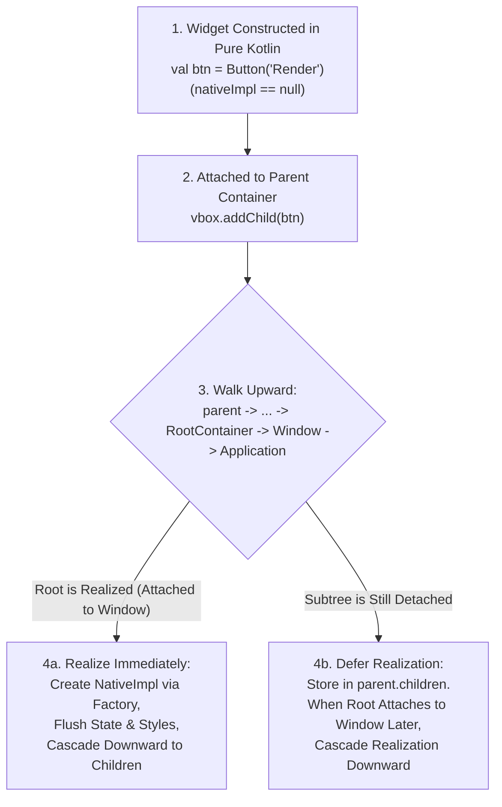

# GenericUI Architecture Guide

`GenericUI` is a Kotlin Multiplatform (KMP) UI, windowing, docking, media, and hardware-accelerated GPU canvas framework engineered for native OS responsiveness and zero runtime bloat.

---

## 1. Why GenericUI? (Replacing NW.js / Electron with Native-First KMP)

Desktop applications built on Chromium/NW.js bundle an entire browser engine per process, consuming hundreds of megabytes of baseline RAM and forcing every OS window, menu bar, and file dialog through web emulation.

GenericUI solves this by combining:
- **100% Shared Kotlin Multiplatform Application Code** (`:common` + `:extensions:*`)
- **True Native OS Controls** across 8 platform backends (`:windows`, `:macos`, `:gtk`, `:qt`, `:swing`, `:android`, `:ios`, `:web`)
- **Direct Hardware GPU Surfaces** (`Canvas2D`, `GLCanvas` with Google ANGLE on Windows, and `VKCanvas` with MoltenVK on Apple platforms)

---

## 2. Symmetrical 17-Subpackage Architecture

To keep the codebase modular and predictable across all 8 platform backends, every `.kt` file contains **at most 1 public class, interface, or enum**, and every backend mirrors the exact 17 subpackages of `:common`:

```text
com.nexustools.genericui
├── core                (Application, FragmentApplication, Window, Fragment, Widget, Container, RootContainer, Bundle)
├── core.fragment       (AdaptiveSplitTabFragment, DockWorkspaceFragment, AdaptiveLayoutMode, AdaptiveSlotDescriptor)
├── nativeimpl          (NativeBackendFactory, NativeBackendRegistry, NativeWidgetImpl, *NativeImpl peer contracts)
├── enums.bootstrap     (BootstrapType, BootstrapSize, SpacingScale, FontWeight, BorderRadiusStyle, ShadowElevation, ...)
├── style               (StyleSheet, StyleRule, StyleProperty, CssSelector, ThemeEngine, ComputedStyle)
├── event               (UiEvent, ClickEvent, PointerEvent, KeyEvent, WheelEvent, FocusEvent, ResizeEvent, WindowEvent)
├── widget.layout       (VBox, HBox, GridPane, FlowPane, StackPane, ScrollPane, SplitPane, TabPane, Accordion, ...)
├── widget.display      (Label, Badge, ProgressBar, ImageView, IconView, Tooltip, AlertBanner, Divider, StatusIndicator)
├── widget.action       (Button, IconButton, ToggleButton, Toolbar, ContextMenu, MenuDescriptor, ActionItem, TitleBar)
├── widget.input        (TextInput, TextArea, PasswordInput, NumberSpinner, CheckBox, RadioButton, SwitchToggle, Slider, ...)
├── widget.data         (LazyList, LazyColumn, LazyRow, LazyGrid, ViewHolderPool, ListView, TreeView, TreeItem, DataTable, ...)
├── docking             (DockWorkspace, DockArea, DockNode, DockTab, FloatingDockWindow, DockPosition, WorkspaceWindowMode)
├── dialog              (Dialog, MessageDialog, ConfirmDialog, PromptDialog, FileDialog, FileBrowserDialog, FileBrowserMode, ...)
├── image               (ImageLoader, ImageCodecNativeImpl, ImageBuffer, LibJpegCodec, LibPngCodec, LibWebpCodec, PixelFormat, ...)
└── canvas              (AbstractCanvas, VBlankCallback, VBlankTimer, CanvasInputState)
```

---

## 3. Modular Two-Tier Extension Architecture (Project-of-Projects vs. Single Project)

To keep `:common` focused while allowing deep native GPU/media hardware integration, GenericUI extensions support two Gradle project structures:

1. **Project-of-Projects Extensions** (`:extensions:<name>:common`, `:desktop`, `:mobile`, `:swing`, `:web`, plus umbrella `:extensions:<name>`) for extensions requiring native C/C++/ObjC, Java/LWJGL, and Web platform-specific implementations:
   - **`:extensions:gpu`**: Unified Vulkan (`#version 450` SPIR-V primary, MoltenVK on Apple) and OpenGL ES 3.0+ (`#version 300 es` fallback, Google ANGLE on Windows) device, shader, and offscreen context foundation (`GpuDevice`, `GpuOffscreenContext`, `VKContext`, `GLContext`).
   - **`:extensions:canvas2d`**: Hardware-accelerated 2D canvas (`Canvas2D`, `Canvas2DContext`, `CurveEditor`).
   - **`:extensions:canvas3d`**: Hardware-accelerated 3D/shader canvases (`GLCanvas`, `VKCanvas`) relying on `:extensions:gpu`.
   - **`:extensions:media`**: `VideoPlayer`, `AudioPlayer`, `AudioAnalyzer`, `WebVttSrtParser`, and `:extensions:media:desktop`'s VLC playback, Vulkan/OpenGL ES HDR tone-mapping, and HW/SW decode engine (relying on `:extensions:gpu`).
   - **`:extensions:webview`**: Dedicated `WebView` extension (`:common`, `:desktop`, `:mobile`, `:swing`, `:web`). On Desktop builds (`:desktop` / `:windows`, `:macos`, `:gtk`, `:qt`, and `:swing`), uses the **Chromium** project (`ChromiumBlinkEngine`) for HTML/CSS layout & rendering coupled with **`NJS`** (`D:\IdeaProjects\NJS`, symlinked at `D:\IdeaProjects\GenericUI\lib\NJS` for live development and to become a git submodule later) with its **AsmJit / SLJIT Native JIT Engine** (`com.nexustools.njs.jit.*`). On Mobile (`:android` `android.webkit.WebView`, `:ios` `WKWebView`) and `:web` (`<iframe>`), uses the native platform implementation and **NEVER uses `NJS`**.
2. **Single Multiplatform Project Extensions** (`:extensions:<name>`) built in 100% shared KMP code atop `:common` and other extensions:
   - **`:extensions:imageprocessing`** (relies on `:extensions:gpu` + base `:common` Image API)
   - **`:extensions:codeeditor`** (relies on `:extensions:canvas2d`)
   - **`:extensions:aichat`** (relies on `:extensions:codeeditor`)
   - **`:extensions:threejs`** (relies on `:extensions:gpu` + `:extensions:canvas3d`)
   - **`:extensions:box2d`** (relies on `:extensions:canvas2d` + `:extensions:canvas3d`)
   - **`:extensions:box3d`** (relies on `:extensions:canvas3d` + `:extensions:threejs`)

---

## 3. Deferred Upward `NativeImpl` Resolution

A key ergonomic challenge in native UI toolkits is when native OS handles (`HWND`, `NSView`, `GtkWidget`, `QWidget`, `android.view.View`) are allocated. If widgets require an active `Window` or `Context` inside their constructor, developers cannot modularly build UI subtrees or run fast headless unit tests.

GenericUI solves this with **Deferred Upward `NativeImpl` Resolution**:



### Key Guarantees
1. **Order-Independent Construction**: You can instantiate widgets, configure their `BootstrapType`, add CSS classes, bind `onClick` listeners, and assemble deeply nested `VBox`/`HBox`/`SplitPane` hierarchies **before** creating a `Window`.
2. **State Synchronization on Realization**: Every property mutation (`text`, `enabled`, `visible`, `bootstrapType`, `inlineStyles`, event listeners) is stored on the Kotlin `Widget` instance and immediately pushed to `nativeImpl` if realized—or flushed in a single batch when `realizeNativeTree(factory)` runs.
3. **Clean Re-Parenting**: Detaching a widget from one container and attaching it to another preserves its Kotlin state and seamlessly re-mounts its native peer.

---

## 4. `TitleBar` Instruction Architecture

Unlike web frameworks that render fake HTML titlebars inside the client viewport, GenericUI treats `TitleBar` as an **instruction object** (`com.nexustools.genericui.widget.action.TitleBar`), **not** a `Widget`.

### Window-Level vs. Fragment-Level Application
- **`window.setTitleBar(titleBar)`**: Instructs the OS window to configure its native title, subtitle, back button, menu bar (`menus`), and toolbar actions (`actions`).
  - **macOS (`:macos`)**: Automatically binds `titleBar.menus` to the **global macOS system menu bar** (`NSApplication.sharedApplication.mainMenu`) at the top of the screen while placing `titleBar.actions` into the window's native `NSToolbar`.
  - **Windows (`:windows`), Linux (`:gtk`, `:qt`), and JVM (`:swing`)**: Populates the native `HMENU`, `GtkHeaderBar`, `QMenuBar`, or `JMenuBar` along with native action buttons.
- **`fragment.setNavBar(titleBar)`**:
  - When the `Fragment` is the top-level active screen in `FragmentApplication`, it updates the primary window/screen `TitleBar` (`ActionBar` on Android, `UINavigationBar` on iOS, or Window `TitleBar` on desktop).
  - When the `Fragment` is nested inside a `SplitPane`, `AdaptiveSplitTabFragment`, or `DockWorkspaceFragment`, `setNavBar` renders a **local contextual header bar** at the top of that fragment's panel.

---

## 5. Dual-Mode Styling: Bootstrap Enums + SASS/CSS Cascade

GenericUI combines the compile-time safety of **Bootstrap Enums** with the expressive power of **SASS/CSS Stylesheets**:

### Mode 1: Type-Safe Bootstrap Enums (`com.nexustools.genericui.enums.bootstrap`)
- `BootstrapType`: `PRIMARY`, `SECONDARY`, `SUCCESS`, `INFO`, `WARNING`, `DANGER`, `LIGHT`, `DARK`, `LINK`
- `BootstrapSize`: `XS`, `SM`, `MD`, `LG`, `XL`
- `SpacingScale`: `NONE`, `P_1`..`P_5`, `M_1`..`M_5`, `PX_2`, `PY_2`, `G_2`, `G_3`, `G_4`
- `FontWeight`: `LIGHT`, `NORMAL`, `MEDIUM`, `SEMIBOLD`, `BOLD`, `MONOSPACE`
- `BorderRadiusStyle`: `NONE`, `SM`, `DEFAULT`, `LG`, `XL`, `XXL`, `PILL`, `CIRCLE`
- `ShadowElevation`: `NONE`, `SM`, `DEFAULT`, `LG`, `INSET`
- `DisplayMode`: `BLOCK`, `INLINE`, `INLINE_BLOCK`, `FLEX`, `GRID`, `NONE`
- `TextAlignment`: `START`, `CENTER`, `END`, `JUSTIFY`
- `ResponsiveBreakpoint`: `XS`, `SM`, `MD`, `LG`, `XL`, `XXL`

### Mode 2: SASS/CSS Cascade (`ThemeEngine` & `StyleSheet`)
Stylesheets compiled by `compileGenericUiSass` (or loaded dynamically via `ThemeEngine.loadStyleSheet(css)`) cascade onto native widgets using deterministic CSS specificity:
1. **Bootstrap Enum Defaults** (lowest priority baseline)
2. **Type / Tag Selectors** (e.g., `Button`, `Label`, `VBox`)
3. **Class Selectors** (e.g., `.toolbar-btn`, `.panel-card`)
4. **ID Selectors** (e.g., `#main-canvas-toolbar`)
5. **Inline Style Properties** (`widget.setInlineStyle("background-color", "#1e222a")` — highest priority)

---

## 6. Shared `:desktop` & `:mobile` Architectural Layers

GenericUI consolidates common native platform logic into two shared foundation modules:

### A. Shared `:desktop:shared` Module (`:desktop:windows`, `:desktop:macos`, `:desktop:gtk`, `:desktop:qt`)
Included automatically via `api(project(":desktop:shared"))` in `:desktop:windows`, `:desktop:macos`, `:desktop:gtk`, and `:desktop:qt`, `:desktop:shared` provides shared desktop widget base classes, file/folder dialog helpers (`DesktopFileBrowserHelper`), lazy viewport recycling (`DesktopLazyViewportEngine`), and multi-window dock coordination (`DesktopMultiWindowDockCoordinator`). Media, WebView, GPU, and Canvas classes are strictly isolated in their respective extensions (`:extensions:media`, `:extensions:webview`, `:extensions:gpu`, `:extensions:canvas2d`, `:extensions:canvas3d`), where `:extensions:media:desktop:shared` provides native `libvlc` (`LibVlcBindings`) for `:qt`, `:gtk`, `:windows`, and `:macos`, and `:extensions:media:desktop:swing` uses `libvlcj`.

### B. Shared `:mobile` Module (`:android` & `:ios`)
Included automatically via `api(project(":mobile"))` in `:android` and `:ios`, `:mobile` provides unified mobile form-factor and posture detection (`MobileDeviceFormFactor`, `MobileOrientationPosture`, `MobileSafeAreaTracker`, `MobileAdaptiveFragmentCoordinator`), multi-touch gesture & fling physics (`MobileGestureRecognizer`, `MobileFlingPhysics`, `MobileHapticEngine`), Picture-in-Picture (`MobilePipController`), media sessions (`MobileMediaSessionBridge`), document picker coordination (`MobileDocumentPickerBridge`), and `MobileLazyViewportPool`.

---

## 7. True Lazy Views & Viewport Recycling Across All 8 Platforms

`LazyList` (`LazyColumn`, `LazyRow`), `LazyGrid`, and `TreeView` dynamically load and bind items (`onBind`) only as they enter the visible viewport window (`[firstActiveIndex .. lastActiveIndex]`) and immediately unload/recycle (`onUnbind` $\rightarrow$ `ViewHolderPool`) items as they scroll out of view on all 8 platforms.
