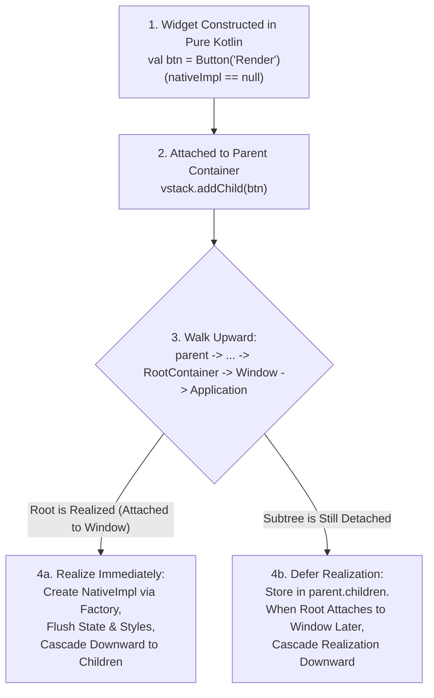

# GenericUI Architecture Guide

> **Root Repository**: [**GenericUI (`../README.md`)**](../README.md) | **Master Docs Index**: [**`docs/README.md`**](./README.md)  
> **Related Guides**: [Shared JVM (`jvm.md`)](./jvm.md) · [Shared Apple (`apple.md`)](./apple.md) · [iPadOS (`ipados.md`)](./ipados.md) · [Fragments & Windows (`fragments-and-windows.md`)](./fragments-and-windows.md) · [Application (`application.md`)](./application.md) · [Resources (`resources.md`)](./resources.md) · [SourceSets (`sourcesets.md`)](./sourcesets.md) · [Platform Backends (`backends.md`)](./backends.md) · [Extensions (`extensions.md`)](./extensions.md) · [Gradle Plugin (`gradle-plugin.md`)](./gradle-plugin.md)

`GenericUI` is a **54-project** Kotlin Multiplatform (KMP) UI, windowing, docking, media, schema, background-worker, game-engine, and hardware-accelerated GPU canvas framework engineered for native OS responsiveness and zero runtime bloat.

---

## 1. Why GenericUI? (Single-`commonMain` KMP with Native OS Widgets)

Desktop applications built on Chromium/NW.js or Electron bundle an entire browser engine per process, consuming hundreds of megabytes of baseline RAM and forcing every OS window, menu bar, and file dialog through web emulation.

GenericUI solves this by combining:
- **Single-`commonMain` Application Development**: Write `@MainAppFragment`, `@AppFragment`, `@SchemaData`, and `@MainServiceWorker` / `@ServiceWorkerMessage` classes once in `src/commonMain/kotlin`. The GenericUI Gradle plugin generates per-backend launchers, 1:1 Android `AppCompatActivity` classes, Xcode iOS/iPadOS wrappers (`UIDeviceFamily = 1` and `2`), `AndroidManifest.xml`, reflection-free schema/IPC codecs, and module-scoped `R` / `RC` / `Resource` classes automatically.
- **True Retained Native OS Controls Across 9 Platform Backends**: `Windows` (`Win32` child `HWND`s + `ComCtl32 v6`), `MacOS` (flipped AppKit `NSView`/`NSControl`), `Gtk` (`GTK4 / Libadwaita` `GtkWidget*`), `Kde` (`KF6` + `Breeze` on `Qt6` alien `QWidget*`), `Swing` (`JVM AWT/Swing`), `Android` (`Material 3`), `IOS` (`UIKit`), `IPadOS` (`UIKit multi-window Stage Manager + UIMenuSystem`), and `Web` (`HTML5 DOM / WebGL2 / WebGPU`).
- **Consolidated Shared Foundations**: `:system` (`StyledWidgetVisualController`, `SemanticSurfaceStyleResolver`), `:jvm` (Swing + Android, including `JniLibraryLoader` and `JvmBackdropCapturePlanner`), and `:apple` (macOS + iOS + iPadOS, including `AppleStyledSurfaceHelper` and `AppleBackdropFilterController`), plus **24 categorized first-party extensions** (`extensions/{graphics,physics,game,media,data,system,ui}/*` + **16** companion `:dsl` modules + **4** companion `:alien` modules = **44** `:extensions:*` modules).

---

## 2. Consolidated 54-Project Core & Multi-Backend Hierarchy

Every `.kt` file in GenericUI strictly follows the **1 Public Class / Interface / Enum Per File** rule, and all multiplatform backend and extension modules are organized cleanly into **54 Gradle subprojects** (`settings.gradle.kts`, with `52` library/test modules in `GenericUiGradlePlugin.KNOWN_GENERICUI_MODULES` plus `:gradle-plugin` & `:idea-plugin`, alongside `lib/NJS` via `includeBuild`):

```text
:common                     (All 9 backends: UI widgets, Scoped R / ResourceTable, GenericUiExtensionRegistry,
                             IWindow, alwaysOnTop, windowed aspectRatio, TitleCapabilities, AppleIconTileComposer,
                             IApplication, BackendTarget, AppTarget, IFragment, @MainAppFragment, @AppFragment,
                             FragmentHostFragment, FragmentHostSystem, Resource/ResourceID/ResourceResolver,
                             PreferenceStore, Image API)
├── :web                    (Kotlin/Wasm primary + Kotlin/JS IR fallback, HTML5 DOM, WebGL2/WebGPU,
│                            #hash + History.state, web-root ./serviceworker.js + ${resolvedBase}.sw.js|wasm)
│   └── :system                 (All 8 OS/system targets excluding Web: BlinkStyleEngine, SystemCssAnimationController [Animator-backed @keyframes], BrowserLayoutEngine, StyledWidgetVisualController, SemanticSurfaceStyleResolver, & system utilities)
│       ├── :jvm                (Shared JVM 11 module for Swing + Android: JvmIoExecutor, NIO/sockets, JDBC/SQLite,
│       │                        JniLibraryLoader, JvmBackdropCapturePlanner, Swing Pixel Tint)
│       ├── :apple              (Shared Darwin module for macOS + iOS + iPadOS: CoreFoundation, Security TLS, Network,
│       │                        ImageIO, CoreGraphics, AppleStyledSurfaceHelper, AppleBackdropFilterController, SQLite)
│       ├── :desktop            (5 desktop targets across source sets: commonMain, jvmMain, nativeDesktopMain,
│       │                        mingwMain [Win32], macosMain [AppKit], linuxMain [Gtk4 + Kde KF6 + XDG + linux/style])
│       └── :mobile             (3 mobile targets across source sets: commonMain, androidMain [AppCompat/Material 3],
│                                iosMain [UIKit Ios* for BackendTarget.IOS + Ipados* for BackendTarget.IPadOS])
```

- **`:tests`**: Single consolidated KMP verification module running `JestElectricRunner` across all 10 Kotlin targets (`commonMain`/`Test`, `systemMain`, `desktopMain`, `jvmAndAndroidMain`, `nativeDesktopMain`, `mingwMain`, `macosMain`, `linuxMain`, `mobileMain`, `iosMain`, `webMain`, `jsMain`, `wasmJsMain`).
- **`:gradle-plugin` & `:idea-plugin`**: Build-time codegen/packaging/nativebuild plugin (`id("com.nexustools.genericui")`) and IntelliJ IDEA scaffolding/targets wizard.
- **Native Desktop Dynamic Linking**: On native desktop targets (`macosArm64`, `linuxX64`, `linuxArm64`, `mingwX64`), `:gradle-plugin` (`GenericUiBuildNativeSharedLibsTask` + `GenericUiKonanCompilerShim` + `WindowsCoffObjectPartitioner` for MinGW >65,535 exports) links GenericUI core (`libgenericui.{dylib,so}` / `genericui.dll`), the active backend (`libgenericui-{macos,gtk,kde}.*` / `genericui-windows.dll`), `njs` (when used), enabled extensions (`libgenericui-ext-<ext>.*` + `-dsl` / `-alien`), and tests (`genericui-tests`) as separate shared libraries with embedded `nativeResourceKey` resource tables and strict `Gtk` (`libgenericui-gtk.so`) vs `Kde` (`libgenericui-kde.so`) isolation, while JVM Swing, Mobile (`Android`, `iOS`, `iPadOS`), and Web (`wasmJs` / `js`) remain integrated into their application packages.

---

## 3. Categorized Single-Project Extensions, Extension SPI, & Fail-Fast Registry Pattern

To keep `:common` and core backend modules 100% free of extension-specific logic, all **24 first-party extensions** (plus **16 companion `:dsl` modules** and **4 companion `:alien` modules**) live cleanly under **7** consolidated categories (`extensions/{graphics,physics,game,media,data,system,ui}/*`):

- **Graphics (`:extensions:graphics:*`)**: `gpu`, `imageprocessing`, `svg` (+`:dsl`, +`:alien`), `canvas2d` (+`:dsl`, +`:alien`), `canvas3d` (+`:dsl`, +`:alien`), `threejs` (+`:dsl`).
- **Physics (`:extensions:physics:*`)**: `box2d` (+`:dsl`), `box3d` (+`:dsl`).
- **Game & Input (`:extensions:game:*`)**: `gamepad`, `engine` (+`:dsl`), `engine2d` (+`:dsl`), `engine3d` (+`:dsl`).
- **Media (`:extensions:media:*`)**: `media` (+`:dsl`, +`:alien`), `mediacontrols`.
- **Data (`:extensions:data:*`)**: `schema` (+`:dsl`) — reflection-free `@SchemaData` codegen (`<ClassName>SchemaDescriptor.kt`, `GeneratedSchemaRegistrar.kt`, `SchemaExtension`, `SchemaRegistry`, `SchemaForm`).
- **System (`:extensions:system:*`)**: `ipc` (Desktop + Android ONLY — Win32 Named Pipes, `AF_UNIX`, macOS XPC, Android `Service` Binder helpers with >240 KB chunking; `BinaryJson` `IpcPacket` + `TYPE_BYTES` payloads; never `web`/`ios*`), `serviceworker` — `@MainServiceWorker` + `@ServiceWorkerMessage` IPC (`ServiceWorkerExtension`, `ServiceWorker`, `ServiceWorkerChannel`, `ServiceWorkerFragmentBinding.getOrCreate(...)`), desktop secondary `serviceworker` tray executables & autostart, Android foreground `<service>` / `BOOT_COMPLETED`, Web `./serviceworker.js` + `${resolvedBase}.sw.js|wasm`, and honest unsupported status on iOS/iPadOS (`ServiceWorkerExtension.isSupported == false`, zero simulation).
- **UI & Tooling (`:extensions:ui:*`)**: `dsl`, `overlay` (+`:dsl`), `alien` (+`:dsl`, auto-wiring & auto-registering `svg:alien`, `canvas2d:alien`, `canvas3d:alien`, `media:alien`), `webview` (+`:dsl` — isolated per-instance Desktop Alien + Stylesheet + SVG/Canvas2D/Canvas3D/Media + `:NJS` worker `${baseName}-webview(.exe)` / `GeneratedSwingWebViewWorkerMain` over `:extensions:system:ipc`, Android `android.webkit.WebView`, iOS `WKWebView`, Web sandboxed `<iframe>`), `codeeditor` (+`:dsl`), `aichat` (+`:dsl`), `pip`.

Every extension is a **single multiplatform KMP project** with internal platform source sets (e.g., `androidMain`, `appleMain`, `jvmMain`, `linuxMain`, `mingwMain`, `webMain`) instead of multi-module Project-of-Projects trees.

### Decoupled Extension Integration (`GenericUiExtensionContributor` SPI & `GenericUiExtensionRegistry`)
- **Build-Time Contributor SPI (`:gradle-plugin/.../spi/`)**: Extensions hook into compilation and packaging without touching core codegen via `GenericUiExtensionContributor` (`GenericUiExtensionContributorRegistry`, `ExtensionBuildContext`), supporting built-in contributors (`PipExtensionContributor`, `SchemaExtensionContributor`, `ServiceWorkerExtensionContributor`, `WebViewExtensionContributor`), `ServiceLoader`, and `META-INF/genericui/extensions/*.json` manifests to emit Android Activity/Manifest/Service/Receiver contributions (`AndroidExtensionContribution`), Desktop secondary executables (`SecondaryDesktopExecutableContribution`, e.g., `serviceworker` and `${baseName}-webview`, plus Swing `GeneratedSwingServiceWorkerMain` / `GeneratedSwingWebViewWorkerMain`) and autostart entries, Apple mobile `Info.plist` entries (`AppleMobileExtensionContribution`), Web `./serviceworker.js` plugin scripts (`WebServiceWorkerContribution`), reflection-free `@BinarySerializable` codecs (`BinaryCodecCodegen` / `generateGenericUiBinaryCodecs`), and raw uncompiled extension `styles/theme.scss` templates (`META-INF/genericui/themes/<scopeId>.scss` + `META-INF/genericui/module-resources/<scopeId>.json` alongside optional `GenericUiExtensionContributor.contributeThemeScss` — never pre-baked into library artifacts, and extracted/compiled solely by the consumer app's `:gradle-plugin` build).
- **Runtime Extension Hooks (`:common`)**: [`GenericUiExtensionRegistry`](../common/src/commonMain/kotlin/com/nexustools/genericui/core/GenericUiExtensionRegistry.kt) lets extensions register [`ApplicationLifecycleExtensionHook`](../common/src/commonMain/kotlin/com/nexustools/genericui/core/ApplicationLifecycleExtensionHook.kt) callbacks (`onBeforeAppPrepare`, `onAppPrepared`, `onBeforeAppRun`, `onAppShutdown`) and extension properties without introducing core-to-extension dependencies.

### Fail-Fast Zero-Stub Extension Registries

GenericUI enforces a **zero-silent-stub / fail-fast contract** across extension registries (`Canvas2DExtension`, `Canvas3DRegistry`, `MediaExtension`, `MediaControlsRegistry`, `WebView`, `FragmentRegistry`):
- Attempting to instantiate an extension component or backend context without a registered platform provider throws an immediate **`IllegalStateException`** or **`UnsupportedOperationException`**.
- **Out-of-the-Box Default Media Controls**: [`MediaControlsRegistry`](../extensions/media/mediacontrols/src/commonMain/kotlin/com/nexustools/genericui/ext/mediacontrols/MediaControlsRegistry.kt) initializes its default factory from [`defaultPlatformMediaControlsFactory()`](../extensions/media/mediacontrols/src/commonMain/kotlin/com/nexustools/genericui/ext/mediacontrols/DefaultPlatformMediaControlsFactory.kt) (`internal expect/actual` across Android, iOS/iPadOS, JVM Swing, Linux, macOS, Windows, and Web) so `MediaControlsSession()` binds genuine OS transport controls automatically without manual registration while still failing fast if explicitly cleared (`factory = null`).

---

## 4. Deferred Upward `NativeImpl` Resolution

Widgets can be constructed freely in pure Kotlin **before** any `Window` or `Application` exists (`val btn = Button("Render")`). When a child is attached to a parent container (`parent.addChild(btn)`), GenericUI traverses **upward** (`parent -> ... -> RootContainer -> Window -> Application`) to resolve the active backend's `NativeFactory`:



---

## 5. `TitleBar`, `TitleCapabilities`, & Single-Placement Components

Unlike web frameworks that render fake HTML titlebars inside the client area, GenericUI models [`TitleBar`](../common/src/commonMain/kotlin/com/nexustools/genericui/window/TitleBar.kt) as a window chrome descriptor inspected via [`TitleCapabilities`](../common/src/commonMain/kotlin/com/nexustools/genericui/window/TitleCapabilities.kt):
- **Single-Placement Guarantee (`TitleCapabilities.canEmbedComponentsInTitleBar`)**: When a window supports custom components in its titlebar (`canEmbedComponentsInTitleBar == true`), components added to `TitleBar` (`leadingComponents`, `centerComponents`, `trailingComponents`—such as `FragmentHostFragment`'s Back/Forward buttons or `AiChatContainer`'s action buttons) are marked `mountedInTitleBar = true` and rendered **only once** inside the titlebar, never duplicated inside the content body.
- **Conditional Chrome on Mobile & Web (`TitleCapabilities.isTitleBarRequired == false`)**:
  - **Android & iOS (`BackendTarget.IOS`)**: Setting a `TitleBar` **or** a `MenuBar` creates a top navbar; if neither is set, **no navbar is added to the view hierarchy**.
  - **iPadOS (`BackendTarget.IPadOS`)**: `TitleBar` renders as an inline navigation/header bar (`titleBarRendersAsNavbar = true`), while `MenuBar` attaches to Apple's native system menu bar (`UIMenuSystem.mainSystem`) rather than adding a mobile menu button bar.
  - **Web (`:web`)**: `MenuBar` only renders a menubar; `TitleBar` only renders a navbar; `TitleBar` + `MenuBar` merges both into a single Bootstrap navbar (title/icon on the left, menu on the right); neither renders no navbar at all.

---

## 6. Strongly-Typed Zero-Allocation Styling, Pure Retained Widgets, & Custom Bootstrap Surfaces

### 6.1 Zero String-Keyed Style APIs & Bitmask-Driven `ComponentStyle` / `ComputedStyle`

GenericUI **never** exposes string-keyed style APIs (`setStyleProperty(String, String)`, `getStyleProperty`, `removeStyleProperty`, `clearStyleProperties`, `inlineStyle`, `setRawDeclaration`, `getRawDeclaration`, `fromDeclarations`, `rawDeclarations` are strictly prohibited in `:common`):
- **Zero-Allocation 128-Bit Bitmasks on System Targets**: [`ComponentStyle`](../common/src/commonMain/kotlin/com/nexustools/genericui/style/css/ComponentStyle.kt) (`component.getStyle()`) and [`ComputedStyle`](../common/src/commonMain/kotlin/com/nexustools/genericui/style/css/ComputedStyle.kt) store 100% strongly-typed Kotlin fields (`RgbaColor?`, `Float?`, `CssDimension?`, `CssEdgeInsets?`, `CssCornerRadii?`, `CssFontWeight?`, etc.) tracked via two 64-bit `Long` bitmasks (`activePropertiesBitmaskLow` / `activePropertiesBitmaskHigh` and `importantBitmaskLow` / `importantBitmaskHigh` indexed by [`CssProperty.ordinal`](../common/src/commonMain/kotlin/com/nexustools/genericui/style/css/CssProperty.kt)). All 8 non-web system backends evaluate styles using zero string formatting and zero `Map<String, String>` allocations, assisted by `:system`'s [`BlinkStyleEngine`](../system/src/commonMain/kotlin/com/nexustools/genericui/system/style/BlinkStyleEngine.kt) and [`BrowserLayoutEngine`](../system/src/commonMain/kotlin/com/nexustools/genericui/style/layout/BrowserLayoutEngine.kt).
- **Transparent DOM CSS Translation on `:web` (`WebCssStyleTranslator`)**: Only `:web` formats CSS strings at the DOM boundary via [`WebCssStyleTranslator`](../web/src/commonMain/kotlin/com/nexustools/genericui/web/style/WebCssStyleTranslator.kt) (`translateStyleToCssDeclarationMap(style: ComponentStyle)` and `applyComponentStyleToElement(element, style, bootstrap)`).
- **Specificity Cascade**: Stylesheets compiled by `compileGenericUiSass` into [`PrecompiledStyleSheet`](../common/src/commonMain/kotlin/com/nexustools/genericui/style/css/PrecompiledStyleSheet.kt) (`Resource.style.<name>`) cascade onto components using deterministic specificity:
  1. **Bootstrap Enum Defaults** ([`ComponentBootstrap`](../common/src/commonMain/kotlin/com/nexustools/genericui/style/bootstrap/ComponentBootstrap.kt) — `BootstrapType`, `BootstrapSize`, `SpacingScale`, `BorderRadiusStyle`, `ShadowElevation`)
  2. **Type / Tag Selectors** (`Button`, `Label`, `VStack`)
  3. **Class Selectors** (`.toolbar-btn`, `.panel-card`)
  4. **ID Selectors** (`#main-canvas-toolbar`)
  5. **Inline `ComponentStyle` Properties** (`component.getStyle().setColor(RgbaColor.fromHex("#2A80FF"))` or `:extensions:ui:dsl` `style { color = RgbaColor.fromHex("#2A80FF") }`)
  6. **`!important` Overrides** (`important = true` / `importantBitmaskLow` & `High`)

### 6.2 `style.scss`-First Rules, Core/Extension `theme.scss`, `.hidden` + `Animator` `@keyframes`, & Proximal `position: relative` Parity

1. **Zero Direct Component Styles in Kotlin (`style.scss`-First)**:
   - Static visuals, interactive state visuals (`:hover`, `:focus`, `:active`, `:disabled`), layouts (`position`, `top`, `transform`, `z-index`, `pointer-events`, `cursor`), and theme-derived colors MUST live in `src/commonMain/resources/styles/style.scss` / `theme.scss` for `:common`, each extension (e.g. `:extensions:ui:overlay`, `:extensions:media:media`, `:extensions:ui:pip`), GenericUI core, and consumer applications (`episode-caster/receiver`, `episode-caster/client`).
   - Only genuinely runtime-dynamic per-frame/per-value attributes (such as `StyledSlider` fill/knob `%`, `SeekBar` preload `%`, or scrub bubble `left`) may be set directly in Kotlin. Backends and `:system` contain **zero** class/id/app-specific fast-paths.
2. **Raw Library `theme.scss` Templates vs. Consumer-App-Only Compilation (`GenericUiGeneratedThemeStyleSheet` & `gui/genericui-theme.css`)**:
   - GenericUI libraries (`:common` and `:extensions:*`) are prebuilt and generic and **NEVER compile or integrate resulting `theme.scss` code into the library `.jar`/`.klib` artifacts themselves**. Instead, they package **only raw uncompiled `src/commonMain/resources/styles/theme.scss` source templates** inside artifact metadata (`META-INF/genericui/themes/<scopeId>.scss` and `META-INF/genericui/module-resources/<scopeId>.json`) referencing `$primary`, `$accent`, `$surface`, `rgba($accent, ...)`, etc.
   - **Only the consumer application's build (`:gradle-plugin` — `compileGenericUiSass` + `GenericUiWebDistributionTask`)** extracts those upstream `theme.scss` templates, substitutes the consumer app's `genericui { theme { ... } }` settings from its `build.gradle.kts`, and integrates the resulting compiled theme stylesheet solely into the consumer application (`GenericUiGeneratedThemeStyleSheet` on `:system` and `gui/genericui-theme.css` on `:web`), while `ThemeStyleSheetRegistry` in `:common` handles dynamic runtime `app.setThemeConfig(...)` changes and standalone tests.
3. **`.hidden` Overlay Fade & `:system` `Animator` CSS `@keyframes`**:
   - Fading overlays (`FadingOverlay` / `AutoHideController` in `:extensions:ui:overlay`) define `.hidden` (`opacity: 0; pointer-events: none; cursor: none;`) and fade-in / fade-out `@keyframes` in `style.scss`, toggled solely by adding/removing `"hidden"` on the overlay root. `:system` drives CSS `@keyframes` via VBlank-synced `Animator` (`SystemCssAnimationController`), while `:web` delegates to native browser CSS.
4. **Proximal `position: relative` Ancestor / `Window` Containing-Block Parity + Transforms**:
   - Across `:web` and all 8 `:system` backends (`Windows`, `MacOS`, `Gtk`, `Kde`, `Swing`, `Android`, `IOS`, `IPadOS`), `BrowserLayoutEngine` (paired with `DesktopContainerLayoutController` on native desktop) resolves `position: absolute` against the **proximal ancestor with `position: relative`** (or positioned ancestor `position != static`, else the `Window` itself), with `top: 50%; transform: translate(0, -50%)` (and `translate(-50%, -50%)` on slider knobs), `z-index` stacking, and `pointer-events: none` click-through.

### 6.3 `Composite`, `StyledComponent`, `StyledSlider`, Strictly `Button`-Only Control `BootstrapType`, & System Backend Style Restraints

On all 8 non-web system targets (`Windows`, `MacOS`, `Gtk`, `Kde`, `Swing`, `Android`, `IOS`, `IPadOS`), standard UI controls mount genuine OS widgets directly and cannot have their aesthetic styles redesigned to look alien without `:extensions:ui:alien` (or `StyledComponent`, `StyledContainer`, `StyledButton`, or `Composite` / `StyledSlider`):

| Component Category | `acceptsTypographyStylesOnSystemBackend` | `acceptsAestheticSkinStylesOnSystemBackend` | System Backend Behavior & `BootstrapType` Policy (All 9 Backends) |
| :--- | :---: | :---: | :--- |
| **Text / Typography Elements** (`Label`, `Text`, `Heading`, `Blockquote`, `CodeBlock`, `MarkdownView`) | `true` | `false` | Honor all typography & text-color properties on `ComponentStyle` (`color` / `textColor`, `fontFamily`, `fontSize`, `fontWeight`, `fontStyle`, `lineHeight`, `letterSpacing`, `textAlign`, `textDecoration`, `textTransform`, `textOverflow`, `whiteSpace`, `wordBreak`) and `ComponentBootstrap` (`textColorType`, `fontSize`, `fontWeight`, `textAlignment`). |
| **`Button` & `Button` Subclasses ONLY** (`Button`, `IconButton`, `ToggleButton`, `FloatingActionButton`, plus `StyledButton` below) | `false` *(native)*<br/>`true` *(`StyledButton`)* | `false` *(native)*<br/>`true` *(`StyledButton`)* | **ONLY control components eligible for `BootstrapType`** (`bootstrap.type`, `bootstrap.backgroundType`, `bootstrap.outline`). Every native desktop and mobile backend wraps genuine OS push controls directly (`NSButton` native `bezelColor`/`hasDestructiveAction`/`bordered`/`showsBorderOnlyWhileMouseInside`/`contentTintColor` on macOS, `GtkButton` + Libadwaita/GTK CSS classes & theme-derived `GtkCssProvider` on GTK, `QPushButton` + `setFlat`/`QPalette` styled by `Breeze` on KDE, Win32 `"Button"`/`WC_BUTTON` with `NM_CUSTOMDRAW` on Windows, `UIButton` + `UIButtonConfiguration` on iOS/iPadOS, and `AppCompatButton` + `backgroundTintList`/`RippleDrawable`/`GradientDrawable` on Android); only Swing continues using `SwingControlTintRenderUtil` / `JvmControlTintPixelUtil` where standard Java Look-and-Feels ignore button background tinting. `StyledButton` honors both `BootstrapType` and full CSS/SCSS styling. |
| **Non-`Button` Controls & Standard Containers** (`DropdownButton`, `SplitDropdownButton`, `ProgressBar`, `Spinner`, `CheckBox`, `RadioButton`, `Switch`, `Select`, `ComboBox`, `DatePicker`, `TimePicker`, `ColorPicker`, `SearchField`, `NumberField`, `TextField`, `TextArea`, `RangeSlider`, `Slider`, `TabContainer`, `Tab`, `ScrollView`, `Container`, `VStack`, `HStack`, `FlexBox`, etc.) | `false` | `false` | **MUST NOT support `BootstrapType`** (`DropdownButton`, `SplitDropdownButton`, `ProgressBar`, `Spinner`, and all other non-`Button` controls ignore `BootstrapType`) and silently ignore aesthetic skinning/typography overrides on `ComponentStyle` (`backgroundColor`, `background`, `color`, `accentColor`, `borderColor`, `borderWidth`, `borderStyle`, `borderRadius`, `boxShadow`, `textShadow`, `filter`, `backdropFilter`, `fontFamily`, `fontSize`, `fontWeight`, `fontStyle`). Form subclasses stamp `data-control-variant` so native factories instantiate specialized OS pickers/controls. Layout/geometry properties (`width`, `height`, `padding`, `margin`, `gap`, `flexGrow`, `cursor`) are honored on all components. |
| **Bootstrap-Specific Non-Control Classes** (`Badge`, `Alert`, `Banner`, `Toast`, `Card`, `ListGroup`, `ListGroupItem`, `Jumbotron`, `Well`) | `true` | `true` *(policy-scoped)* | **DO support semantic `BootstrapType`** (`type`, `backgroundType`, `textColorType`, `borderType`) across all **9 backends** under [`AestheticStylePolicy`](../common/src/commonMain/kotlin/com/nexustools/genericui/style/policy/AestheticStylePolicy.kt), mounting custom native semantic widgets resolved via `:system`'s [`SemanticSurfaceStyleResolver`](../system/src/commonMain/kotlin/com/nexustools/genericui/system/style/SemanticSurfaceStyleResolver.kt) (`SemanticSurfacePaintSpec`). |
| **`StyledComponent`, `StyledContainer`, `StyledButton`, `Composite`, & `StyledSlider` (and `:extensions:ui:alien`)** | `true` | `true` | **`StyledComponent`** (`AbstractComponent` + `StyledComponentNativeImpl`, non-container non-button visual leaf), **`StyledContainer`**, **`StyledButton`**, and **`Composite`** (`AbstractComponent` — NOT `AbstractContainer` — hiding internal primitives while realizing via `StyledContainerNativeImpl` with zero custom `*NativeImpl`, including **`StyledSlider : Composite`**) mount dedicated custom widgets driven by `StyledWidgetVisualController`, `DesktopStyledWidgetDelegate`, `:apple` (`AppleStyledSurfaceHelper`, `AppleBackdropFilterController`), `linux/style` (`LinuxStyledSurfaceHelper`, `LinuxBackdropFilterController`), and `:jvm` (`JvmBackdropCapturePlanner`), supporting full CSS/SCSS styling across all 9 backends (`StyledSlider` composes `.styled-slider-track` `StyledButton` at `z-index: 1`, `$accent`-colored `.styled-slider-progress` `StyledComponent` at `z-index: 3` with `pointer-events: none`, and `.styled-slider-knob` `StyledButton` at `z-index: 4`). **`Composite` and `StyledSlider` MUST NOT support `BootstrapType`**; only `StyledButton` supports `BootstrapType` as a `Button` subclass. Under [`AestheticStylePolicy`](../common/src/commonMain/kotlin/com/nexustools/genericui/style/policy/AestheticStylePolicy.kt) (`supportsBackdropFilterBlur`), all 10 `CssFilter` / `backdrop-filter` ops (`blur`, `brightness`, `contrast`, `grayscale`, `hue-rotate`, `invert`, `opacity`, `saturate`, `sepia`, `drop-shadow` via `CssFilterColorMatrix` & `FastBackdropBlurKernel`) and gradients (`GradientStopNormalizer`) are supported across all 9 backends on **`StyledComponent`**, **`StyledContainer`**, and **`StyledButton`**. |

### 6.4 Unmodified Native Push Controls (`BootstrapType.NONE && !outline`) vs. Native Button Tinting & Swing Fallback

On native desktop and mobile targets, standard controls wrap genuine retained OS widgets directly without monolithic canvas painting or offscreen pixel sprite dumping:
1. **When `(type == null || type == BootstrapType.NONE) && !outline` on `Button`, or Any Non-`Button` Control**: Mounts the **100% unmodified genuine retained OS child widget** (Win32 `"Button"` / `ComCtl32 v6` `HWND`s returning `CDRF_DODEFAULT` in `NM_CUSTOMDRAW`, AppKit `NSButton`/`NSControl`, GTK4/Libadwaita `GtkButton`/`GtkWidget*`, KDE `KF6` + `Breeze` alien `QPushButton`/`QWidget*`, Swing L&F `JComponent`, `AppCompatButton`/Material on Android, UIKit `UIButton`/`UIControl` on iOS & iPadOS).
2. **When `BootstrapType != BootstrapType.NONE` or `outline == true` on `Button` / `Button` Subclasses (`Button`, `IconButton`, `ToggleButton`, `FloatingActionButton`)**:
   - **macOS (`MacOS`)**: Retains the genuine `NSButton`, updating native AppKit appearance via `bezelColor`, `hasDestructiveAction`, `bordered`, `showsBorderOnlyWhileMouseInside`, and `contentTintColor` resolved from `ThemeConfig` / `BootstrapColorPalette`.
   - **Linux GTK4 (`Gtk`)**: Retains the genuine `GtkButton`, toggling Libadwaita/GTK CSS classes (`suggested-action`, `destructive-action`, `flat`, `gui-btn-*`) backed by a theme-derived `GtkCssProvider`.
   - **Linux KDE (`Kde`)**: Retains the genuine `QPushButton`, applying `setFlat` and a per-widget `QPalette` styled natively by `Breeze`.
   - **Windows (`Windows`)**: Retains the genuine `"Button"` (`WC_BUTTON`) child `HWND`, using `NM_CUSTOMDRAW` (`CDDS_PREPAINT` -> `CDRF_SKIPDEFAULT`) for Bootstrap variants where UxTheme `BP_PUSHBUTTON` lacks a color-tint API.
   - **iOS & iPadOS (`IOS`, `IPadOS`)**: Retains the genuine `UIButton` styled via native `UIButtonConfiguration` (`filled`/`plain`, `baseBackgroundColor`, `baseForegroundColor`, `strokeColor`) with zero offscreen pixel sprites.
   - **Android (`Android`)**: Retains the genuine `AppCompatButton` styled via native `backgroundTintList` and `RippleDrawable` + `GradientDrawable` without CPU bitmap pixel-tinting in `onDraw`.
   - **JVM Swing (`Swing`)**: Continues using `SwingControlTintRenderUtil` / `JvmControlTintPixelUtil` bevel-preserving tinting where standard Java Look-and-Feels ignore button background tinting.

### 6.5 Modular Retained Per-Component `*NativeImpl` & Shared Style/Layout Helpers

Instead of monolithic window canvas painters or backend `*RenderUtil` / `*RenderContext` sprite classes, every native desktop backend uses a strictly modular **1-Class-Per-File** retained widget architecture:
- **`:desktop` (`nativeDesktopMain`)**: [`DesktopBaseNativeImpl`](../desktop/src/nativeDesktopMain/kotlin/com/nexustools/genericui/desktop/core/DesktopBaseNativeImpl.kt), [`DesktopBaseContainerNativeImpl`](../desktop/src/nativeDesktopMain/kotlin/com/nexustools/genericui/desktop/core/DesktopBaseContainerNativeImpl.kt), [`DesktopContainerLayoutController`](../desktop/src/nativeDesktopMain/kotlin/com/nexustools/genericui/desktop/layout/DesktopContainerLayoutController.kt), [`DesktopStyledWidgetDelegate`](../desktop/src/nativeDesktopMain/kotlin/com/nexustools/genericui/desktop/style/DesktopStyledWidgetDelegate.kt), [`DesktopButtonNativeImpl`](../desktop/src/nativeDesktopMain/kotlin/com/nexustools/genericui/desktop/widget/DesktopButtonNativeImpl.kt), and `DesktopStyled*NativeImpl`.
- **`:desktop` Backend Child-Widget Trees**:
  - **`mingwMain` (`Windows`)**: Modular `Windows*NativeImpl` child `HWND` peers (`ComCtl32 v6` activated via `shell32.dll` resource `124` before `InitCommonControlsEx`) + `Win32ControlMessageRouter` (`NM_CUSTOMDRAW` on `"Button"` `WC_BUTTON`) + `Win32LayeredStageHostHwnd` + `Win32Direct2dBackdropBlurEngine`.
  - **`macosMain` (`MacOS`)**: Modular `Macos*NativeImpl` flipped AppKit `NSView`/`NSControl`/`NSPanel`/`NSPopover`/`NSMenu` peers (`MacosWindowRootView` + 4-mode `MacosHostWindow`) + `MacosButtonNativeImpl` (`NSButton`) + `MacosSurfaceLayerSupport` (`NSVisualEffectView` `blendingMode = WithinWindow` for `backdrop-filter: blur(...)` + `:apple`'s `AppleStyledSurfaceHelper`, reserving `AppleBackdropFilterController` for non-blur `requiresFullFilterPipeline` ops and offscreen `JestElectricRunner` capture).
  - **`linuxMain` (`Gtk` & `Kde`, strictly `.so`-isolated)**: Toolkit-agnostic `linux/style/` (`LinuxStyledSurfaceHelper`, `LinuxBackdropFilterController`); **`Gtk`** `Gtk*NativeImpl` real `GtkWidget*`/Libadwaita hierarchy with `GtkCustomLayout`, `GskTransform`, `GtkOverlay`, `GtkPopover`, and `GtkButtonNativeImpl` (`GtkButton` + `GtkCssProvider`) in `libgenericui-gtk.so`; **`Kde`** `Kde*NativeImpl` real `KF6` + `Breeze` alien `QWidget*` hierarchy (`KdeDynamicBindings`, `KdeVTableBridge`, `KdeButtonNativeImpl` on `QPushButton`, `KBusyIndicatorWidget`, `KStatusNotifierItem`, `KWindowEffects::enableBlurBehind`) in `libgenericui-kde.so`.
- **`:tests` (`commonMain`)**: 12 modular headless snapshot utilities in [`tests/.../jestelectric/render/`](../tests/src/commonMain/kotlin/com/nexustools/genericui/test/jestelectric/render) (`JestElectricRenderContext`, `JestElectricButtonRenderUtil`, `JestElectricContainerChromeRenderUtil`, `JestElectricControlTintRenderUtil`, `JestElectricDataDisplayRenderUtil`, `JestElectricInputFieldRenderUtil`, `JestElectricMediaCanvasRenderUtil`, `JestElectricNavigationRenderUtil`, `JestElectricSliderProgressRenderUtil`, `JestElectricTextRenderUtil`, `JestElectricToggleSelectionRenderUtil`, `JestElectricWorkspaceWindowRenderUtil`), while native desktop visual/runner tests capture real OS widget surfaces (`cacheDisplayInRect:toBitmapImageRep:`, `PrintWindow(..., PW_RENDERFULLCONTENT)`, `GtkWidgetPaintable` + `GskRenderer`, `QWidget::render`).
