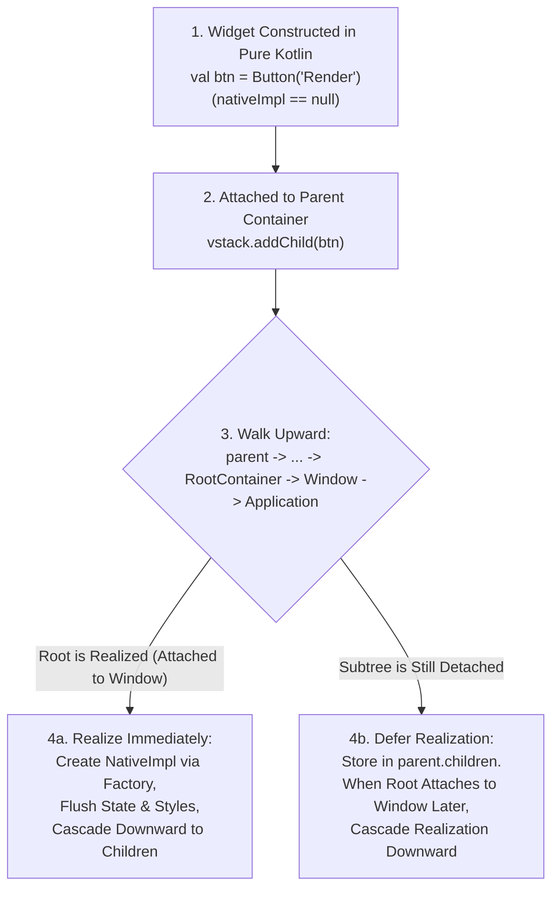

# GenericUI Architecture Guide

> **Root Repository**: [**GenericUI (`../README.md`)**](../README.md) | **Master Docs Index**: [**`docs/README.md`**](./README.md)  
> **Related Guides**: [Fragments & Windows (`fragments-and-windows.md`)](./fragments-and-windows.md) · [Application (`application.md`)](./application.md) · [Resources (`resources.md`)](./resources.md) · [SourceSets (`sourcesets.md`)](./sourcesets.md) · [Platform Backends (`backends.md`)](./backends.md) · [Extensions (`extensions.md`)](./extensions.md) · [Gradle Plugin (`gradle-plugin.md`)](./gradle-plugin.md)

`GenericUI` is a Kotlin Multiplatform (KMP) UI, windowing, docking, media, and hardware-accelerated GPU canvas framework engineered for native OS responsiveness and zero runtime bloat.

---

## 1. Why GenericUI? (Single-`commonMain` KMP with Native OS Widgets)

Desktop applications built on Chromium/NW.js or Electron bundle an entire browser engine per process, consuming hundreds of megabytes of baseline RAM and forcing every OS window, menu bar, and file dialog through web emulation.

GenericUI solves this by combining:
- **Single-`commonMain` Application Development**: Write `@MainAppFragment` and `@AppFragment` classes once in `src/commonMain/kotlin`. The GenericUI Gradle plugin generates per-backend launchers, 1:1 Android `AppCompatActivity` classes, `AndroidManifest.xml`, and `Resource.ResourceID` translations automatically.
- **True Native OS Controls** across 8 platform backends (`:desktop:windows`, `:desktop:macos`, `:desktop:gtk`, `:desktop:qt`, `:desktop:swing`, `:mobile:android`, `:mobile:ios`, `:web`).
- **Direct Hardware GPU Surfaces & Overlays** (`:extensions:gpu`, `:extensions:overlay`, `:extensions:canvas2d`, `:extensions:canvas3d`, `:extensions:media`, `:extensions:mediacontrols`).

---

## 2. Core & Multi-Backend Foundation Module Hierarchy

Every module in GenericUI is **either a direct backend target or a common target**, strictly following the **1 Public Class / Interface / Enum Per `.kt` File** standard:

```text
:common                     (All 8 backends: UI widgets, IWindow, TitleCapabilities, IApplication, BackendTarget,
                             AppTarget, IFragment, @MainAppFragment, @AppFragment, FragmentHostFragment,
                             FragmentHostSystem, Resource/ResourceID/ResourceResolver, PreferenceStore, Image API)
├── :web                    (Kotlin/Wasm primary + Kotlin/JS IR fallback, HTML5 DOM, WebGL2/WebGPU, #hash + History.state)
└── :systemCommon           (All 7 OS/system targets including JVM Swing: pure-Kotlin system utilities)
    ├── :desktop:common     (All 5 desktop targets: Windows, macOS, GTK, Qt, Swing)
    │   ├── :desktop:swing  (JVM AWT/Swing + optional LWJGL 3 OpenGL ES & Vulkan)
    │   └── :desktop:nativeCommon (All 4 native desktop targets: Windows, macOS, GTK, Qt)
    │       ├── :desktop:windows  (Win32 HWND, Direct2D, Google ANGLE, Vulkan, embedded .rc/.res resources)
    │       ├── :desktop:macos    (AppKit NSWindow/NSView, global NSMenu, CoreGraphics, MoltenVK)
    │       └── :desktop:linuxCommon (Linux XDG config/cache/preferences shared by GTK & Qt)
    │           ├── :desktop:gtk  (GTK4 / Libadwaita / Cairo / GResource)
    │           └── :desktop:qt   (Qt6 QMainWindow / QPainter / QVulkanWindow / QResource)
    └── :mobile:common      (Mobile posture, gestures, fling physics, PiP, lazy viewport pool)
        ├── :mobile:android (1:1 generated AppCompatActivity per @AppFragment/@MainAppFragment, Material 3, RecyclerView, SAF)
        └── :mobile:ios     (UIKit UIWindow/UIViewController, CADisplayLink, UIDocumentPicker, MoltenVK)
```

---

## 3. Modular Two-Tier Extension Architecture

To keep `:common` and core backend modules 100% free of extension-specific logic, specialized capabilities are isolated in `:extensions:*`:

1. **Project-of-Projects Extensions** (`:extensions:<name>:common`, `:systemCommon`, `:desktop:common`, `:desktop:nativeCommon`, `:desktop:{windows,macos,gtk,qt,swing}`, `:mobile:common`, `:mobile:{android,ios}`, `:web`, plus umbrella `:extensions:<name>`):
   - **`:extensions:gpu`**: Unified Vulkan 1.2+ (`VKContext` primary with SPIR-V & MoltenVK) and OpenGL ES 3.0+ (`GLContext` fallback with Google ANGLE on Windows) device, shader, and offscreen context foundation.
   - **`:extensions:imageprocessing`**: Offscreen GPU-accelerated image filters and layer compositing (`GpuImageProcessor`, `GpuImageFilterChain`, `GpuImageKernel`).
   - **`:extensions:canvas2d`**: Hardware-accelerated 2D canvas (`Canvas2D`, `ScrollCanvas2D`, `CurveEditor`, `Canvas2DOverlayHost`).
   - **`:extensions:canvas3d`**: Hardware-accelerated 3D/shader canvases (`GLCanvasExt`, `VKCanvasExt`, `ScrollCanvas3D`, `Canvas3DOverlayHost`).
   - **`:extensions:media`**: `VideoPlayer` (with `VideoOverlayHost`), `AudioPlayer`, `AudioAnalyzer`, `WebVttSrtParser`, native `libvlc` in `:extensions:media:desktop:nativeCommon`, and `libvlcj` in `:extensions:media:desktop:swing`.
   - **`:extensions:mediacontrols`**: Standalone OS media transport controls and hardware keyboard media key hooks (`MediaControlsSession` — depends **only on `:common`**).
   - **`:extensions:webview`**: Chromium (`ChromiumBlinkEngine`) + `NJS` (`lib/NJS` AsmJit/SLJIT Native JIT Engine) on Desktop/Swing, and native `android.webkit.WebView` / `WKWebView` / `<iframe>` on Mobile/Web.
   - **`:extensions:alien`**: Self-rendered Bootstrap 5.3 `Canvas2D` UI engine on system targets (`AlienFactory`, `AlienFragment`, `UnalienContainer`) with zero-overhead native DOM pass-through on `:web`.
2. **Single Multiplatform Project Extensions** (`:extensions:<name>`):
   - **`:extensions:overlay`** (depends **only on `:common`**), **`:extensions:codeeditor`**, **`:extensions:aichat`**, **`:extensions:threejs`**, **`:extensions:box2d`**, **`:extensions:box3d`**, and **`:extensions:dsl`**.

---

## 4. Deferred Upward `NativeImpl` Resolution

Widgets can be constructed freely in pure Kotlin **before** any `Window` or `Application` exists (`val btn = Button("Render")`). When a child is attached to a parent container (`parent.addChild(btn)`), GenericUI traverses **upward** (`parent -> ... -> RootContainer -> Window -> Application`) to resolve the active backend's `NativeFactory`:



---

## 5. `TitleBar`, `TitleCapabilities`, & Single-Placement Components

Unlike web frameworks that render fake HTML titlebars inside the client area, GenericUI models [`TitleBar`](../common/src/commonMain/kotlin/com/nexustools/genericui/window/TitleBar.kt) as a window chrome descriptor inspected via [`TitleCapabilities`](../common/src/commonMain/kotlin/com/nexustools/genericui/window/TitleCapabilities.kt):
- **Single-Placement Guarantee (`TitleCapabilities.canEmbedComponentsInTitleBar`)**: When a window supports custom components in its titlebar (`canEmbedComponentsInTitleBar == true`), components added to `TitleBar` (`leadingComponents`, `centerComponents`, `trailingComponents`—such as `FragmentHostFragment`'s Back/Forward buttons or `AiChatContainer`'s action buttons) are marked `mountedInTitleBar = true` and rendered **only once** inside the titlebar, never duplicated inside the content body.
- **Conditional Chrome on Mobile & Web (`TitleCapabilities.isTitleBarRequired == false`)**:
  - **Android & iOS**: Setting a `TitleBar` **or** a `MenuBar` creates a top navbar; if neither is set, **no navbar is added to the view hierarchy**.
  - **Web**: `MenuBar` only renders a menubar; `TitleBar` only renders a navbar; `TitleBar` + `MenuBar` merges both into a single Bootstrap navbar (title/icon on the left, menu on the right); neither renders no navbar at all.

---

## 6. Dual-Mode Styling: Bootstrap Enums + SASS/CSS Cascade

Stylesheets compiled by `compileGenericUiSass` cascade onto native widgets using deterministic specificity:
1. **Bootstrap Enum Defaults** (`BootstrapType`, `BootstrapSize`, `SpacingScale`, `BorderRadiusStyle`, `ShadowElevation`)
2. **Type / Tag Selectors** (`Button`, `Label`, `VStack`)
3. **Class Selectors** (`.toolbar-btn`, `.panel-card`)
4. **ID Selectors** (`#main-canvas-toolbar`)
5. **Inline Style Properties** (`component.setStyle("background-color", "#1e222a")`)
