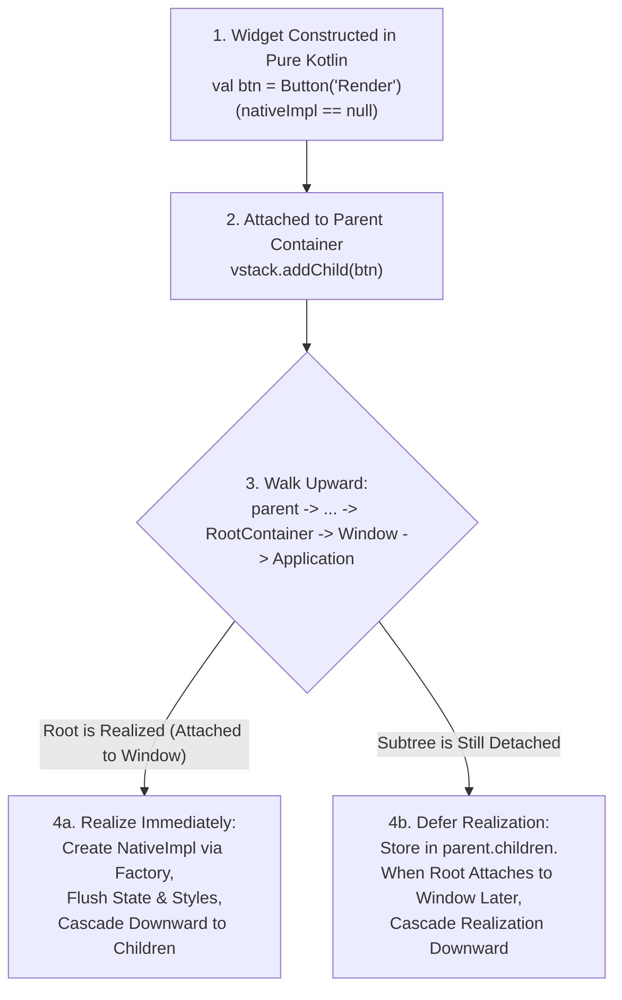

# GenericUI Architecture Guide

> **Root Repository**: [**GenericUI (`../README.md`)**](../README.md) | **Master Docs Index**: [**`docs/README.md`**](./README.md)  
> **Related Guides**: [Shared JVM (`jvm.md`)](./jvm.md) · [Shared Apple (`apple.md`)](./apple.md) · [iPadOS (`ipados.md`)](./ipados.md) · [Fragments & Windows (`fragments-and-windows.md`)](./fragments-and-windows.md) · [Application (`application.md`)](./application.md) · [Resources (`resources.md`)](./resources.md) · [SourceSets (`sourcesets.md`)](./sourcesets.md) · [Platform Backends (`backends.md`)](./backends.md) · [Extensions (`extensions.md`)](./extensions.md) · [Gradle Plugin (`gradle-plugin.md`)](./gradle-plugin.md)

`GenericUI` is a **51-project** Kotlin Multiplatform (KMP) UI, windowing, docking, media, schema, background-worker, game-engine, and hardware-accelerated GPU canvas framework engineered for native OS responsiveness and zero runtime bloat.

---

## 1. Why GenericUI? (Single-`commonMain` KMP with Native OS Widgets)

Desktop applications built on Chromium/NW.js or Electron bundle an entire browser engine per process, consuming hundreds of megabytes of baseline RAM and forcing every OS window, menu bar, and file dialog through web emulation.

GenericUI solves this by combining:
- **Single-`commonMain` Application Development**: Write `@MainAppFragment`, `@AppFragment`, `@SchemaData`, and `@MainServiceWorker` / `@ServiceWorkerMessage` classes once in `src/commonMain/kotlin`. The GenericUI Gradle plugin generates per-backend launchers, 1:1 Android `AppCompatActivity` classes, Xcode iOS/iPadOS wrappers (`UIDeviceFamily = 1` and `2`), `AndroidManifest.xml`, reflection-free schema/IPC codecs, and module-scoped `R` / `RC` / `Resource` classes automatically.
- **True Native OS Controls Across 9 Platform Backends**: `Windows` (`Win32`), `MacOS` (`AppKit`), `Gtk` (`GTK4 / Libadwaita`), `Qt` (`Qt6`), `Swing` (`JVM AWT/Swing`), `Android` (`Material 3`), `IOS` (`UIKit`), `IPadOS` (`UIKit multi-window Stage Manager + UIMenuSystem`), and `Web` (`HTML5 DOM / WebGL2 / WebGPU`).
- **Consolidated Shared Foundations**: `:system`, `:jvm` (Swing + Android, including `JniLibraryLoader`), and `:apple` (macOS + iOS + iPadOS), plus **22 categorized first-party extensions** (`extensions/{graphics,physics,game,media,data,system,ui}/*` + **19** companion `:dsl` modules = 41 `:extensions:*` modules).

---

## 2. Consolidated 51-Project Core & Multi-Backend Hierarchy

Every `.kt` file in GenericUI strictly follows the **1 Public Class / Interface / Enum Per File** rule, and all multiplatform backend and extension modules are organized cleanly into **51 Gradle subprojects** (`settings.gradle.kts`, with `49` library/test modules in `GenericUiGradlePlugin.KNOWN_GENERICUI_MODULES` plus `:gradle-plugin` & `:idea-plugin`, alongside `lib/NJS` via `includeBuild`):

```text
:common                     (All 9 backends: UI widgets, Scoped R / ResourceTable, GenericUiExtensionRegistry,
                             IWindow, alwaysOnTop, windowed aspectRatio, TitleCapabilities, AppleIconTileComposer,
                             IApplication, BackendTarget, AppTarget, IFragment, @MainAppFragment, @AppFragment,
                             FragmentHostFragment, FragmentHostSystem, Resource/ResourceID/ResourceResolver,
                             PreferenceStore, Image API)
├── :web                    (Kotlin/Wasm primary + Kotlin/JS IR fallback, HTML5 DOM, WebGL2/WebGPU,
│                            #hash + History.state, web-root ./serviceworker.js + ${resolvedBase}.sw.js|wasm)
└── :system                 (All 8 OS/system targets excluding Web: Blink layout & CSS matching engine + system utilities)
    ├── :jvm                (Shared JVM 11 module for Swing + Android: JvmIoExecutor, NIO/sockets, JDBC/SQLite,
    │                        JniLibraryLoader, Pixel Tint)
    ├── :apple              (Shared Darwin module for macOS + iOS + iPadOS: CoreFoundation, Security TLS, Network,
    │                        ImageIO, CoreGraphics, SQLite)
    ├── :desktop            (5 desktop targets across source sets: commonMain, jvmMain, nativeDesktopMain,
    │                        mingwMain [Win32], macosMain [AppKit], linuxMain [Gtk4 + Qt6 + XDG])
    └── :mobile             (3 mobile targets across source sets: commonMain, androidMain [AppCompat/Material 3],
                             iosMain [UIKit Ios* for BackendTarget.IOS + Ipados* for BackendTarget.IPadOS])
```

- **`:tests`**: Single consolidated KMP verification module running `JestElectricRunner` across all 10 Kotlin targets (`commonMain`/`Test`, `systemMain`, `desktopMain`, `jvmAndAndroidMain`, `nativeDesktopMain`, `mingwMain`, `macosMain`, `linuxMain`, `mobileMain`, `iosMain`, `webMain`, `jsMain`, `wasmJsMain`).
- **`:gradle-plugin` & `:idea-plugin`**: Build-time codegen/packaging/nativebuild plugin (`id("com.nexustools.genericui")`) and IntelliJ IDEA scaffolding/targets wizard.
- **Native Desktop Dynamic Linking**: On native desktop targets (`macosArm64`, `linuxX64`, `linuxArm64`, `mingwX64`), `:gradle-plugin` (`GenericUiBuildNativeSharedLibsTask` + `GenericUiKonanCompilerShim` + `WindowsCoffObjectPartitioner` for MinGW >65,535 exports) links GenericUI core (`libgenericui.{dylib,so}` / `genericui.dll`), the active backend (`libgenericui-{macos,gtk,qt}.*` / `genericui-windows.dll`), `njs` (when used), enabled extensions (`libgenericui-ext-<ext>.*` + `-dsl`), and tests (`genericui-tests`) as separate shared libraries with embedded `nativeResourceKey` resource tables and strict GTK vs Qt isolation, while JVM Swing, Mobile (`Android`, `iOS`, `iPadOS`), and Web (`wasmJs` / `js`) remain integrated into their application packages.

---

## 3. Categorized Single-Project Extensions, Extension SPI, & Fail-Fast Registry Pattern

To keep `:common` and core backend modules 100% free of extension-specific logic, all **22 first-party extensions** (plus **19 companion `:dsl` modules**) live cleanly under **7** consolidated categories (`extensions/{graphics,physics,game,media,data,system,ui}/*`):

- **Graphics (`:extensions:graphics:*`)**: `gpu`, `imageprocessing`, `canvas2d` (+`:dsl`), `canvas3d` (+`:dsl`), `threejs` (+`:dsl`).
- **Physics (`:extensions:physics:*`)**: `box2d` (+`:dsl`), `box3d` (+`:dsl`).
- **Game & Input (`:extensions:game:*`)**: `gamepad` (+`:dsl`), `engine` (+`:dsl`), `engine2d` (+`:dsl`), `engine3d` (+`:dsl`).
- **Media (`:extensions:media:*`)**: `media` (+`:dsl`), `mediacontrols` (+`:dsl`).
- **Data (`:extensions:data:*`)**: `schema` (+`:dsl`) — reflection-free `@SchemaData` codegen (`<ClassName>SchemaDescriptor.kt`, `GeneratedSchemaRegistrar.kt`, `SchemaExtension`, `SchemaRegistry`, `SchemaForm`).
- **System (`:extensions:system:*`)**: `serviceworker` (+`:dsl`) — `@MainServiceWorker` + `@ServiceWorkerMessage` IPC (`ServiceWorkerExtension`, `ServiceWorker`, `ServiceWorkerChannel`), desktop secondary `serviceworker` tray executables & autostart, Android foreground `<service>` / `BOOT_COMPLETED`, Web `./serviceworker.js` + `${resolvedBase}.sw.js|wasm`, and honest unsupported status on iOS/iPadOS (`ServiceWorkerExtension.isSupported == false`, zero simulation).
- **UI & Tooling (`:extensions:ui:*`)**: `dsl`, `overlay` (+`:dsl`), `alien` (+`:dsl`), `webview` (+`:dsl`), `codeeditor` (+`:dsl`), `aichat` (+`:dsl`), `pip` (+`:dsl`).

Every extension is a **single multiplatform KMP project** with internal platform source sets (e.g., `androidMain`, `appleMain`, `jvmMain`, `linuxMain`, `mingwMain`, `webMain`) instead of multi-module Project-of-Projects trees.

### Decoupled Extension Integration (`GenericUiExtensionContributor` SPI & `GenericUiExtensionRegistry`)
- **Build-Time Contributor SPI (`:gradle-plugin/.../spi/`)**: Extensions hook into compilation and packaging without touching core codegen via `GenericUiExtensionContributor` (`GenericUiExtensionContributorRegistry`, `ExtensionBuildContext`), supporting built-in contributors (`PipExtensionContributor`, `SchemaExtensionContributor`, `ServiceWorkerExtensionContributor`), `ServiceLoader`, and `META-INF/genericui/extensions/*.json` manifests to emit Android Activity/Manifest/Service/Receiver contributions (`AndroidExtensionContribution`), Desktop secondary executables (`SecondaryDesktopExecutableContribution`, e.g., `serviceworker` + `-gtk`/`-qt` variants) and autostart entries, Apple mobile `Info.plist` entries (`AppleMobileExtensionContribution`), and Web `./serviceworker.js` plugin scripts (`WebServiceWorkerContribution`).
- **Runtime Extension Hooks (`:common`)**: [`GenericUiExtensionRegistry`](../common/src/commonMain/kotlin/com/nexustools/genericui/core/GenericUiExtensionRegistry.kt) lets extensions register [`ApplicationLifecycleExtensionHook`](../common/src/commonMain/kotlin/com/nexustools/genericui/core/ApplicationLifecycleExtensionHook.kt) callbacks (`onBeforeAppPrepare`, `onAppPrepared`, `onBeforeAppRun`, `onAppShutdown`) and extension properties without introducing core-to-extension dependencies.

### Fail-Fast Zero-Stub Extension Registries

GenericUI enforces a **zero-silent-stub / fail-fast contract** across extension registries (`Canvas2DExtension`, `Canvas3DRegistry`, `MediaExtension`, `MediaControlsRegistry`, `WebView`, `FragmentRegistry`):
- Attempting to instantiate an extension component or backend context without a registered platform provider throws an immediate **`IllegalStateException`** or **`UnsupportedOperationException`**.
- **Out-of-the-Box Default Media Controls**: [`MediaControlsRegistry`](../extensions/media/mediacontrols/src/commonMain/kotlin/com/nexustools/genericui/ext/mediacontrols/MediaControlsRegistry.kt) initializes its default factory from [`defaultPlatformMediaControlsFactory()`](../extensions/media/mediacontrols/src/commonMain/kotlin/com/nexustools/genericui/ext/mediacontrols/DefaultPlatformMediaControlsFactory.kt) (`internal expect/actual` across Android, iOS/iPadOS, JVM Swing, Linux, macOS, Windows, and Web) so `MediaControlsSession()` binds genuine OS transport controls automatically without manual registration while still failing fast if explicitly cleared (`factory = null`).

---

## 4. Deferred Upward `NativeImpl` Resolution

Widgets can be constructed freely in pure Kotlin **before** any `Window` or `Application` exists (`val btn = Button("Render")`). When a child is attached to a parent container (`parent.addChild(btn)`), GenericUI traverses **upward** (`parent -> ... -> RootContainer -> Window -> Application`) to resolve the active backend's `NativeFactory`:



---

## 5. `TitleBar`, `TitleCapabilities`, & Single-Placement Components

Unlike web frameworks that render fake HTML titlebars inside the client area, GenericUI models [`TitleBar`](../common/src/commonMain/kotlin/com/nexustools/genericui/window/TitleBar.kt) as a window chrome descriptor inspected via [`TitleCapabilities`](../common/src/commonMain/kotlin/com/nexustools/genericui/window/TitleCapabilities.kt):
- **Single-Placement Guarantee (`TitleCapabilities.canEmbedComponentsInTitleBar`)**: When a window supports custom components in its titlebar (`canEmbedComponentsInTitleBar == true`), components added to `TitleBar` (`leadingComponents`, `centerComponents`, `trailingComponents`—such as `FragmentHostFragment`'s Back/Forward buttons or `AiChatContainer`'s action buttons) are marked `mountedInTitleBar = true` and rendered **only once** inside the titlebar, never duplicated inside the content body.
- **Conditional Chrome on Mobile & Web (`TitleCapabilities.isTitleBarRequired == false`)**:
  - **Android & iOS (`BackendTarget.IOS`)**: Setting a `TitleBar` **or** a `MenuBar` creates a top navbar; if neither is set, **no navbar is added to the view hierarchy**.
  - **iPadOS (`BackendTarget.IPadOS`)**: `TitleBar` renders as an inline navigation/header bar (`titleBarRendersAsNavbar = true`), while `MenuBar` attaches to Apple's native system menu bar (`UIMenuSystem.mainSystem`) rather than adding a mobile menu button bar.
  - **Web (`:web`)**: `MenuBar` only renders a menubar; `TitleBar` only renders a navbar; `TitleBar` + `MenuBar` merges both into a single Bootstrap navbar (title/icon on the left, menu on the right); neither renders no navbar at all.

---

## 6. Strongly-Typed Zero-Allocation Styling, System Typography vs. Aesthetic Restraints, & Native Control Offscreen Tinting

### 6.1 Zero String-Keyed Style APIs & Bitmask-Driven `ComponentStyle` / `ComputedStyle`

GenericUI **never** exposes string-keyed style APIs (`setStyleProperty(String, String)`, `getStyleProperty`, `removeStyleProperty`, `clearStyleProperties`, `inlineStyle`, `setRawDeclaration`, `getRawDeclaration`, `fromDeclarations`, `rawDeclarations` are strictly prohibited in `:common`):
- **Zero-Allocation 128-Bit Bitmasks on System Targets**: [`ComponentStyle`](../common/src/commonMain/kotlin/com/nexustools/genericui/style/css/ComponentStyle.kt) (`component.getStyle()`) and [`ComputedStyle`](../common/src/commonMain/kotlin/com/nexustools/genericui/style/css/ComputedStyle.kt) store 100% strongly-typed Kotlin fields (`RgbaColor?`, `Float?`, `CssDimension?`, `CssEdgeInsets?`, `CssCornerRadii?`, `CssFontWeight?`, etc.) tracked via two 64-bit `Long` bitmasks (`activePropertiesBitmaskLow` / `activePropertiesBitmaskHigh` and `importantBitmaskLow` / `importantBitmaskHigh` indexed by [`CssProperty.ordinal`](../common/src/commonMain/kotlin/com/nexustools/genericui/style/css/CssProperty.kt)). All 8 non-web system backends evaluate styles using zero string formatting and zero `Map<String, String>` allocations, assisted by `:system`'s [`BlinkStyleEngine`](../system/src/commonMain/kotlin/com/nexustools/genericui/system/style/BlinkStyleEngine.kt) and [`BrowserLayoutEngine`](../system/src/commonMain/kotlin/com/nexustools/genericui/style/layout/BrowserLayoutEngine.kt).
- **Transparent DOM CSS Translation on `:web` (`WebCssStyleTranslator`)**: Only `:web` formats CSS strings at the DOM boundary via [`WebCssStyleTranslator`](../web/src/commonMain/kotlin/com/nexustools/genericui/web/style/WebCssStyleTranslator.kt) (`translateStyleToCssDeclarationMap(style: ComponentStyle)` and `applyComponentStyleToElement(element, style, bootstrap)`).
- **Specificity Cascade**: Stylesheets compiled by `compileGenericUiSass` into [`PrecompiledStyleSheet`](../common/src/commonMain/kotlin/com/nexustools/genericui/style/css/PrecompiledStyleSheet.kt) (`Resource.style.<name>`) cascade onto components using deterministic specificity:
  1. **Bootstrap Enum Defaults** ([`ComponentBootstrap`](../common/src/commonMain/kotlin/com/nexustools/genericui/style/bootstrap/ComponentBootstrap.kt) — `BootstrapType`, `BootstrapSize`, `SpacingScale`, `BorderRadiusStyle`, `ShadowElevation`)
  2. **Type / Tag Selectors** (`Button`, `Label`, `VStack`)
  3. **Class Selectors** (`.toolbar-btn`, `.panel-card`)
  4. **ID Selectors** (`#main-canvas-toolbar`)
  5. **Inline `ComponentStyle` Properties** (`component.getStyle().setColor(RgbaColor.fromHex("#2A80FF"))` or `:extensions:ui:dsl` `style { color = RgbaColor.fromHex("#2A80FF") }`)
  6. **`!important` Overrides** (`important = true` / `importantBitmaskLow` & `High`)

### 6.2 System Backend Typography vs. Aesthetic Style Restraints

On all 8 non-web system targets (`Windows`, `MacOS`, `Gtk`, `Qt`, `Swing`, `Android`, `IOS`, `IPadOS`), standard UI controls cannot have their aesthetic styles redesigned to look alien without `:extensions:ui:alien` (or [`StyledContainer`](../common/src/commonMain/kotlin/com/nexustools/genericui/component/layout/StyledContainer.kt) / [`StyledButton`](../common/src/commonMain/kotlin/com/nexustools/genericui/component/action/StyledButton.kt)):

| Component Category | `acceptsTypographyStylesOnSystemBackend` | `acceptsAestheticSkinStylesOnSystemBackend` | System Backend Behavior (`Windows`, `MacOS`, `Gtk`, `Qt`, `Swing`, `Android`, `IOS`, `IPadOS`) |
| :--- | :---: | :---: | :--- |
| **Text / Typography Elements** (`Label`, `Text`, `Heading`, `Badge`, `Blockquote`, `CodeBlock`, `MarkdownView`) | `true` | `false` | Honor all typography & text-color properties on `ComponentStyle` (`color` / `textColor`, `fontFamily`, `fontSize`, `fontWeight`, `fontStyle`, `lineHeight`, `letterSpacing`, `textAlign`, `textDecoration`, `textTransform`, `textOverflow`, `whiteSpace`, `wordBreak`) and `ComponentBootstrap` (`textColorType`, `fontSize`, `fontWeight`, `textAlignment`). |
| **Buttons, Inputs, Controls, & Standard Containers** (`Button`, `IconButton`, `ToggleButton`, `CheckBox`, `RadioButton`, `Switch`, `Select`, `DropdownButton`, `TextField`, `TextArea`, `RangeSlider`, `ProgressBar`, `Spinner`, `TabContainer`, `Tab`, `Container`, `Card`, `VStack`, `HStack`, `FlexBox`, etc.) | `false` | `false` | Aesthetic skinning and typography overrides on `ComponentStyle` (`backgroundColor`, `background`, `color`, `accentColor`, `borderColor`, `borderWidth`, `borderStyle`, `borderRadius`, `boxShadow`, `textShadow`, `filter`, `backdropFilter`, `fontFamily`, `fontSize`, `fontWeight`, `fontStyle`) are **silently ignored**. Standard components can **ONLY** be tinted via `BootstrapType` (`bootstrap.type`, `bootstrap.backgroundType`, `bootstrap.textColorType`, `bootstrap.borderType`, `bootstrap.outline`). Layout/geometry properties (`width`, `height`, `padding`, `margin`, `gap`, `flexGrow`, `cursor`) are honored on all components. |
| **`StyledContainer` & `StyledButton` (and `:extensions:ui:alien`)** | `true` | `true` | Explicitly opt-in custom-styled components that honor full `ComponentStyle` aesthetic (`backgroundColor`, `background` gradients, `borderColor`, `borderWidth`, `borderStyle`, `borderRadius`, `boxShadow`, `opacity`) and typography properties across all 9 backends. Under [`AestheticStylePolicy`](../common/src/commonMain/kotlin/com/nexustools/genericui/style/policy/AestheticStylePolicy.kt) (`supportsBackdropFilterBlur`), hardware `backdropFilter` / `setBackdropBlur(...)` frosted-glass blur is supported across all 9 backends on both `StyledContainer` and `StyledButton` (with [`FastBackdropBlurKernel`](../common/src/commonMain/kotlin/com/nexustools/genericui/style/css/FastBackdropBlurKernel.kt) CPU fallback), while explicitly **excluding `TextBubble`** even though `TextBubble` extends `StyledContainer`. |

### 6.3 Native Control Rendering (`BootstrapType.NONE`) vs. Offscreen Sprite + `ThemeConfig` Tint + Text Overlay (`BootstrapType != NONE`)

On native desktop and mobile targets, standard controls never fall back to flat custom-painted rectangles:
1. **When `BootstrapType == BootstrapType.NONE` (Default)**: Renders the **100% unmodified genuine native OS component** (`uxtheme.dll` / `comctl32.dll` / `user32.dll` on Windows, AppKit `NSButtonCell` / `NSControl` on macOS, GTK4 `GtkSnapshot` on GTK, Qt6 `QApplication::style()` `QStyle` on Qt, system Look-And-Feel on Swing, Material/AppCompat `defaultNativeBackground` on Android, and UIKit `UIControl` on iOS & iPadOS).
2. **When `BootstrapType != BootstrapType.NONE` (`PRIMARY`, `SECONDARY`, `SUCCESS`, `DANGER`, `WARNING`, `INFO`, `LIGHT`, `DARK`)**:
   - **Step 1 (Empty-Text Native Sprite)**: Renders the genuine native OS control **with NO text** into an offscreen ARGB pixel buffer (`DrawThemeBackground` on Win32, `NSButtonCell` with `title = ""` on macOS, `gtk_widget_snapshot` with empty label on GTK4, `QStyle::drawControl` with empty `QStyleOptionButton.text` on Qt6).
   - **Step 2 (`ThemeConfig` Luminance-Preserving Pixel Tint)**: Color-tints the offscreen native control pixels using [`DesktopControlTintRenderUtil`](../desktop/src/nativeDesktopMain/kotlin/com/nexustools/genericui/desktop/render/DesktopControlTintRenderUtil.kt) (on native desktop), [`JvmControlTintPixelUtil`](../jvm/src/jvmSharedMain/kotlin/com/nexustools/genericui/jvm/JvmControlTintPixelUtil.kt) (shared by Swing & Android), and [`IosControlTintRenderUtil`](../mobile/src/iosMain/kotlin/com/nexustools/genericui/ios/IosControlTintRenderUtil.kt) (on iOS & iPadOS) with the active [`ThemeConfig`](../common/src/commonMain/kotlin/com/nexustools/genericui/style/theme/ThemeConfig.kt) / [`BootstrapColorPalette`](../common/src/commonMain/kotlin/com/nexustools/genericui/style/color/BootstrapColorPalette.kt) color while preserving native bevels, borders, rounded corners, specular highlights, and hover/pressed/disabled states.
   - **Step 3 (Blit & Contrasting Text Overlay)**: Blits the tinted native control sprite onto the destination surface and renders the contrasting text label (`BootstrapColorPalette.resolveOnFillTextColor` / `ThemeConfig`) and icon cleanly on top afterward.

### 6.4 Modular Per-Component `*NativeImpl` + Type-Grouped `*RenderUtil` Architecture

Instead of monolithic tree renderers, every native desktop backend and the `JestElectricRunner` snapshot engine use a strictly modular **1-Class-Per-File** architecture:
- **`:desktop` (`nativeDesktopMain`)**: [`DesktopRenderableNativeImpl`](../desktop/src/nativeDesktopMain/kotlin/com/nexustools/genericui/desktop/render/DesktopRenderableNativeImpl.kt) (`renderNativeComponent(...)`) and [`DesktopControlTintRenderUtil`](../desktop/src/nativeDesktopMain/kotlin/com/nexustools/genericui/desktop/render/DesktopControlTintRenderUtil.kt).
- **`:desktop` (`mingwMain`)**: 37 per-component `Windows*NativeImpl` classes in [`windows/impl/`](../desktop/src/mingwMain/kotlin/com/nexustools/genericui/windows/impl) delegating to 12 type-grouped `Win32*RenderUtil` classes in [`windows/render/`](../desktop/src/mingwMain/kotlin/com/nexustools/genericui/windows/render) (`Win32RenderContext`, `Win32ButtonRenderUtil`, `Win32ContainerChromeRenderUtil`, `Win32ControlTintRenderUtil`, `Win32DataDisplayRenderUtil`, `Win32InputFieldRenderUtil`, `Win32MediaCanvasRenderUtil`, `Win32NavigationRenderUtil`, `Win32SliderProgressRenderUtil`, `Win32TextRenderUtil`, `Win32ToggleSelectionRenderUtil`, `Win32WorkspaceWindowRenderUtil`).
- **`:desktop` (`macosMain`, `linuxMain`)**: Modular `Macos*NativeImpl` + `Macos*RenderUtil` (`MacosControlRenderUtil`, `MacosNavigationRenderUtil`, `MacosStageOverlayRenderUtil`, `MacosWorkspaceLayoutRenderUtil`), `Gtk*NativeImpl` + `Gtk*RenderUtil` (`GtkControlRenderUtil`, `GtkWorkspaceLayoutRenderUtil`), and `Qt*NativeImpl` + `Qt*RenderUtil` (`QtControlRenderUtil`, `QtWorkspaceLayoutRenderUtil`).
- **`:tests` (`commonMain`)**: 12 modular `JestElectric*RenderUtil` classes in [`tests/.../jestelectric/render/`](../tests/src/commonMain/kotlin/com/nexustools/genericui/test/jestelectric/render) (`JestElectricRenderContext`, `JestElectricButtonRenderUtil`, `JestElectricContainerChromeRenderUtil`, `JestElectricControlTintRenderUtil`, `JestElectricDataDisplayRenderUtil`, `JestElectricInputFieldRenderUtil`, `JestElectricMediaCanvasRenderUtil`, `JestElectricNavigationRenderUtil`, `JestElectricSliderProgressRenderUtil`, `JestElectricTextRenderUtil`, `JestElectricToggleSelectionRenderUtil`, `JestElectricWorkspaceWindowRenderUtil`).
