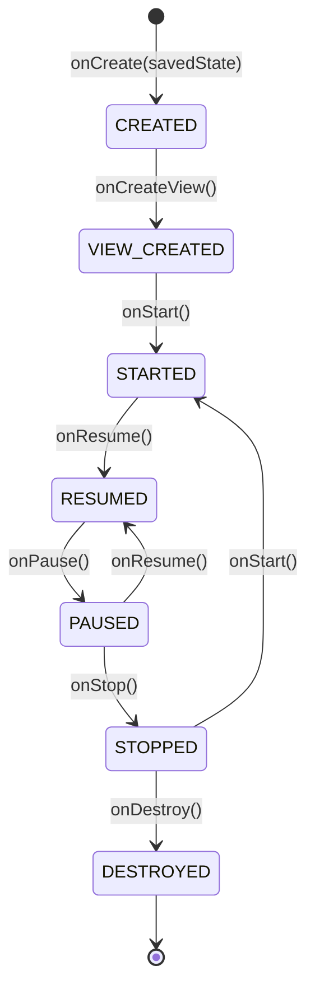

# GenericUI Components, Fragments, Docking, & Styling Guide

This guide covers GenericUI's native widget catalog, `Application` vs. `FragmentApplication`, the 1:1 Android `Activity`-compatible `Fragment` lifecycle, `Fragment.setNavBar(TitleBar)`, the built-in helper fragments (`AdaptiveSplitTabFragment`, `DockWorkspaceFragment`, `OverlayDockWorkspaceFragment`), and Dual-Mode Styling (including `LinearGradient` and `RadialGradient` background gradients).

- **Navigation**: [GenericUI README](../README.md) | [Master Documentation Index](README.md) | [Hierarchical SourceSet Setup](sourcesets.md) | [Platform Backends](backends.md) | [First-Party Extensions](extensions.md) | [Declarative DSL Guide](../extensions/docs/dsl.md)

---

## 1. Complete Native Widget Catalog (`com.nexustools.genericui.widget.*`)

All widgets inherit from `Widget` (or `Container` for layout parents) and resolve their platform `NativeImpl` lazily via **Deferred Upward `NativeImpl` Resolution**.

### Layout Containers (`widget.layout`)
- **`VBox` / `HBox`**: Vertical and horizontal linear flex containers with `SpacingScale` gap and alignment controls.
- **`GridPane`**: 2D row/column grid with flexible column spans and proportional sizing.
- **`FlowPane`**: Wrapping horizontal/vertical flow container for tags, badges, and tool palettes.
- **`StackPane`**: Z-ordered overlay container.
- **`ScrollPane`**: Native hardware-accelerated scroll container with horizontal/vertical scrollbars.
- **`SplitPane`**: Resizable two-pane or multi-pane divider container (`HORIZONTAL` / `VERTICAL`).
- **`TabContainer` & `FragmentTabContainer` (`com.nexustools.genericui.component.tabs`)**: Native tabbed containers supporting `Tab`, `CloseableTab`, `BadgeTab`, `PinnedTab`, `EditableTab`, and arbitrary custom `AbstractComponent` tab headers—all translated to native tab components (`JTabbedPane` + `setTabComponentAt`, `WC_TABCONTROL`, `NSTabView` + `NSTabViewItem`, `AdwTabView` + `AdwTabPage`, `QTabWidget` + `QTabBar`, `TabLayout` + `TabLayout.Tab`, `UITabBar` + `UITabBarItem`, and `.nav-tabs` + `.nav-item`) where possible.
- **`Accordion` / `CardContainer` / `DrawerContainer`**: Collapsible sections, elevated Bootstrap cards, and slide-out side drawers.

### Display Widgets (`widget.display`)
- **`Label`**: Single-line or multi-line text label with `FontWeight` and `TextAlignment`.
- **`Badge`**: Compact status pill styled via `BootstrapType`.
- **`ProgressBar`**: Determinate (`0.0..1.0`) or indeterminate native progress indicator.
- **`ImageView` / `IconView`**: Raster and vector icon display with aspect-ratio scaling.
- **`Tooltip` / `AlertBanner` / `Divider` / `StatusIndicator`**: Native hover tooltips, contextual banners, separators, and live status dots.

### Action Widgets & Instructions (`widget.action`)
- **`Button` / `IconButton` / `ToggleButton`**: Native push and toggle buttons supporting `BootstrapType` and `BootstrapSize`.
- **`Toolbar` / `ContextMenu`**: Horizontal action bars and right-click/long-press native popup menus.
- **`TitleBar` (Instruction Descriptor)**: Non-widget declarative instruction passed to `window.setTitleBar(titleBar)` or `fragment.setNavBar(titleBar)` containing `title`, `subtitle`, `showBackButton`, `menus: List<MenuDescriptor>`, and `actions: List<ActionItem>`.

### Input Controls (`widget.input`)
- **`TextInput` / `TextArea` / `PasswordInput`**: Single-line, multi-line, and masked text fields with change/submit callbacks.
- **`NumberSpinner` / `Slider`**: Numeric steppers and continuous/stepped range sliders.
- **`CheckBox` / `RadioButton` / `SwitchToggle`**: Boolean and mutually-exclusive selection controls.
- **`SelectDropdown`**: Native combo-box / dropdown selector (powers `AICore`'s `ModelCatalog` provider/model pickers).
- **`ColorPicker` / `DatePicker` / `FilePickerButton`**: Native OS color, calendar, and file chooser triggers.

### Data Views (`widget.data`)
- **`ListView`**: Virtualized 1D list for high-volume datasets.
- **`TreeView` & `TreeItem`**: Hierarchical tree view (powers `HAEditor`'s layer/object hierarchy and `AICore`'s workspace explorer).
- **`DataTable` & `DataColumn`**: Sortable multi-column table with row selection.
- **`PropertyGrid` & `PaginationBar`**: Key-value inspector grid (powers `HAEditor`'s dynamic GIMP filter parameter inspector) and page navigation bar.

---

## 2. `Application` vs. `FragmentApplication`

GenericUI provides two top-level application entry points in `com.nexustools.genericui.core`:

1. **`Application`**: Direct multi-window desktop/web entry point where you create `Window` instances (`createWindow(...)`) and populate them with `Widget` trees or `Fragment` hosts.
2. **`FragmentApplication`**: Navigation-centric entry point modeled 1:1 after Android's `Activity`/`Fragment` architecture—ideal for applications that run identically across Android, iOS, Desktop, and Web with back-stack lifecycle management.

---

## 3. `Fragment` Lifecycle & `Fragment.setNavBar(TitleBar)`

Every `Fragment` implements the Android `Activity`-compatible lifecycle:



### Dual-Mode `Fragment.setNavBar(TitleBar)`
Calling `setNavBar(TitleBar(...))` inside a `Fragment` automatically adapts to how the `Fragment` is mounted:
- **Root / Fullscreen Fragment**: Updates the host `Window.setTitleBar(...)` (including the macOS global system menu bar on `:macos`, `ActionBar`/`Toolbar` on `:android`, and `UINavigationBar` on `:ios`).
- **Nested / Docked Child Fragment**: Renders a dedicated **local header bar** at the top of the child fragment's container—complete with its own title, action buttons, and dropdown menu—without overwriting the main window's titlebar.

---

## 4. Helper Fragments (`com.nexustools.genericui.core.fragment`)

### A. `AdaptiveSplitTabFragment` (Designed for **Episode Caster**)
`AdaptiveSplitTabFragment` eliminates boilerplate media-app layout code by automatically switching between three responsive modes (`AdaptiveLayoutMode`):
1. **`MULTI_COLUMN_SPLIT`** (Desktop & Tablet $\ge 840\text{dp}$): Renders the primary media viewport alongside secondary slots (Shows, Episode Queue, Cast Devices) in a multi-column `SplitPane`.
2. **`FULLSCREEN_PRIMARY`** (Phone Landscape when `isFullscreenPrimaryInLandscape = true`): Hides secondary chrome and expands the primary `VideoPlayer` fragment to 100% fullscreen.
3. **`PORTRAIT_TABS`** (Phone Portrait): Places the compact media player at the top and organizes secondary slots into a switchable `TabPane`.

### B. `DockWorkspaceFragment` (Designed for **HAEditor** & **AICore**)
`DockWorkspaceFragment` provides a full IDE and creative-suite docking system inspired by **GIMP** and **JetBrains Fleet/IntelliJ**:
- **GIMP Single-Window Mode (`WorkspaceWindowMode.SINGLE_WINDOW`)**: All toolboxes, layer trees, property grids, AI chat drawers, and timeline panels are docked into resizable `LEFT`, `RIGHT`, `TOP`, `BOTTOM`, and tabbed `CENTER` `DockArea`s inside a single OS `Window`.
- **GIMP Multi-Window Mode (`WorkspaceWindowMode.MULTI_WINDOW`)**: Detached or utility dock panels (`FloatingDockWindow`) are promoted into independent native OS utility `Window`s that can be arranged across multiple monitors, while keeping the central document canvas window focused.
- **Persistent Layout Serialization (`DockLayoutSerializer`)**: Save and restore user panel arrangements, split ratios, active tabs, and floating window coordinates to/from JSON.

---

## 5. Native Dialogs & File/Folder Browser (`com.nexustools.genericui.dialog`)

GenericUI provides standard modal dialogs (`Dialog`, `MessageDialog`, `ConfirmDialog`, `PromptDialog`) and a comprehensive **Native File & Folder Browser (`FileBrowserDialog`)**:

### `FileBrowserDialog` & Supporting Types (1 Class Per File)
- **`FileBrowserDialog`**: Configures and launches a native file or folder chooser dialog.
- **`FileBrowserMode`**:
  - `OPEN_SINGLE_FILE`: Select a single existing file.
  - `OPEN_MULTIPLE_FILES`: Select one or more existing files.
  - `SAVE_FILE`: Choose a destination file path and name for saving/exporting.
  - `SELECT_FOLDER`: Select a directory/folder (e.g., opening a project workspace in **AICore**).
- **`FileTypeFilter`**: Filters selectable files by `description`, `extensions` (e.g., `listOf("hacanvas", "png", "svg")`), and `mimeTypes` (e.g., `listOf("image/png", "image/svg+xml")`).
- **`SelectedFile`**: Uniform descriptor representing a chosen file or folder (`name`, `pathOrUri`, `sizeBytes`, `mimeType`, `isDirectory`).
- **`FileBrowserCallback`**: Callback interface with two methods:
  - `onFilesSelected(files: List<SelectedFile>)`
  - `onCancelled()`

### Platform-Specific Native Execution
| Platform Backend | Native Implementation Mechanism |
| :--- | :--- |
| **Desktop (`:windows`, `:macos`, `:gtk`, `:qt`, `:swing`) & `:ios`** | Native OS file/folder dialog (`IFileOpenDialog`/`IFileSaveDialog` with `FOS_PICKFOLDERS`, `NSOpenPanel`/`NSSavePanel`, `GtkFileChooserNative`, `QFileDialog`, `JFileChooser`/`FileDialog`, `UIDocumentPickerViewController`). |
| **Web (`:web`)** | Dynamically creates an **invisible, un-interactable `<input type="file">` element** (`display: none; visibility: hidden; pointer-events: none`), sets `multiple` or `webkitdirectory` (when `mode == FileBrowserMode.SELECT_FOLDER`), translates `FileTypeFilter` rules into the HTML `accept` attribute, triggers `.click()`, and wires `change` and `cancel` DOM listeners to `onFilesSelected` or `onCancelled` before removing the temporary element. |
| **Android (`:android`)** | Passes the request directly to the **native Android system file browser app** (Storage Access Framework) via the host `Activity` result launcher (`Intent.ACTION_OPEN_DOCUMENT`, `Intent.ACTION_CREATE_DOCUMENT`, or `Intent.ACTION_OPEN_DOCUMENT_TREE` for `SELECT_FOLDER`), resolving returned `Uri`s into `SelectedFile` entries or calling `onCancelled`. |

### Example: Selecting a Project Folder or Multiple Artwork Files
```kotlin
import com.nexustools.genericui.dialog.FileBrowserCallback
import com.nexustools.genericui.dialog.FileBrowserDialog
import com.nexustools.genericui.dialog.FileBrowserMode
import com.nexustools.genericui.dialog.FileTypeFilter
import com.nexustools.genericui.dialog.SelectedFile

// 1. Folder Selection Mode (e.g. AICore Project Chroot Selection)
val folderDialog = FileBrowserDialog(
    title = "Select Project Workspace Folder",
    mode = FileBrowserMode.SELECT_FOLDER
)
folderDialog.show(mainWindow, object : FileBrowserCallback {
    override fun onFilesSelected(files: List<SelectedFile>) {
        val folder = files.firstOrNull() ?: return
        println("Selected workspace directory: ${folder.pathOrUri}")
    }

    override fun onCancelled() {
        println("Folder selection cancelled")
    }
})

// 2. Multi-File Selection Mode with Extension & MIME Filters (e.g. HAEditor Import)
val importDialog = FileBrowserDialog(
    title = "Import Layers or Canvases",
    mode = FileBrowserMode.OPEN_MULTIPLE_FILES,
    filters = listOf(
        FileTypeFilter(
            description = "Supported Artwork (.hacanvas, .psd, .xcf, .ora, .svg, .png)",
            extensions = listOf("hacanvas", "psd", "xcf", "ora", "svg", "png"),
            mimeTypes = listOf("image/png", "image/svg+xml")
        )
    )
)
importDialog.show(mainWindow, object : FileBrowserCallback {
    override fun onFilesSelected(files: List<SelectedFile>) {
        files.forEach { file -> println("Importing: ${file.name} (${file.pathOrUri})") }
    }

    override fun onCancelled() {
        println("Import cancelled")
    }
})
```

---

## 6. True Lazy Views & Viewport Recycling Across All 8 Platforms (`com.nexustools.genericui.widget.data`)

To handle tens of thousands of rows, media tiles, or deep layer/file hierarchies with zero frame drops and constant memory usage, GenericUI implements **true viewport-window lazy loading and view-holder recycling** across all 8 platforms:

### Core Lazy View Components
- **`LazyList<T>` (`LazyColumn<T>`, `LazyRow<T>`)**: 1D vertical or horizontal virtualized scrolling list.
- **`LazyGrid<T>`**: 2D virtualized grid with fixed or adaptive column counts (`minCellWidthPx`).
- **`TreeView` & `TreeItem`**: Flattens expanded tree nodes into a virtualized visible node list so collapsed subtrees and off-screen nodes consume zero native widget handles.
- **`ViewHolderPool<W : Widget>`**: Per-view-type recycling pool that stores detached item widgets (`onUnbind`) and re-issues them (`acquire()`) as new indices scroll into the visible viewport window.

### Dynamic Viewport Window Lifecycle (`[firstActiveIndex .. lastActiveIndex]`)
1. **Scroll & Resize Calculation**: On every scroll or viewport resize event, the lazy container computes the active index window `[firstActiveIndex .. lastActiveIndex]` (including a configurable `overscanCount` buffer).
2. **Dynamic Unload (`onUnbind` $\rightarrow$ `ViewHolderPool`)**: Any previously visible item index $i \notin [\text{firstActiveIndex} .. \text{lastActiveIndex}]$ immediately triggers `onUnbindItem(i, widget)`, detaches from the active viewport slot, and returns to `ViewHolderPool`.
3. **Dynamic Load (`ViewHolderPool` $\rightarrow$ `onBind`)**: Any newly visible item index $j \in [\text{firstActiveIndex} .. \text{lastActiveIndex}]$ acquires a recycled `Widget` from `ViewHolderPool` (or invokes `itemFactory()` if the pool is empty) and invokes `onBindItem(j, widget)`.

### Native Platform Backing for Lazy Views
- **`:android`**: Backed by `androidx.recyclerview.widget.RecyclerView` (`LinearLayoutManager` / `GridLayoutManager`) + `:mobile` `MobileLazyViewportPool`.
- **`:ios`**: Backed by `UITableView` / `UICollectionView` cell reuse queues + `:mobile` `MobileLazyViewportPool`.
- **`:windows` / `:macos` / `:gtk` / `:qt` / `:swing` / `:web`**: Virtualized viewport scroll container + `ViewHolderPool` recycling only the visible item peers.

---

## 7. Extension-Based Specialized Views (`:extensions:webview` & `:extensions:codeeditor`)

To keep `:common` lightweight, embedded web views and IDE code editors live in dedicated extension modules:
- **`:extensions:webview` (`WebView`, `WebViewController`, `WebViewJsBridge`)**: Project-of-Projects extension (`:common`, `:desktop`, `:mobile`, `:swing`, `:web`). On Desktop (`:desktop` and `:swing`), uses the **Chromium** project (`ChromiumBlinkEngine`) for HTML/CSS layout & rendering coupled with **`NJS`** (`D:\IdeaProjects\NJS`, symlinked at `D:\IdeaProjects\GenericUI\lib\NJS`) with its **AsmJit / SLJIT Native JIT Engine** (`com.nexustools.njs.jit.*`). On Mobile (`:android` `android.webkit.WebView`, `:ios` `WKWebView`) and `:web` (`<iframe>`), uses the native platform implementation and **NEVER uses `NJS`**.
- **`:extensions:codeeditor` (`IdeCodeEditor`)**: Single KMP project extension built atop `:extensions:canvas2d`.
