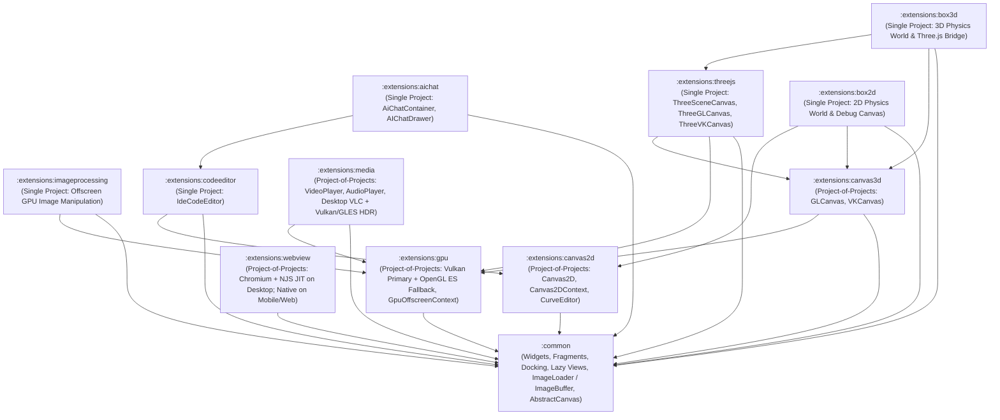

# GenericUI First-Party Extensions Guide (`:extensions:*`)

GenericUI ships with **11 first-party extension modules** organized into a clean, composable dependency hierarchy. Extensions are structured either as a **Project-of-Projects** (`:extensions:<name>:common`, `:desktop`, `:mobile`, `:swing`, `:web`, plus umbrella `:extensions:<name>`) when they require native C/C++/ObjC, Java/LWJGL, and Web platform-specific implementations, or as a **Single Multiplatform Gradle Project** (`:extensions:<name>`) when built purely atop `:common` and other extensions.

---

## 1. Inter-Extension Dependency Graph

Extensions actively reuse and build upon one another so GPU contexts, 2D/3D canvases, image buffers, and code editors are never duplicated:

### Summary of Inter-Extension Dependencies
- **`:extensions:gpu`** $\rightarrow$ `:common`
- **`:extensions:imageprocessing`** $\rightarrow$ `:extensions:gpu` + `:common` (`ImageLoader` / `ImageBuffer`)
- **`:extensions:canvas2d`** $\rightarrow$ `:common` (`ImageBuffer`, `AbstractCanvas`)
- **`:extensions:canvas3d`** $\rightarrow$ `:extensions:gpu` + `:common` (`AbstractCanvas`)
- **`:extensions:media`** (Video & Audio Player + Desktop VLC engine) $\rightarrow$ `:extensions:gpu` + `:common`
- **`:extensions:webview`** $\rightarrow$ `:common` (plus `lib/NJS` on `:desktop` and `:swing` only; **never on iOS, Android, or Web**)
- **`:extensions:threejs`** $\rightarrow$ `:extensions:canvas3d` + `:extensions:gpu` + `:common` (`ImageLoader`)
- **`:extensions:box2d`** $\rightarrow$ `:extensions:canvas2d` + `:extensions:canvas3d` + `:common`
- **`:extensions:box3d`** $\rightarrow$ `:extensions:threejs` + `:extensions:canvas3d` + `:common`
- **`:extensions:codeeditor`** $\rightarrow$ `:extensions:canvas2d` + `:common`
- **`:extensions:aichat`** $\rightarrow$ `:extensions:codeeditor` + `:common`

---

## 2. Project-of-Projects Extensions (`:common`, `:desktop`, `:mobile`, `:swing`, `:web`)

### 2.1 `:extensions:gpu` — Unified Vulkan Primary & OpenGL ES Fallback GPU Foundation
Provides low-level GPU device management, shader compilation (`shaderc` GLSL $\rightarrow$ SPIR-V), and headless/offscreen compute & render contexts (`GpuDevice`, `GpuOffscreenContext`, `VKContext`, `GLContext`):
- **Vulkan 1.2+ Primary (`VKContext`)**: Native `vulkan-1.dll` on Windows, `libvulkan.so` on Linux/Android, **MoltenVK** on macOS/iOS, LWJGL 3 Vulkan on Swing, and WebGPU on Web.
- **OpenGL ES 3.0+ Fallback (`GLContext`)**: **Google ANGLE** (`libEGL.dll` + `libGLESv2.dll` $\rightarrow$ Direct3D 11) on Windows, native EGL/GLES on Linux/Android, EAGL/Metal on Apple, LWJGL 3 OpenGL ES on Swing, and WebGL2 on Web.

### 2.2 `:extensions:canvas2d` — 2D Vector & Raster Canvas (`Canvas2D`, `CurveEditor`)
Relies on `:common` (`ImageBuffer`, `AbstractCanvas`). Provides hardware-accelerated 2D path, shape, text, gradient, and `ImageBuffer` drawing (`Direct2D` on Windows, `CoreGraphics` on macOS/iOS, `Cairo` on GTK, `QPainter` on Qt, `Java2D` on Swing, `android.graphics.Canvas` on Android, and HTML5 2D Context on Web) plus `CurveEditor` for cubic-Bezier keyframe easing curves.

### 2.3 `:extensions:canvas3d` — 3D & Programmable Shader Canvases (`GLCanvas`, `VKCanvas`)
Relies on **`:extensions:gpu`** + `:common` (`AbstractCanvas`). Exposes interactive `GLCanvas` and `VKCanvas` widgets synchronized to hardware VBlank (`registerVBlankRender { deltaMs -> ... }`).

### 2.4 `:extensions:media` — `VideoPlayer`, `AudioPlayer`, & Desktop VLC HDR Engine
Relies on **`:extensions:gpu`** + `:common`.
- Provides `VideoPlayer` (with uniform codec & container capability reporting), `AudioPlayer`, `AudioAnalyzer`, and `WebVttSrtParser`.
- **`:extensions:media:desktop:shared`** provides shared native `libvlc` bindings (`LibVlcBindings`, `DesktopLibVlcVideoPlayerImpl`, `DesktopLibVlcAudioPlayerImpl`, `DesktopLibVlcAudioAnalyzerImpl`) called by `:extensions:media:desktop:{qt,gtk,windows,macos}`, while **`:extensions:media:desktop:swing`** uses `libvlcj` (`uk.co.caprica:vlcj`).

### 2.5 `:extensions:webview` — Chromium (`ChromiumBlinkEngine`) + `NJS` Native JIT Engine on Desktop & Native Platform WebView on Mobile/Web
Relies on `:common` (and `lib/NJS` on Desktop/Swing only).
- **Desktop (`:extensions:webview:desktop` for `:windows`, `:macos`, `:gtk`, `:qt`, and `:extensions:webview:swing` for `:swing`)**: Uses the **Chromium** project (`ChromiumBlinkEngine`) for HTML/CSS layout & rendering coupled with **`NJS`** (`D:\IdeaProjects\NJS`, symlinked at `D:\IdeaProjects\GenericUI\lib\NJS` for live development and to become a git submodule later) for the JavaScript runtime:
  - **Desktop Native Builds (`mingwX64`, `linuxX64`, `linuxArm64`, `macosArm64`, `macosX64`)**: `NJS` uses its **AsmJit / SLJIT Native JIT Engine** (`com.nexustools.njs.jit.*` in `nativeMain` only).
  - **Desktop JVM Builds (`jvm` / `:swing`)**: `NJS` uses its own **Java Compiler System** (`JavaSourceTranspiler` + `JavaTranspiler` backed by `javax.tools.ToolProvider.getSystemJavaCompiler()`).
- **Mobile (`:extensions:webview:mobile` for `:android` & `:ios`) and Web (`:extensions:webview:web`) — STRICT RULE: DO NOT USE `NJS` ON iOS, ANDROID, OR WEB**: Uses `android.webkit.WebView` on `:android`, `WKWebView` on `:ios`, and `<iframe>` on `:web`, and **NEVER uses `NJS`**.

---

## 3. Single Multiplatform Project Extensions (`:extensions:<name>`)

### 3.1 `:extensions:imageprocessing` — Offscreen GPU Image Manipulation
Relies on **`:extensions:gpu`** + `:common` (`ImageLoader` / `ImageBuffer`).
- Processes `ImageBuffer` instances offscreen in memory using `GpuImageProcessor`, `GpuImageFilterChain`, and `GpuImageKernel` without requiring an on-screen canvas.

### 3.2 `:extensions:codeeditor` — Extension-Only IDE Code Editor (`IdeCodeEditor`)
Relies on **`:extensions:canvas2d`** + `:common`.
- Renders virtualized syntax-highlighted source code, line numbers, code folding gutter, minimap, inline diagnostics (`CodeDiagnosticMarker`), autocomplete popovers (`CodeCompletionProvider`), and `Ctrl+Click` Go-To-Definition (`CodeSymbolLocation`).

### 3.3 `:extensions:aichat` — Multi-Agent AI Chat & Orchestration UI
Relies on **`:extensions:codeeditor`** ($\rightarrow$ `:extensions:canvas2d`) + `:common`.
- Provides `AiChatContainer` / `AIChatDrawer`, `AIChatConversationList`, `AIChatMessageView` (using `:extensions:codeeditor` for syntax-highlighted code blocks and diffs), `AIChatPromptComposer`, `AIChatToolCallPill`, and `AIChatAgentOrchestrator`.

### 3.4 `:extensions:threejs` — 3D Scene Graph on `GLCanvas` / `VKCanvas`
Relies on **`:extensions:canvas3d`** + **`:extensions:gpu`** + `:common` (`ImageLoader`).
- Provides `ThreeSceneCanvas`, `ThreeGLCanvas`, `ThreeVKCanvas`, `ThreeScene`, `ThreeCamera`, `ThreeMesh`, `ThreeGeometry`, `ThreeMaterial` (loading textures via `:common`'s `ImageLoader`), `ThreeLight`, and `ThreeOrbitControls`.

### 3.5 `:extensions:box2d` — 2D Rigid-Body Physics & Debug Visualizer
Relies on **`:extensions:canvas2d`** + **`:extensions:canvas3d`** + `:common`.
- Provides `Box2DWorld`, `Box2DBody`, `Box2DCollider`, `Box2DJoint`, and `Box2DCanvas` / `Box2DDebugDraw` stepped by VBlank `deltaMs`.

### 3.6 `:extensions:box3d` — 3D Rigid-Body Physics & Three.js Synchronizer
Relies on **`:extensions:threejs`** + **`:extensions:canvas3d`** + `:common`.
- Provides `Box3DWorld`, `Box3DBody`, `Box3DCollider`, `Box3DConstraint`, and `Box3DThreeJsBridge` / `Box3DThreeSynchronizer` to automatically sync 3D physics bodies with `ThreeMesh` nodes every VBlank frame.

### 3.7 `:extensions:dsl` — `kotlinx.html`-Style Component Builders & MVC (`Model-View-Controller`)
Relies **exclusively on `:common`** (`api(project(":common"))`).
- Provides `MvcModel`, `MvcView<M>`, `MvcController<M, V>`, `@GenericUiDslMarker`, and `kotlinx.html`-style in-place builder functions (`div`, `row`, `col`, `h1`..`h6`, `p`, `span`, `label`, `button`, `textInput`, `select { option(...) }`, `table { tr { th(...); td(...) } }`, `+"text"`, etc.) strictly for `:common` components.
- **Strict Boundary Rule**: `:extensions:dsl` MUST NOT depend on or provide builders for other extensions; other extensions provide their own dedicated DSL extension modules when needed.
