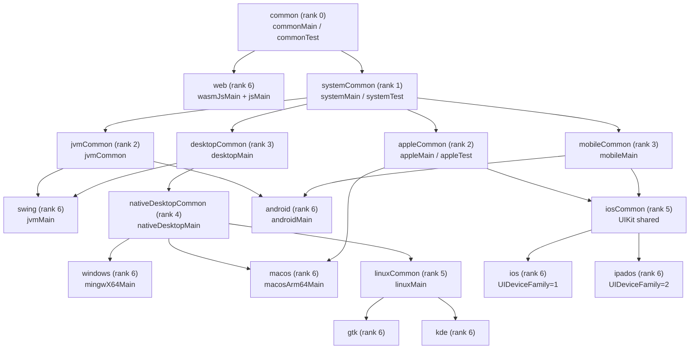

# GenericUI Hierarchical SourceSet Setup & Variant Scopes Guide

> **Root Repository**: [**GenericUI (`../README.md`)**](../README.md) | **Master Docs Index**: [**`docs/README.md`**](./README.md)  
> **Related Guides**: [Shared JVM (`jvm.md`)](./jvm.md) · [Shared Apple (`apple.md`)](./apple.md) · [iPadOS (`ipados.md`)](./ipados.md) · [Gradle Plugin (`gradle-plugin.md`)](./gradle-plugin.md) · [Fragments & Windows (`fragments-and-windows.md`)](./fragments-and-windows.md) · [Application (`application.md`)](./application.md) · [Resources (`resources.md`)](./resources.md) · [Platform Backends (`backends.md`)](./backends.md)

GenericUI is designed around a **Single-`commonMain` First** workflow: a standard application contains only `src/commonMain` (and `src/commonTest`), while the GenericUI Gradle plugin generates all backend launchers, 1:1 Android `AppCompatActivity` classes, iOS & iPadOS Xcode apps, manifests, and resource bindings automatically.

When an application or library needs target-specific dependencies or platform-specific code (such as an Android background `Service` in `src/androidMain` or shared Darwin code in `src/appleMain`), [`GenericUiMultiplatformConfigurator`](../gradle-plugin/src/main/kotlin/com/nexustools/genericui/plugin/GenericUiMultiplatformConfigurator.kt) and [`GenericUiSourceSetsConfig`](../gradle-plugin/src/main/kotlin/com/nexustools/genericui/plugin/GenericUiSourceSetsConfig.kt) provide a multi-tier **Kotlin Multiplatform SourceSet & Variant Scope Hierarchy** matching [`AppTarget`](../common/src/commonMain/kotlin/com/nexustools/genericui/enums/system/AppTarget.kt) and [`GenericUiVariantScope`](../gradle-plugin/src/main/kotlin/com/nexustools/genericui/plugin/GenericUiVariantScope.kt) (`0..6`). Intermediate source sets are created **only when configured or when their source directory exists on disk**, keeping single-`commonMain` projects completely clean.

---

## 1. Visual SourceSet & Variant Scope Hierarchy

```text
common (commonMain / commonTest — rank 0)
├── web (webMain / webTest — rank 6)
│   ├── wasmJsMain / wasmJsTest  [Primary WebAssembly target]
│   └── jsMain / jsTest          [Automatic JS IR fallback target]
└── systemCommon (systemCommon / systemMain / systemTest — rank 1)
    ├── jvmCommon (jvmCommon / jvmCommonTest — rank 2)      [JVM Swing + Android]
    ├── appleCommon (appleMain / appleTest — rank 2)        [macOS + iOS + iPadOS]
    ├── desktopCommon (desktopCommon / desktopMain — rank 3)
    │   ├── swing (swingMain / swingTest -> jvmMain / jvmTest — rank 6)
    │   └── nativeDesktopCommon (nativeDesktopCommon / nativeDesktopMain — rank 4)
    │       ├── windows (windowsMain -> mingwX64Main — rank 6)
    │       ├── macos / mac (macosMain / macMain -> macosArm64Main — rank 6)
    │       └── linuxCommon (linuxCommon / linuxMain -> linuxX64Main, linuxArm64Main — rank 5)
    │           ├── gtk (gtkMain — rank 6)
    │           └── kde (kdeMain — rank 6)
    └── mobileCommon (mobileCommon / mobileMain — rank 3)
        ├── android (androidMain — rank 6)
        └── iosCommon (iosCommon / iosCommonMain — rank 5) [iOS iPhone + iPadOS iPad]
            ├── ios (iosMain -> iosArm64Main, iosSimulatorArm64Main — rank 6)
            └── ipados / ipad (ipadosMain -> iosArm64Main, iosSimulatorArm64Main — rank 6)
```

### Mermaid Specificity Graph (`0 → 6`)



---

## 2. SourceSet Tier, `AppTarget`, & GenericUI Consolidated Module Mapping

> [!NOTE]
> **Framework Modules vs. Consumer SourceSets**: Inside the **51-project** GenericUI repository (`49` `GenericUiGradlePlugin.KNOWN_GENERICUI_MODULES` plus `:gradle-plugin` & `:idea-plugin`, alongside `lib/NJS`), core implementations are organized into consolidated KMP modules (`:common`, `:system`, `:jvm`, `:apple`, `:desktop`, `:mobile`, `:web`) with multi-target source sets (`nativeDesktopMain`, `linuxMain`, `mingwMain`, `macosMain`, `jvmMain`, `androidMain`, `iosMain`). Consumer applications use **source sets inside their own single Gradle project** (`src/commonMain`, and optionally `src/appleMain`, `src/androidMain`, `src/ipadosMain`, etc.).

| Variant Scope (`GenericUiSourceSetsConfig`) | `AppTarget` Enum (`specificityRank`) | Backing GenericUI Module / SourceSet | Consumer Source Directories (Optional except `commonMain`) | Target Scope & Purpose |
| :--- | :--- | :--- | :--- | :--- |
| **`common`** | `AppTarget.COMMON` (`0`) | **`:common`** | `src/commonMain/kotlin`<br/>`src/commonTest/kotlin`<br/>`src/commonMain/resources` | **100% Cross-Platform Code**: `@MainAppFragment`, `@AppFragment`, UI components, layouts, `PreferenceStore`, `Resource` access, and tests shared across all 9 backends. |
| **`systemCommon`** | `AppTarget.SYSTEM_COMMON` (`1`) | **`:system`** | `src/systemCommon/kotlin`<br/>`src/systemMain/kotlin` | **All 8 Non-Web OS Targets**: Blink style/layout engines, pure-Kotlin system utilities, filesystem/socket logic (`Windows`, `MacOS`, `Gtk`, `Kde`, `Swing`, `Android`, `IOS`, `IPadOS`). |
| **`appleCommon`** | `AppTarget.APPLE_COMMON` (`2`) | **`:apple`** | `src/appleMain/kotlin`<br/>`src/appleCommon/kotlin` | **All 3 Apple Darwin Targets (`MacOS`, `IOS`, `IPadOS`)**: `AppleStyledSurfaceHelper`, `AppleBackdropFilterController`, `Foundation`, `CoreFoundation`, `Security`, `Network`, `ImageIO`, `CoreGraphics`, `UniformTypeIdentifiers`, `UserNotifications`, and `libsqlite3` shared code. |
| **`jvmCommon`** | `AppTarget.JVM_COMMON` (`2`) | **`:jvm`** | `src/jvmCommon/kotlin` | **Both JVM Targets (`Swing` + `Android`)**: Shared Java/JDK 11 NIO, HTTP, RFC 6455 WebSockets, JDBC/SQLite, `JvmIoExecutor`, `JvmBackdropCapturePlanner`, and pixel-tinting helpers. |
| **`desktopCommon`** | `AppTarget.DESKTOP_COMMON` (`3`) | **`:desktop`** (`commonMain`) | `src/desktopCommon/kotlin`<br/>`src/desktopMain/kotlin` | **All 5 Desktop Targets (`Windows`, `MacOS`, `Gtk`, `Kde`, `Swing`)**: Multi-window workflows, desktop file browser helpers, lazy viewport engines, and system tray logic. |
| **`mobileCommon`** | `AppTarget.MOBILE_COMMON` (`3`) | **`:mobile`** (`commonMain`) | `src/mobileCommon/kotlin`<br/>`src/mobileMain/kotlin` | **All 3 Mobile Targets (`Android`, `IOS`, `IPadOS`)**: Form-factor posture detection, multi-touch gestures, fling physics, PiP controllers, and mobile lazy viewport pools. |
| **`nativeDesktopCommon`** | `AppTarget.NATIVE_DESKTOP_COMMON` (`4`) | **`:desktop`** (`nativeDesktopMain`) | `src/nativeDesktopCommon/kotlin`<br/>`src/nativeDesktopMain/kotlin` | **All 4 Native Desktop Targets (`Windows`, `MacOS`, `Gtk`, `Kde`)**: Kotlin/Native `kotlinx.cinterop` (`CPointer`, `memScoped`), `DesktopContainerLayoutController`, `DesktopStyledWidgetDelegate`, `DesktopButtonNativeImpl`, POSIX/Win32 native helpers, and multi-window dock coordination. |
| **`linuxCommon`** | `AppTarget.LINUX_COMMON` (`5`) | **`:desktop`** (`linuxMain`) | `src/linuxCommon/kotlin`<br/>`src/linuxMain/kotlin` | **Linux Desktop Targets (`Gtk` + `Kde`)**: Shared Linux XDG config/cache/preference storage, toolkit-agnostic `linux/style` (`LinuxStyledSurfaceHelper`, `LinuxBackdropFilterController`), ELF resources, D-Bus, and Wayland/X11 helpers. |
| **`iosCommon`** | `AppTarget.IOS_COMMON` (`5`) | **`:mobile`** (`iosMain`) | `src/iosCommon/kotlin` | **Apple UIKit Targets (`IOS` + `IPadOS`)**: UIKit shared views, `CADisplayLink`, `UIDocumentPickerViewController`, and MoltenVK code shared between iPhone and iPad. |
| **`windows`** | `AppTarget.WINDOWS` (`6`) | **`:desktop`** (`mingwMain`) | `src/windowsMain/kotlin` | **Windows (`mingwX64`)**: Win32 child `HWND`s (`ComCtl32 v6`), Direct2D, Google ANGLE, Vulkan. |
| **`macos`** (`mac`) | `AppTarget.MACOS` (`6`) | **`:desktop`** (`macosMain`) | `src/macosMain/kotlin`<br/>`src/macMain/kotlin` | **macOS (`macosArm64`)**: AppKit/Cocoa, system `NSMenu`, MoltenVK. |
| **`gtk`** | `AppTarget.GTK` (`6`) | **`:desktop`** (`linuxMain`) | `src/gtkMain/kotlin` | **Linux GTK4 (`linuxX64`, `linuxArm64`)**: GTK4 / Libadwaita / GSK / Cairo (`libgenericui-gtk.so`). |
| **`kde`** | `AppTarget.KDE` (`6`) | **`:desktop`** (`linuxMain`) | `src/kdeMain/kotlin` | **Linux KDE (`linuxX64`, `linuxArm64`)**: `KF6` + `Breeze` on `Qt6` alien `QWidget*` (`libgenericui-kde.so`). |
| **`swing`** | `AppTarget.SWING` (`6`) | **`:desktop`** (`jvmMain`) | `src/swingMain/kotlin`<br/>`src/jvmMain/kotlin` | **JVM Swing (`jvm`)**: AWT/Swing, Java2D, optional LWJGL 3 OpenGL ES & Vulkan. |
| **`android`** | `AppTarget.ANDROID` (`6`) | **`:mobile`** (`androidMain`) | `src/androidMain/kotlin` | **Android**: Android-only code such as background `Service` subclasses (`android { services { ... } }`), MediaSession, or Cast SDK integration. |
| **`ios`** | `AppTarget.IOS` (`6`) | **`:mobile`** (`iosMain`) | `src/iosMain/kotlin` | **iOS iPhone (`iosArm64`, `iosSimulatorArm64`; `UIDeviceFamily = 1`)**: iPhone-specific UIKit tuning. |
| **`ipados`** (`ipad`) | `AppTarget.IPADOS` (`6`) | **`:mobile`** (`iosMain`) | `src/ipadosMain/kotlin` | **iPadOS iPad (`iosArm64`, `iosSimulatorArm64`; `UIDeviceFamily = 2`)**: Stage Manager / Split View scenes, `UIMenuSystem`, and trackpad/keyboard integration. |
| **`web`** | `AppTarget.WEB` (`6`) | **`:web`** | `src/webMain/kotlin` | **Web (`wasmJs` + `js`)**: Browser DOM, WebGL2 / WebGPU, `#hash` + `window.history.state` bridge, and PWA manifest integration. |

---

## 3. Configuring Optional SourceSet Dependencies (`genericui { sourceSets { ... } }`)

Each scope in `genericui { sourceSets { ... } }` configures a [`GenericUiSourceSetSpec`](../gradle-plugin/src/main/kotlin/com/nexustools/genericui/plugin/GenericUiSourceSetSpec.kt) supporting `implementation(...)`, `api(...)`, `compileOnly(...)`, `runtimeOnly(...)`, `project(...)`, `kotlinSrcDir(path)`, and `resourcesSrcDir(path)`. Dependencies propagate down the hierarchy tree:

```kotlin
plugins {
    id("com.nexustools.genericui")
}

genericui {
    app {
        id = "com.example.studio"
        name = "Studio"
        version = "1.0.0"
    }

    backends {
        all() // Enables all 9 targets including Windows, macOS, GTK, KDE, Swing, Android, iOS, iPadOS, and Web
    }

    sourceSets {
        common {
            api(project(":studio-domain-model"))
            implementation("org.jetbrains.kotlinx:kotlinx-serialization-json:1.8.0")
        }

        // Shared across all 8 OS targets (excludes Web)
        systemCommon {
            implementation("com.squareup.okio:okio:3.9.1")
        }

        // Shared across macOS, iOS, and iPadOS
        appleCommon {
            // Optional Darwin / CoreAudio / Apple-only libraries
        }

        // Shared across Swing and Android
        jvmCommon {
            // Optional JVM 11 libraries
        }

        // Shared across Windows, macOS, GTK, and KDE (excludes JVM Swing, Mobile, and Web)
        nativeDesktopCommon {
            implementation(project(":native-dsp-bridge"))
        }

        // Android only (e.g. for background Service classes in src/androidMain/kotlin)
        android {
            implementation("androidx.media:media:1.7.0")
        }
    }

    // Per-variant native C/C++/JNI & CInterop scopes mirror the exact same 0..6 hierarchy (`GenericUiVariantConfig`):
    // jni { jniLibsDirs("src/androidMain/jniLibs"); library("native_dsp") { sources("src/native/cpp"); buildHostLibraryForTests = true } }
    // cinterops { create("native_dsp") { defFile("src/native/native_dsp.def"); packageName("com.example.studio.native") } }
    // nativeLibraries { link("native_dsp"); libraryDirs("libs") }
}
```

### 3.1 Plugin-Generated `commonMain` & Native Source Sets

When enabled in `genericui { ... }`, `:gradle-plugin` automatically wires generated source directories into the consumer project's compilations (and stages compiled native libraries per target):
- **Scoped `R` / `RC` / `Resource` & Precompiled Stylesheets**: Emits typed `<appPkg>.res` classes and `.scss` `PrecompiledStyleSheet` objects into `build/generated/genericui/commonMain/kotlin`.
- **Schema Codegen (`extensions { schema() }`)**: Emits `<ClassName>SchemaDescriptor.kt` and `GeneratedSchemaRegistrar.kt` from `@SchemaData` classes into `build/generated/genericui/schema/commonMain/kotlin`.
- **ServiceWorker Codegen (`extensions { serviceWorker { ... } }`)**: Validates `@MainServiceWorker` and emits `<Msg>ServiceWorkerCodec.kt` and `GeneratedServiceWorkerCodecRegistrar.kt` from `@ServiceWorkerMessage` classes into `build/generated/genericui/serviceworker/commonMain/kotlin`.
- **Variant-Scoped Native Libraries (`jni`, `cinterops`, `nativeLibraries`)**: Can be configured globally on `genericui { ... }` or inside any target/variant block (`windows { ... }`, `macos { ... }`, `android { ... }`, `linuxCommon { ... }`, etc.), staging `.so` libraries into Android APKs (`16KB` page-aligned) and host binaries into JVM Swing `META-INF/native/<os>-<arch>/` + `jvmTest` runtime paths.
```

---

## 4. Using Variant Scopes with `@MainAppFragment` and `expect` / `actual`

### 4.1 Variant-Scoped `@MainAppFragment` Overrides

You do not need separate source sets to use different root fragments per target family. Annotate multiple fragments in `src/commonMain/kotlin` with different [`AppTarget`](../common/src/commonMain/kotlin/com/nexustools/genericui/enums/system/AppTarget.kt) scopes:

```kotlin
import com.nexustools.genericui.component.fragment.Fragment
import com.nexustools.genericui.component.fragment.MainAppFragment
import com.nexustools.genericui.enums.system.AppTarget

// Used on Desktop (Windows, macOS, GTK, KDE, Swing) and Web (specificity rank 0)
@MainAppFragment(targets = [AppTarget.COMMON], label = "Studio Workspace")
class DesktopAndWebWorkspaceFragment : Fragment()

// Overrides COMMON on Android, iOS, and iPadOS because MOBILE_COMMON (rank 3) > COMMON (rank 0)
@MainAppFragment(targets = [AppTarget.MOBILE_COMMON], label = "Studio Mobile")
class MobileWorkspaceFragment : Fragment()

// Overrides MOBILE_COMMON specifically on iPadOS because IPADOS (rank 6) > MOBILE_COMMON (rank 3)
@MainAppFragment(targets = [AppTarget.IPADOS], label = "Studio iPad")
class IpadStudioFragment : Fragment()
```

### 4.2 Resolving `expect` / `actual` at `web` vs. `systemCommon`

When platform-specific APIs are needed, `expect` declarations in `commonMain` can be satisfied with just two `actual` implementations—one in `webMain` and one in `systemCommon` (shared by all 8 desktop and mobile targets):

```kotlin
// src/commonMain/kotlin/com/example/app/PlatformCapabilities.kt
package com.example.app

expect object PlatformCapabilities {
    val hasRawSockets: Boolean
}

// src/webMain/kotlin/com/example/app/PlatformCapabilities.web.kt
package com.example.app

actual object PlatformCapabilities {
    actual val hasRawSockets: Boolean = false
}

// src/systemCommon/kotlin/com/example/app/PlatformCapabilities.system.kt
package com.example.app

actual object PlatformCapabilities {
    // Shared across Windows, macOS, GTK, KDE, Swing, Android, iOS, and iPadOS
    actual val hasRawSockets: Boolean = true
}
```
