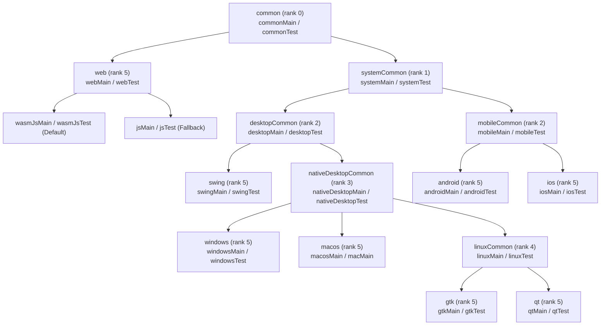

# GenericUI Hierarchical SourceSet Setup & Variant Scopes Guide

> **Root Repository**: [**GenericUI (`../README.md`)**](../README.md) | **Master Docs Index**: [**`docs/README.md`**](./README.md)  
> **Related Guides**: [Gradle Plugin (`gradle-plugin.md`)](./gradle-plugin.md) · [Fragments & Windows (`fragments-and-windows.md`)](./fragments-and-windows.md) · [Application (`application.md`)](./application.md) · [Resources (`resources.md`)](./resources.md) · [Platform Backends (`backends.md`)](./backends.md)

GenericUI is designed around a **Single-`commonMain` First** workflow: a standard application contains only `src/commonMain` (and `src/commonTest`), while the GenericUI Gradle plugin generates all backend launchers, Android `AppCompatActivity` classes, manifests, and resource bindings automatically.

When an application or library needs target-specific dependencies or platform-specific code (such as an Android background `Service` in `src/androidMain`), [`GenericUiMultiplatformConfigurator`](../gradle-plugin/src/main/kotlin/com/nexustools/genericui/plugin/GenericUiMultiplatformConfigurator.kt) and [`GenericUiSourceSetsConfig`](../gradle-plugin/src/main/kotlin/com/nexustools/genericui/plugin/GenericUiSourceSetsConfig.kt) provide a multi-tier **Kotlin Multiplatform SourceSet & Variant Scope Hierarchy**. Intermediate source sets are created **only when configured or when their source directory exists on disk**, keeping single-`commonMain` projects completely clean.

---

## 1. Visual SourceSet & Variant Scope Hierarchy

```text
common (commonMain / commonTest)
├── web (webMain / webTest)
│   ├── wasmJsMain / wasmJsTest  [Primary WebAssembly target]
│   └── jsMain / jsTest          [Automatic JS IR fallback target]
└── systemCommon (systemMain / systemTest)
    ├── desktopCommon (desktopMain / desktopTest)
    │   ├── swing (swingMain / swingTest -> jvmMain / jvmTest)
    │   └── nativeDesktopCommon (nativeDesktopMain / nativeDesktopTest)
    │       ├── windows (windowsMain / windowsTest -> mingwX64Main / mingwX64Test)
    │       ├── macos / mac (macosMain / macMain / macosTest -> macosArm64Main, macosX64Main)
    │       └── linuxCommon (linuxMain / linuxTest -> linuxX64Main, linuxArm64Main)
    │           ├── gtk (gtkMain / gtkTest)
    │           └── qt (qtMain / qtTest)
    └── mobileCommon (mobileMain / mobileTest)
        ├── android (androidMain / androidTest)
        └── ios (iosMain / iosTest -> iosArm64Main, iosSimulatorArm64Main)
```

### Mermaid `dependsOn` & Specificity Graph



---

## 2. SourceSet Tier, `AppTarget`, & GenericUI Module Mapping

> [!NOTE]
> **Framework Modules vs. Consumer SourceSets**: Inside the GenericUI repository, backends and extensions are organized as **separate Gradle modules** (`:common`, `:systemCommon`, `:desktop:common`, `:desktop:nativeCommon`, `:desktop:linuxCommon`, `:desktop:{windows,macos,gtk,qt,swing}`, `:mobile:common`, `:mobile:{android,ios}`, `:web`). Consumer applications use **nested source sets in a single Gradle project** (`src/commonMain`, and optionally `src/androidMain`, `src/nativeDesktopCommon`, etc.).

| Variant Scope | `AppTarget` Enum (`specificityRank`) | Corresponding GenericUI Core Module | Consumer Source Directories (Optional except `commonMain`) | Target Scope & Purpose |
| :--- | :--- | :--- | :--- | :--- |
| **`common`** | `AppTarget.COMMON` (`0`) | **`:common`** | `src/commonMain/kotlin`<br/>`src/commonTest/kotlin`<br/>`src/commonMain/resources` | **100% Cross-Platform Code**: `@MainAppFragment`, `@AppFragment`, UI components, layouts, `PreferenceStore`, `Resource` access, and tests shared across all 8 backends. |
| **`systemCommon`** | `AppTarget.SYSTEM_COMMON` (`1`) | **`:systemCommon`** | `src/systemCommon/kotlin`<br/>`src/systemMain/kotlin` | **All 7 Non-Web OS Targets (`Windows`, `MacOS`, `Gtk`, `Qt`, `Swing`, `Android`, `IOS`)**: Pure-Kotlin system logic (includes JVM/Swing), direct filesystem access, sockets, and CLI argument handling. |
| **`desktopCommon`** | `AppTarget.DESKTOP_COMMON` (`2`) | **`:desktop:common`** | `src/desktopCommon/kotlin`<br/>`src/desktopMain/kotlin` | **All 5 Desktop Targets (`Swing` + Native Desktop)**: Multi-window workflows, desktop file browser helpers, lazy viewport engines, and system tray logic. |
| **`nativeDesktopCommon`** | `AppTarget.NATIVE_DESKTOP_COMMON` (`3`) | **`:desktop:nativeCommon`** | `src/nativeDesktopCommon/kotlin`<br/>`src/nativeDesktopMain/kotlin` | **All 4 Native Desktop Targets (`Windows`, `MacOS`, `Gtk`, `Qt`)**: Kotlin/Native `kotlinx.cinterop` (`CPointer`, `memScoped`), POSIX/Win32 native helpers, and multi-window dock coordination. |
| **`linuxCommon`** | `AppTarget.LINUX_COMMON` (`4`) | **`:desktop:linuxCommon`** | `src/linuxCommon/kotlin`<br/>`src/linuxMain/kotlin` | **Linux Desktop Targets (`Gtk` + `Qt`)**: Shared Linux XDG config/cache directories (`LinuxXdgConfigDirectoryImpl`, `LinuxXdgCacheDirectoryImpl`, `LinuxXdgPreferenceStoreImpl`), D-Bus, and Wayland/X11 helpers. |
| **`windows`** | `AppTarget.WINDOWS` (`5`) | **`:desktop:windows`** | `src/windowsMain/kotlin` | **Windows (`mingwX64`)**: Win32 APIs, Direct2D, Google ANGLE, Vulkan. |
| **`macos`** (`mac`) | `AppTarget.MACOS` (`5`) | **`:desktop:macos`** | `src/macosMain/kotlin`<br/>`src/macMain/kotlin` | **macOS (`macosArm64`, `macosX64`)**: AppKit/Cocoa, system menu bar, MoltenVK. |
| **`gtk`** | `AppTarget.GTK` (`5`) | **`:desktop:gtk`** | `src/gtkMain/kotlin` | **Linux GTK4 (`linuxX64`, `linuxArm64`)**: GTK4 / Libadwaita / Cairo. |
| **`qt`** | `AppTarget.QT` (`5`) | **`:desktop:qt`** | `src/qtMain/kotlin` | **Linux Qt6 (`linuxX64`, `linuxArm64`)**: Qt6 `QWidget` / `QPainter` / `QVulkanWindow`. |
| **`swing`** | `AppTarget.SWING` (`5`) | **`:desktop:swing`** | `src/swingMain/kotlin`<br/>`src/jvmMain/kotlin` | **JVM Swing (`jvm`)**: AWT/Swing, Java2D, optional LWJGL 3 OpenGL ES & Vulkan. |
| **`mobileCommon`** | `AppTarget.MOBILE_COMMON` (`2`) | **`:mobile:common`** | `src/mobileCommon/kotlin`<br/>`src/mobileMain/kotlin` | **Mobile Targets (`Android` + `IOS`)**: Form-factor posture detection, multi-touch gestures, fling physics, PiP controllers, and mobile lazy viewport pools. |
| **`android`** | `AppTarget.ANDROID` (`5`) | **`:mobile:android`** | `src/androidMain/kotlin` | **Android**: Optional Android-only code such as background `Service` subclasses (`android { services { ... } }`), MediaSession, or Cast SDK integration. |
| **`ios`** | `AppTarget.IOS` (`5`) | **`:mobile:ios`** | `src/iosMain/kotlin` | **iOS (`iosArm64`, `iosSimulatorArm64`)**: UIKit, `CADisplayLink`, `UIDocumentPickerViewController`, MoltenVK. |
| **`web`** | `AppTarget.WEB` (`5`) | **`:web`** | `src/webMain/kotlin` | **Web (`wasmJs` + `js`)**: Browser DOM, WebGL2 / WebGPU, `#hash` + `window.history.state` bridge, and PWA manifest integration. |

---

## 3. Configuring Optional SourceSet Dependencies (`genericui { sourceSets { ... } }`)

Each scope in `genericui { sourceSets { ... } }` configures a [`GenericUiSourceSetSpec`](../gradle-plugin/src/main/kotlin/com/nexustools/genericui/plugin/GenericUiSourceSetSpec.kt) supporting:
- `implementation(dependencyNotation)`
- `api(dependencyNotation)`
- `compileOnly(dependencyNotation)`
- `runtimeOnly(dependencyNotation)`
- `project(":module-name")`
- `kotlinSrcDir(path)` and `resourcesSrcDir(path)`

Dependencies declared on an intermediate scope (such as `systemCommon` or `nativeDesktopCommon`) propagate **only** to the targets beneath that scope:

```kotlin
plugins {
    id("com.nexustools.genericui")
}

genericui {
    app {
        id = "com.example.studio"
        name = "Studio"
        version = "1.0.0"
    }

    backends {
        all()
    }

    sourceSets {
        common {
            api(project(":studio-domain-model"))
            implementation("org.jetbrains.kotlinx:kotlinx-serialization-json:1.8.0")
        }

        // Shared across Windows, macOS, GTK, Qt, Swing, Android, and iOS (excludes Web)
        systemCommon {
            implementation("com.squareup.okio:okio:3.9.1")
        }

        // Shared across Windows, macOS, GTK, and Qt (excludes JVM Swing, Mobile, and Web)
        nativeDesktopCommon {
            implementation(project(":native-dsp-bridge"))
        }

        // JVM Swing only
        swing {
            implementation("com.formdev:flatlaf:3.5.4")
        }

        // Android only (e.g. for background Service classes in src/androidMain/kotlin)
        android {
            implementation("androidx.media:media:1.7.0")
        }
    }
}
```

---

## 4. Using Variant Scopes with `@MainAppFragment` and `expect` / `actual`

### 4.1 Variant-Scoped `@MainAppFragment` Overrides

You do not need separate source sets to use different root fragments per target family. Annotate multiple fragments in `src/commonMain/kotlin` with different [`AppTarget`](../common/src/commonMain/kotlin/com/nexustools/genericui/enums/system/AppTarget.kt) scopes:

```kotlin
import com.nexustools.genericui.component.fragment.Fragment
import com.nexustools.genericui.component.fragment.MainAppFragment
import com.nexustools.genericui.enums.system.AppTarget

// Used on Desktop (Windows, macOS, GTK, Qt, Swing) and Web (specificity rank 0)
@MainAppFragment(targets = [AppTarget.COMMON], label = "Studio Workspace")
class DesktopAndWebWorkspaceFragment : Fragment()

// Overrides COMMON on Android and iOS because MOBILE_COMMON (rank 2) > COMMON (rank 0)
@MainAppFragment(targets = [AppTarget.MOBILE_COMMON], label = "Studio Mobile")
class MobileWorkspaceFragment : Fragment()
```

### 4.2 Resolving `expect` / `actual` at `web` vs. `systemCommon`

When platform-specific APIs are needed, `expect` declarations in `commonMain` can be satisfied by just two `actual` implementations—one in `webMain` and one in `systemCommon` (shared by all 7 desktop and mobile targets):

```kotlin
// src/commonMain/kotlin/com/example/app/PlatformCapabilities.kt
package com.example.app

expect object PlatformCapabilities {
    val hasRawSockets: Boolean
}

// src/webMain/kotlin/com/example/app/PlatformCapabilities.web.kt
package com.example.app

actual object PlatformCapabilities {
    actual val hasRawSockets: Boolean = false
}

// src/systemCommon/kotlin/com/example/app/PlatformCapabilities.system.kt
package com.example.app

actual object PlatformCapabilities {
    // Shared across Windows, macOS, GTK, Qt, Swing, Android, and iOS
    actual val hasRawSockets: Boolean = true
}
```
