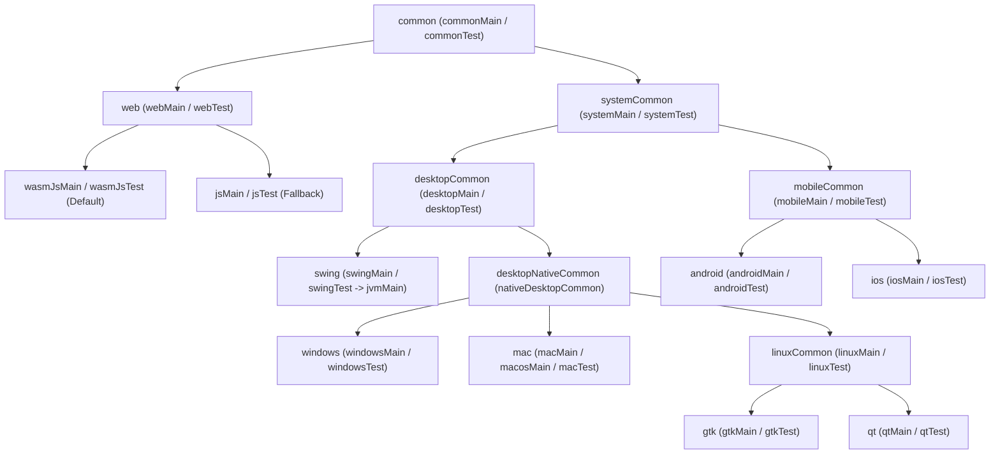

# GenericUI Hierarchical SourceSet Setup & Shared Code Guide

`GenericUI`'s Gradle Plugin (`id("com.nexustools.genericui")` via [`GenericUiMultiplatformConfigurator`](../gradle-plugin/src/main/kotlin/com/nexustools/genericui/plugin/GenericUiMultiplatformConfigurator.kt) and [`GenericUiSourceSetsConfig`](../gradle-plugin/src/main/kotlin/com/nexustools/genericui/plugin/GenericUiSourceSetsConfig.kt)) automatically constructs a multi-tier **Kotlin Multiplatform SourceSet Hierarchy** so applications can share code at the exact level of granularity required without duplicating platform logic.

---

## Navigation & Related Documentation

- **Root Repository**: [GenericUI README](../README.md) | [Master Documentation Index](README.md)
- **Build & IDE Tooling**: [Gradle Plugin Guide](gradle-plugin.md) | [IntelliJ IDEA Plugin Guide](idea-plugin.md)
- **Platform Backends**: [Backends Overview](backends.md) | [Desktop Submodule](../desktop/README.md) | [Mobile Submodule](../mobile/README.md) | [Web Submodule](../web/README.md)
- **Extensions & Testing**: [Extensions Overview](extensions.md) | [Extensions Submodule](../extensions/README.md) | [Testing Guide (`JestElectricRunner`)](testing.md)

---

## 1. Visual SourceSet Hierarchy

When `genericui { ... }` is configured, the Gradle plugin wires the following `dependsOn` hierarchy for both production (`Main`) and verification (`Test`) compilations:

```text
common (common / commonMain / commonTest)
├── web (web / webMain / webTest)
│   ├── wasmJsMain / wasmJsTest  [Primary WebAssembly target]
│   └── jsMain / jsTest          [Automatic JS IR fallback target]
└── systemCommon (systemCommon / systemMain / systemTest)
    ├── desktopCommon (desktopCommon / desktopMain / desktopTest)
    │   ├── swing (swing / swingMain / swingTest)
    │   │   └── jvmMain / jvmTest
    │   └── desktopNativeCommon (desktopNativeCommon / desktopNativeMain / desktopNativeTest)
    │       │  (alias: nativeDesktopCommon / nativeDesktopMain / nativeDesktopTest)
    │       ├── windows (windows / windowsMain / windowsTest)
    │       │   └── mingwX64Main / mingwX64Test
    │       ├── mac (mac / macMain / macosMain / macTest / macosTest)
    │       │   ├── macosArm64Main / macosArm64Test
    │       │   └── macosX64Main / macosX64Test
    │       └── linuxCommon (linuxCommon / linuxMain / linuxTest)
    │           ├── gtk (gtk / gtkMain / gtkTest)
    │           │   ├── linuxX64Gtk / linuxX64Main / linuxX64Test
    │           │   └── linuxArm64Gtk / linuxArm64Main / linuxArm64Test
    │           └── qt (qt / qtMain / qtTest)
    │               ├── linuxX64Qt / linuxX64Main / linuxX64Test
    │               └── linuxArm64Qt / linuxArm64Main / linuxArm64Test
    └── mobileCommon (mobileCommon / mobileMain / mobileTest)
        ├── android (android / androidMain / androidTest)
        │   └── androidUnitTest / androidInstrumentedTest
        └── ios (ios / iosMain / iosTest)
            ├── iosArm64Main / iosArm64Test
            └── iosSimulatorArm64Main / iosSimulatorArm64Test
```

### Mermaid `dependsOn` Graph



---

## 2. SourceSet Tier Reference & Directory Conventions

Every tier in the hierarchy automatically registers both its short directory name (e.g., `src/windows/kotlin`) and its `*Main` / `*Test` directory name (e.g., `src/windowsMain/kotlin`, `src/windowsTest/kotlin`):

| Tier / SourceSet | Parent SourceSet | Kotlin Source Directories | Resource Directories | Target Scope & When to Use |
| :--- | :--- | :--- | :--- | :--- |
| **`common`**<br/>(`commonMain`, `commonTest`) | *(Root)* | `src/common/kotlin`<br/>`src/commonMain/kotlin`<br/>`src/commonTest/kotlin` | `src/common/resources`<br/>`src/commonMain/resources` | **100% Cross-Platform Shared Code**: `Application`, `FragmentApplication`, `Fragment`s, UI components, view models, styles, and business logic shared across Web, Desktop, and Mobile. |
| **`web`**<br/>(`webMain`, `webTest`) | `common` | `src/web/kotlin`<br/>`src/webMain/kotlin`<br/>`src/webTest/kotlin` | `src/web/resources`<br/>`src/webMain/resources` | **Browser Shared Code (`wasmJs` + `js`)**: Code shared between the primary Kotlin/Wasm bundle and the fallback Kotlin/JS IR bundle (`WebApplicationImpl`, browser URL routing, `localStorage` persistence). See [Web Submodule Docs](../web/README.md). |
| **`systemCommon`**<br/>(`systemMain`, `systemTest`)<br/>*(alias: `appCommon`)* | `common` | `src/systemCommon/kotlin`<br/>`src/systemMain/kotlin`<br/>`src/systemTest/kotlin` | `src/systemCommon/resources`<br/>`src/systemMain/resources` | **All Non-Web Targets (Desktop + Mobile)**: Direct OS filesystem access, raw TCP/UDP sockets, local process/daemon management, LAN discovery (mDNS/SSDP/Cast), and background worker threads not available in browser sandboxes. |
| **`desktopCommon`**<br/>(`desktopMain`, `desktopTest`) | `systemCommon` | `src/desktopCommon/kotlin`<br/>`src/desktopMain/kotlin`<br/>`src/desktopTest/kotlin` | `src/desktopCommon/resources`<br/>`src/desktopMain/resources` | **All Desktop Targets (`Swing` + Native Desktop)**: Multi-window management, desktop keyboard shortcuts, menu bars, status bars, and desktop-specific UI workflows shared across JVM Swing and native C/C++ desktop backends. See [Desktop Submodule Docs](../desktop/README.md). |
| **`swing`**<br/>(`swingMain`, `swingTest`) | `desktopCommon` | `src/swing/kotlin`<br/>`src/swingMain/kotlin`<br/>`src/swingTest/kotlin` | `src/swing/resources`<br/>`src/swingMain/resources` | **JVM Swing Target**: Java/JVM interop, AWT/Swing custom integrations, and optional LWJGL 3 OpenGL ES / Vulkan hooks. See [Swing Backend Guide](../desktop/docs/swing.md). |
| **`desktopNativeCommon`**<br/>(`desktopNativeMain`, `desktopNativeTest`)<br/>*(alias: `nativeDesktopCommon`)* | `desktopCommon` | `src/desktopNativeCommon/kotlin`<br/>`src/desktopNativeMain/kotlin`<br/>`src/nativeDesktopCommon/kotlin`<br/>`src/desktopNativeTest/kotlin` | `src/desktopNativeCommon/resources`<br/>`src/nativeDesktopCommon/resources` | **All Native Desktop Targets (`windows`, `mac`, `gtk`, `qt`)**: Kotlin/Native `kotlinx.cinterop` pointers (`CPointer`, `memScoped`), POSIX/Win32 shared native memory buffers, and `:desktop:shared` native helpers. See [Desktop Shared Guide](../desktop/docs/shared.md). |
| **`windows`**<br/>(`windowsMain`, `windowsTest`) | `desktopNativeCommon` | `src/windows/kotlin`<br/>`src/windowsMain/kotlin`<br/>`src/windowsTest/kotlin` | `src/windows/resources`<br/>`src/windowsMain/resources` | **Windows Native Target (`mingwX64`)**: Win32 API calls, registry helpers, Direct2D/ANGLE/Vulkan surface hooks. See [Windows Backend Guide](../desktop/docs/windows.md). |
| **`mac`**<br/>(`macMain`, `macosMain`, `macTest`, `macosTest`) | `desktopNativeCommon` | `src/mac/kotlin`<br/>`src/macMain/kotlin`<br/>`src/macosMain/kotlin`<br/>`src/macTest/kotlin` | `src/mac/resources`<br/>`src/macMain/resources`<br/>`src/macosMain/resources` | **macOS Native Targets (`macosArm64`, `macosX64`)**: AppKit/Cocoa Objective-C interop, macOS system menu bar actions, MoltenVK hooks. See [macOS Backend Guide](../desktop/docs/macos.md). |
| **`linuxCommon`**<br/>(`linuxMain`, `linuxTest`) | `desktopNativeCommon` | `src/linuxCommon/kotlin`<br/>`src/linuxMain/kotlin`<br/>`src/linuxTest/kotlin` | `src/linuxCommon/resources`<br/>`src/linuxMain/resources` | **Linux Native Shared Code (`gtk` + `qt`)**: Shared POSIX/Linux APIs, XDG directories, D-Bus notifications, Wayland/X11 environment helpers shared by both GTK4 and Qt6 builds. |
| **`gtk`**<br/>(`gtkMain`, `gtkTest`) | `linuxCommon` | `src/gtk/kotlin`<br/>`src/gtkMain/kotlin`<br/>`src/gtkTest/kotlin` | `src/gtk/resources`<br/>`src/gtkMain/resources` | **Linux GTK4 Target**: GTK4 / Cairo / GObject specific integrations. See [GTK Backend Guide](../desktop/docs/gtk.md). |
| **`qt`**<br/>(`qtMain`, `qtTest`) | `linuxCommon` | `src/qt/kotlin`<br/>`src/qtMain/kotlin`<br/>`src/qtTest/kotlin` | `src/qt/resources`<br/>`src/qtMain/resources` | **Linux Qt6 Target**: Qt6 Widgets / QPainter / QVulkanWindow specific integrations. See [Qt Backend Guide](../desktop/docs/qt.md). |
| **`mobileCommon`**<br/>(`mobileMain`, `mobileTest`) | `systemCommon` | `src/mobileCommon/kotlin`<br/>`src/mobileMain/kotlin`<br/>`src/mobileTest/kotlin` | `src/mobileCommon/resources`<br/>`src/mobileMain/resources` | **All Mobile Targets (`android` + `ios`)**: Touch gestures, safe-area/cutout insets, Picture-in-Picture (`MobilePipController`), foldable posture adaptation (`MobileDeviceFormFactor`), and mobile overlay persistence. See [Mobile Submodule Docs](../mobile/README.md). |
| **`android`**<br/>(`androidMain`, `androidTest`) | `mobileCommon` | `src/android/kotlin`<br/>`src/androidMain/kotlin`<br/>`src/androidTest/kotlin` | `src/android/resources`<br/>`src/androidMain/resources` | **Android Target**: Android `Context`, `Intent`s, `GenericUiFragmentActivity`, MediaSession/Cast SDKs. See [Android Backend Guide](../mobile/docs/android.md). |
| **`ios`**<br/>(`iosMain`, `iosTest`) | `mobileCommon` | `src/ios/kotlin`<br/>`src/iosMain/kotlin`<br/>`src/iosTest/kotlin` | `src/ios/resources`<br/>`src/iosMain/resources` | **iOS Targets (`iosArm64`, `iosSimulatorArm64`)**: UIKit, `UIDocumentPickerViewController`, AirPlay, CoreGraphics/Metal. See [iOS Backend Guide](../mobile/docs/ios.md). |

---

## 3. Configuring Dependencies & Custom Directories in `genericui { sourceSets { ... } }`

You can add library dependencies (`implementation`, `api`, `compileOnly`, `runtimeOnly`) and extra source/resource directories to any tier in the hierarchy directly inside `genericui { sourceSets { ... } }`:

```kotlin
plugins {
    id("com.nexustools.genericui")
}

genericui {
    application {
        appName = "My Multiplatform Studio"
        baseName = "multiplatform-studio"
        entryPoint = "com.example.studio.main"
        webIcon("assets/logo.svg") // .svg preferred for Web favicon & splash screen
    }

    backends {
        all() // Enables windows, macos, gtk, qt, swing, android, ios, and web (wasmJs + js)
    }

    sourceSets {
        // 1. Root shared code (Web + System)
        common {
            implementation("org.jetbrains.kotlinx:kotlinx-serialization-json:1.8.0")
            implementation("org.jetbrains.kotlinx:kotlinx-datetime:0.6.1")
        }

        // 2. Browser-only shared code (compiled into both wasmJs and js fallback)
        web {
            kotlinSrcDir("src/web/kotlin")
            resourcesSrcDir("src/web/resources")
        }

        // 3. All Non-Web OS targets (Desktop + Mobile)
        systemCommon {
            kotlinSrcDir("src/systemCommon/kotlin")
        }

        // 4. All Desktop targets (Swing + Native Desktop)
        desktopCommon {
            kotlinSrcDir("src/desktopCommon/kotlin")
        }

        // 5. JVM Swing only
        swing {
            implementation("com.formdev:flatlaf:3.5.4")
        }

        // 6. All Native Desktop targets (Windows, macOS, Linux GTK & Qt)
        desktopNativeCommon {
            kotlinSrcDir("src/desktopNativeCommon/kotlin")
        }

        // 7. Shared Linux code across both GTK4 and Qt6
        linuxCommon {
            kotlinSrcDir("src/linuxCommon/kotlin")
        }

        // 8. Individual Native Desktop targets
        windows { kotlinSrcDir("src/windows/kotlin") }
        mac     { kotlinSrcDir("src/mac/kotlin") }
        gtk     { kotlinSrcDir("src/gtk/kotlin") }
        qt      { kotlinSrcDir("src/qt/kotlin") }

        // 9. Mobile shared & platform targets
        mobileCommon { kotlinSrcDir("src/mobileCommon/kotlin") }
        android      { kotlinSrcDir("src/android/kotlin") }
        ios          { kotlinSrcDir("src/ios/kotlin") }
    }
}
```

---

## 4. `expect` / `actual` Sharing Patterns Across Tiers

Because `web` and `systemCommon` branch cleanly under `common`, you can resolve `expect` declarations from `common` at `web` and `systemCommon` without repeating implementations across Desktop and Mobile!

### Example 1: Resolving at `web` vs `systemCommon`

```kotlin
// src/common/kotlin/com/example/app/PlatformStorage.kt
package com.example.app

expect object PlatformStorage {
    val supportsDirectFilesystem: Boolean
    fun defaultWorkspaceDescription(): String
}
```

```kotlin
// src/web/kotlin/com/example/app/PlatformStorage.web.kt
package com.example.app

actual object PlatformStorage {
    actual val supportsDirectFilesystem: Boolean = false
    actual fun defaultWorkspaceDescription(): String = "Browser IndexedDB & Virtual File Input"
}
```

```kotlin
// src/systemCommon/kotlin/com/example/app/PlatformStorage.system.kt
package com.example.app

actual object PlatformStorage {
    // Automatically shared by Windows, macOS, GTK, Qt, Swing, Android, and iOS!
    actual val supportsDirectFilesystem: Boolean = true
    actual fun defaultWorkspaceDescription(): String = "Native OS Filesystem"
}
```

### Example 2: Resolving at `desktopCommon` (`swing` vs `desktopNativeCommon`)

Similarly, an `expect` declared in `desktopCommon` only needs two `actual` implementations—one in `swing` (JVM) and one in `desktopNativeCommon` (shared by `windows`, `mac`, `gtk`, and `qt`):

```kotlin
// src/desktopCommon/kotlin/com/example/app/DesktopRuntimeInfo.kt
package com.example.app

expect object DesktopRuntimeInfo {
    val isNativeBinary: Boolean
}

// src/swing/kotlin/com/example/app/DesktopRuntimeInfo.swing.kt
package com.example.app

actual object DesktopRuntimeInfo {
    actual val isNativeBinary: Boolean = false
}

// src/desktopNativeCommon/kotlin/com/example/app/DesktopRuntimeInfo.native.kt
package com.example.app

actual object DesktopRuntimeInfo {
    // Shared across Windows, macOS, Linux GTK, and Linux Qt!
    actual val isNativeBinary: Boolean = true
}
```
