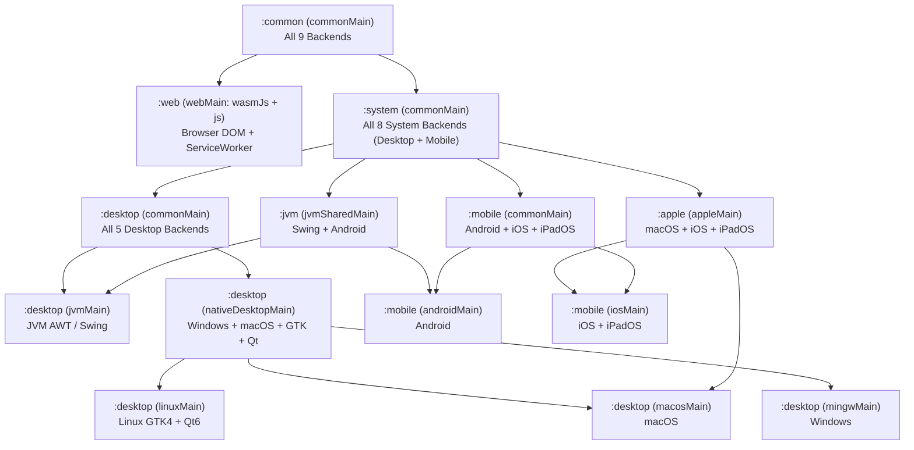

# GenericUI — System Module (`:system`)

> **Root Repository**: [**GenericUI (`../README.md`)**](../README.md) | **Root Documentation**: [SourceSet Hierarchy](../docs/sourcesets.md) · [Backends Guide](../docs/backends.md) · [Fragments & Windows](../docs/fragments-and-windows.md) · [Application & Targets](../docs/application.md) · [Resources](../docs/resources.md) · [Gradle Plugin](../docs/gradle-plugin.md)

The **System Module (`:system`)** (`com.nexustools.genericui.system.*`, `com.nexustools.genericui.style.*`) is the pure-Kotlin foundation shared across all **8 non-browser OS system backends** (`BackendTarget.isSystem == true`):
- **Desktop (`:desktop`)**: `Windows` (`mingwX64`), `MacOS` (`macosArm64`), `Gtk` (`linuxX64`, `linuxArm64`), `Qt` (`linuxX64`, `linuxArm64`), and `Swing` (`jvm`).
- **Mobile (`:mobile`)**: `Android` (`android`), `IOS` (`iosArm64`, `iosSimulatorArm64`), and `IPadOS` (`iosArm64`, `iosSimulatorArm64`).

Because `:system` feeds both Kotlin/Native targets and JVM/Android targets (directly and via [`:jvm`](../docs/jvm.md) and [`:apple`](../docs/apple.md)), it contains 100% pure Kotlin code with zero browser/DOM dependencies.

---

## 1. Position in the Consolidated Module & SourceSet Hierarchy



---

## 2. Core Subsystems in `:system`

### 1. Blink-Inspired CSS Matching & Flexbox/Grid Layout (`BlinkStyleEngine` & `BrowserLayoutEngine`)
- [`BlinkStyleEngine`](src/commonMain/kotlin/com/nexustools/genericui/system/style/BlinkStyleEngine.kt): Evaluates compiled CSS/SCSS stylesheets (`PrecompiledStyleSheet`), cascade specificity, `@media` queries, pseudo-states (`:hover`, `:active`, `:focus`, `:disabled`), and inheritance onto `:common`'s typed bitmask `ComponentStyle` / `ComputedStyle`.
- [`BrowserLayoutEngine`](src/commonMain/kotlin/com/nexustools/genericui/style/layout/BrowserLayoutEngine.kt): Pure-Kotlin Chromium/Blink-inspired layout solver supporting block, flex, grid, box-sizing, min/max constraints, margins, padding, scroll viewports, and percentage resolution across all 8 system targets (`Windows`, `MacOS`, `Gtk`, `Qt`, `Swing`, `Android`, `IOS`, `IPadOS`).

### 2. Filesystem & Preference Key Sanitization (`SystemStorageKeyHelper`)
[`SystemStorageKeyHelper`](src/commonMain/kotlin/com/nexustools/genericui/system/SystemStorageKeyHelper.kt) provides deterministic, cross-OS path normalization and storage key sanitization used by `PreferenceStore`, `ConfigDirectory`, and `CacheDirectory` implementations across `:apple`, `:jvm`, `:desktop`, and `:mobile`:

| Method | Signature | Description |
| :--- | :--- | :--- |
| `sanitizeAppDirectoryName` | `fun sanitizeAppDirectoryName(appName: String): String` | Sanitizes an application directory name by replacing invalid filesystem characters (`\`, `/`, `:`, `*`, `?`, `"`, `<`, `>`, `\|`) with `_`, defaulting to `"GenericUI"` when blank. |
| `sanitizeKey` | `fun sanitizeKey(key: String, fallback: String = "default"): String` | Sanitizes a storage or cache key into a safe single-segment filename. |
| `encodePreferenceKeyToFileName` | `fun encodePreferenceKeyToFileName(key: String): String` | Bijectively encodes any preference key into a filesystem-safe, non-dotfile filename stem. |
| `decodePreferenceKeyFromFileName` | `fun decodePreferenceKeyFromFileName(encodedStem: String): String` | Decodes a preference filename stem losslessly back into the original key string. |
| `normalizePath` | `fun normalizePath(path: String, separator: Char = '/'): String` | Normalizes all `/` and `\` path separators to the target OS `separator`. |
| `validateRelativePath` | `fun validateRelativePath(relativePath: String, separator: Char = '/'): String` | Strips leading/trailing slashes and rejects any `..` parent-directory traversal segments. |
| `joinPath` | `fun joinPath(baseDir: String, childPath: String, separator: Char = '/'): String` | Safely joins a base directory and relative child path using `separator`. |

---

## 3. Command-Line Arguments in `FragmentBundle` & `AppTarget.SYSTEM_COMMON`

On all 8 system targets (`Windows`, `MacOS`, `Gtk`, `Qt`, `Swing`, `Android`, `IOS`, `IPadOS`), the generated platform launcher automatically populates the initial `FragmentBundle` passed to your `@MainAppFragment`'s `onCreate(savedState: FragmentBundle?)` with process command-line arguments (`FragmentBundle.KEY_COMMAND_LINE_ARGS = "genericui:command_line_args"`).

Use `AppTarget.SYSTEM_COMMON` (specificity rank `1`) or `genericui { systemCommon { ... } }` to configure or override UI exclusively across all 8 system backends while leaving `:web` on `AppTarget.COMMON` / `AppTarget.WEB`:

```kotlin
@MainAppFragment(targets = [AppTarget.SYSTEM_COMMON], label = "Studio System")
class StudioSystemFragment : Fragment() {
    override fun onCreate(savedState: FragmentBundle?) {
        super.onCreate(savedState)
        val cliArgs: List<String> = savedState?.getCommandLineArgs().orEmpty()
    }
}
```

---

## 4. System-Target Styling Invariants (`BootstrapType` vs. `StyledContainer` / `StyledButton`)

All 8 non-web system targets enforce strict native look-and-feel and zero-allocation styling rules:

1. **Zero String-Keyed Style APIs**: `ComponentStyle` and `ComputedStyle` operate exclusively on strongly-typed Kotlin properties and two 64-bit bitmasks (`activePropertiesBitmaskLow` / `High`, `importantBitmaskLow` / `High`) with zero `Map<String, String>` allocations or CSS string formatting.
2. **Text / Typography Elements (`Label`, `Text`, `Heading`, `Badge`, `Blockquote`, `CodeBlock`, `MarkdownView`)**: Honor typography and text-color properties (`color`, `fontFamily`, `fontSize`, `fontWeight`, `fontStyle`, `lineHeight`, `letterSpacing`, `textAlign`, `textDecoration`, `textTransform`, `textOverflow`, `whiteSpace`, `wordBreak`, plus `bootstrap.*` typography overrides).
3. **Standard Native Controls & Containers (`Button`, `CheckBox`, `TextField`, `Select`, `Container`, `Card`, etc.)**: Aesthetic skinning (`backgroundColor`, `borderRadius`, `boxShadow`, `backdropFilter`, `filter`) is **silently ignored** on all 8 system backends. Tint them solely via `BootstrapType` (`BootstrapType.NONE` renders unmodified native OS controls; `BootstrapType != NONE` renders empty-text offscreen buffers tinted via `ThemeConfig`).
4. **`StyledContainer`, `StyledButton`, & [`:extensions:ui:alien`](../extensions/docs/alien.md)**: Explicitly opt-in custom-styled components honoring full `ComponentStyle` chrome across all 9 backends, including **60+Hz hardware `backdrop-filter`** on `StyledContainer` and `StyledButton` (excluding [`TextBubble`](../extensions/docs/aichat.md), which strips `backdropFilter` via `withoutBackdropFilter()`).

---

## Related Documentation

- **Foundation Guides**: [`:jvm`](../docs/jvm.md) · [`:apple`](../docs/apple.md) · [`:ipados`](../docs/ipados.md)
- **Desktop Platform Docs**: [`:desktop`](../desktop/README.md) · [`common`](../desktop/docs/common.md) · [`nativeCommon`](../desktop/docs/nativeCommon.md) · [`linuxCommon`](../desktop/docs/linuxCommon.md) · [`windows`](../desktop/docs/windows.md) · [`macos`](../desktop/docs/macos.md) · [`gtk`](../desktop/docs/gtk.md) · [`qt`](../desktop/docs/qt.md) · [`swing`](../desktop/docs/swing.md)
- **Mobile Platform Docs**: [`:mobile`](../mobile/README.md) · [`common`](../mobile/docs/common.md) · [`android`](../mobile/docs/android.md) · [`ios`](../mobile/docs/ios.md)
- **Web & Gradle Plugin**: [`:web`](../web/README.md) · [`:gradle-plugin`](../gradle-plugin/README.md)
