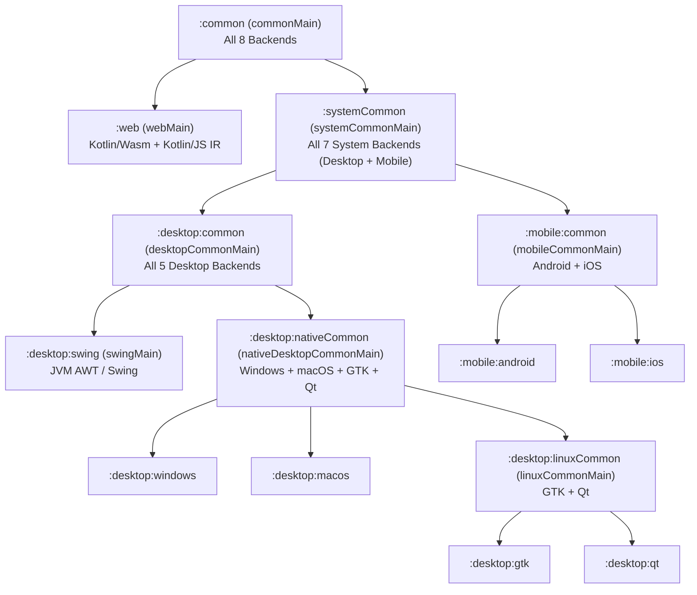

# GenericUI — System Common Submodule (`:systemCommon`)

> **Root Repository**: [**GenericUI (`../README.md`)**](../README.md) | **Root Documentation**: [SourceSet Hierarchy](../docs/sourcesets.md) · [Backends Guide](../docs/backends.md) · [Fragments & Windows](../docs/fragments-and-windows.md) · [Application & Targets](../docs/application.md) · [Resources](../docs/resources.md) · [Gradle Plugin](../docs/gradle-plugin.md)

The **System Common Submodule (`:systemCommon`)** of **GenericUI** (`com.nexustools.genericui.system.*`) is the pure-Kotlin foundation for all non-browser system targets:
- **Desktop**: `:desktop:windows` (`mingwX64`), `:desktop:macos` (`macosArm64`, `macosX64`), `:desktop:gtk` (`linuxX64`, `linuxArm64`), `:desktop:qt` (`linuxX64`, `linuxArm64`), and `:desktop:swing` (`jvm`).
- **Mobile**: `:mobile:android` (`android`) and `:mobile:ios` (`iosArm64`, `iosSimulatorArm64`).

Because `:systemCommon` includes both Kotlin/Native targets and JVM/Android targets, it contains 100% pure Kotlin code with no browser/DOM dependencies.

---

## Position in the Phase 3 Module & SourceSet Hierarchy



---

## Core Responsibilities

### 1. Filesystem & Preference Key Sanitization (`SystemStorageKeyHelper`)
`SystemStorageKeyHelper` (`com.nexustools.genericui.system.SystemStorageKeyHelper`) provides deterministic, cross-OS path normalization and storage key sanitization used by `PreferenceStore`, `ConfigDirectory`, and `CacheDirectory` implementations across `:desktop:nativeCommon`, `:desktop:linuxCommon`, `:desktop:swing`, `:mobile:android`, and `:mobile:ios`:

| Method | Signature | Description |
| :--- | :--- | :--- |
| `sanitizeAppDirectoryName` | `fun sanitizeAppDirectoryName(appName: String): String` | Sanitizes an application directory name by replacing invalid filesystem characters (`\`, `/`, `:`, `*`, `?`, `"`, `<`, `>`, `\|`) with `_`, defaulting to `"GenericUI"` when blank. |
| `sanitizeKey` | `fun sanitizeKey(key: String, fallback: String = "default"): String` | Sanitizes a preference or cache key into a safe single-segment filename. |
| `encodeKeySet` | `fun encodeKeySet(keys: Set<String>): ByteArray` | Encodes a set of preference keys into a newline-delimited UTF-8 `ByteArray`. |
| `decodeKeySet` | `fun decodeKeySet(bytes: ByteArray): LinkedHashSet<String>` | Decodes a newline-delimited UTF-8 `ByteArray` (or `String`) into an ordered `LinkedHashSet<String>`. |
| `normalizePath` | `fun normalizePath(path: String, separator: Char = '/'): String` | Normalizes all `/` and `\` path separators to the target OS `separator`. |
| `validateRelativePath` | `fun validateRelativePath(relativePath: String, separator: Char = '/'): String` | Strips leading/trailing slashes and rejects any `..` parent-directory traversal segments. |
| `joinPath` | `fun joinPath(baseDir: String, childPath: String, separator: Char = '/'): String` | Safely joins a base directory and relative child path using `separator`. |

### 2. Command-Line Arguments in `FragmentBundle` on System Targets
On all 7 system targets (`BackendTarget.isSystem == true`: `Windows`, `MacOS`, `Gtk`, `Qt`, `Swing`, `Android`, and `IOS`), the generated platform launcher (`WindowsLauncher`, `MacosLauncher`, `GtkLauncher`, `QtLauncher`, `SwingLauncher`, `AndroidLauncher`, `IosLauncher`) automatically populates the initial `FragmentBundle` passed to your `@MainAppFragment`'s `onCreate(savedState: FragmentBundle?)` with the process command-line arguments (`FragmentBundle.KEY_COMMAND_LINE_ARGS = "genericui:command_line_args"`):

```kotlin
package com.example.app

import com.nexustools.genericui.component.fragment.Fragment
import com.nexustools.genericui.component.fragment.FragmentBundle
import com.nexustools.genericui.component.fragment.MainAppFragment
import com.nexustools.genericui.enums.system.AppTarget

@MainAppFragment(targets = [AppTarget.COMMON], label = "Studio App")
class StudioMainFragment : Fragment() {
    override fun onCreate(savedState: FragmentBundle?) {
        super.onCreate(savedState)
        if (savedState?.hasCommandLineArgs() == true) {
            val cliArgs: List<String> = savedState.getCommandLineArgs()
            // Inspect CLI flags on Windows, macOS, GTK, Qt, Swing, Android, or iOS
        }
    }
}
```

### 3. Target-Specific `@MainAppFragment` & Variant Scope (`AppTarget.SYSTEM_COMMON`)
In a single-`commonMain` project, you can target all 7 system backends simultaneously using `AppTarget.SYSTEM_COMMON` (specificity rank `1`, which overrides `AppTarget.COMMON` at rank `0` on all desktop and mobile targets while leaving `:web` on the `AppTarget.COMMON` or `AppTarget.WEB` fragment) or configure system-wide settings in `build.gradle.kts`:

```kotlin
genericui {
    app {
        id = "com.example.studio"
        name = "Studio"
        version = "1.0.0"
    }

    backends { all() }

    // Applies to Windows, macOS, GTK, Qt, Swing, Android, and iOS:
    systemCommon {
        window {
            title = "Studio (System Edition)"
        }
    }
}
```

---

## Related Documentation

- **Desktop Submodules**: [`:desktop`](../desktop/README.md) · [`:desktop:common`](../desktop/common/README.md) · [`:desktop:nativeCommon`](../desktop/nativeCommon/README.md) · [`:desktop:linuxCommon`](../desktop/linuxCommon/README.md)
- **Mobile Submodules**: [`:mobile`](../mobile/README.md) · [`:mobile:common`](../mobile/common/README.md) · [`:mobile:android`](../mobile/docs/android.md) · [`:mobile:ios`](../mobile/docs/ios.md)
- **Web Submodule**: [`:web`](../web/README.md)
- **Gradle Plugin**: [`:gradle-plugin`](../gradle-plugin/README.md)
